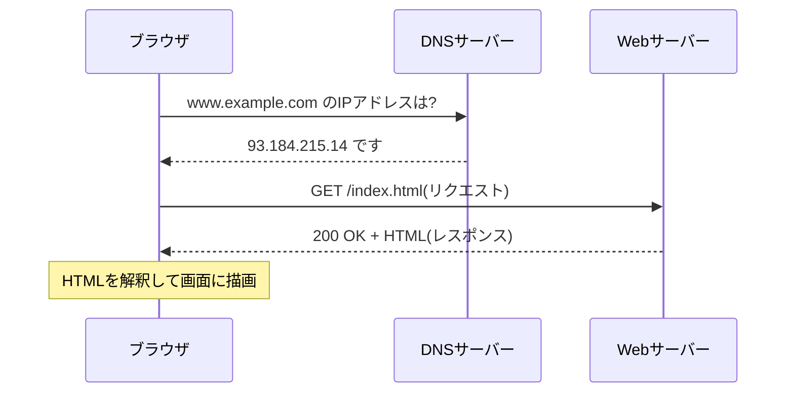

# フェーズ0:開発準備とWebの仕組み

> **ゴール**:開発環境が整い、「ブラウザでURLを開くと何が起きるか」を図で説明できる。

## 1. なぜ学ぶか

- プログラミング学習でつまずく原因の多くは、言語そのものではなく **「環境」と「前提知識」** にあります
- 以降のすべてのフェーズで、ターミナル操作とWebの仕組みを使います
- このフェーズでは、今後何度も登場する「ブラウザとサーバーのやり取り」のイメージを作ります

## 2. 仕組みの解説

### 2-1. クライアントとサーバー

Webは「お願いする側(クライアント)」と「応える側(サーバー)」のやり取りでできています。

- **クライアント**:ブラウザなど。サーバーに「このページをください」と **リクエスト** を送る
- **サーバー**:リクエストを受け取り、HTMLなどを **レスポンス** として返す

### 2-2. URLの構造

```
https://www.example.com:443/blog/index.html
└─┬─┘   └──────┬──────┘└┬┘└──────┬──────┘
プロトコル   ドメイン    ポート    パス
```

| 部分 | 意味 | 例え |
| --- | --- | --- |
| プロトコル | 通信のルール(http / https) | 使う言語 |
| ドメイン | サーバーの名前 | 建物の名前 |
| ポート | サーバー内の受付窓口の番号 | 部屋番号 |
| パス | 欲しいファイルや機能の場所 | 部屋の中の棚 |

### 2-3. DNS:名前から住所を調べる

コンピューター同士は **IPアドレス**(例:`93.184.215.14`)で通信します。人間が覚えやすいドメイン名をIPアドレスに変換するのが **DNS** です。



### 2-4. HTTPメソッドとステータスコード

| メソッド | 用途 |
| --- | --- |
| GET | データを取得する(ページを表示する) |
| POST | データを送信する(フォームを送る) |

| ステータスコード | 意味 |
| --- | --- |
| 200 | 成功 |
| 302 | 別のURLへ移動(リダイレクト) |
| 404 | ページが見つからない |
| 500 | サーバー内部でエラーが起きた |

### 2-5. localhost

`localhost`(`127.0.0.1`)は **「自分自身のPC」** を指す特別な住所です。
`http://localhost:5001` は「自分のPCの5001番の窓口」という意味なので、**他の人のPCからはアクセスできません**。この点はフェーズ6で重要になります。

### 2-6. ターミナルとファイルパス

- **ターミナル**:文字でPCを操作する画面
- **カレントディレクトリ**:いま自分がいるフォルダ
- **絶対パス**:`/Users/taro/project` のように、一番上から書いた場所
- **相対パス**:`./docs` や `../` のように、今いる場所から見た場所

## 3. ハンズオン

> この教材は **Mac(macOS)** を前提にしています。キーボードの `command`(⌘)と `control`(⌃)の違いに注意してください。

### Step 1. 自分のMacのチップを確認する

画面左上の **Appleメニュー → このMacについて** を開き、「チップ」の欄を確認します。

| 表示 | 種類 | 以降の教材での違い |
| --- | --- | --- |
| Apple M1 / M2 / M3 / M4 など | Apple シリコン | Homebrew の場所が `/opt/homebrew`。フェーズ11で注意点あり |
| Intel Core i5 など | Intel | Homebrew の場所が `/usr/local` |

### Step 2. ターミナルを開く

`command + space` で Spotlight を開き、「ターミナル」と入力して起動します。
Macのターミナルでは **zsh** というシェル(コマンドを解釈するプログラム)が動いています。

> よく使うので、Dock に追加しておくと便利です(Dock のアイコンを右クリック → オプション → Dock に追加)。

### Step 3. ターミナル操作に慣れる

```bash
pwd                       # 今いる場所を表示
ls                        # ファイル一覧を表示
mkdir -p ~/dev/practice   # フォルダを作成(~ はホームフォルダ)
cd ~/dev/practice         # 移動
pwd                       # 移動できたか確認
touch memo.txt            # 空のファイルを作成
ls -l                     # 詳細付きで一覧表示
open .                    # 今いるフォルダを Finder で開く
cd ..                     # 1つ上へ移動
```

**期待される結果**:`pwd` の結果が `cd` のたびに変わること、Finder にも `memo.txt` が表示されることを確認する。ターミナルとFinderは、同じファイルを別の見せ方で扱っているだけです。

### Step 4. Command Line Tools をインストールする

Git などの開発用ツールが入った、Apple公式のパッケージです。

```bash
xcode-select --install
```

ダイアログが表示されたら「インストール」を押します(すでにインストール済みの場合はその旨が表示されます)。

### Step 5. Homebrew をインストールする

**Homebrew** は、Mac に開発ツールをコマンドでインストールするための道具(パッケージマネージャー)です。

1. [Homebrew の公式サイト](https://brew.sh/ja/) に表示されているインストールコマンドをコピーし、ターミナルで実行する
2. Macのログインパスワードを求められたら入力する(入力中の文字は表示されません)
3. **インストールの最後に「Next steps」として表示されるコマンドを、必ずそのまま実行する**(`brew` コマンドが使えるように PATH を設定するコマンドです)
4. ターミナルを開き直して確認する

```bash
brew --version   # Homebrew 4.x.x などと表示されればOK
```

### Step 6. 開発ツールをインストールする

```bash
brew install python@3.12 git gh
brew install --cask visual-studio-code google-chrome
```

| ツール | 用途 |
| --- | --- |
| python@3.12 | プログラミング言語Python(フェーズ2〜) |
| git | 変更履歴の管理(フェーズ1〜) |
| gh | GitHub をターミナルから操作する(ログインに使う) |
| Visual Studio Code | コードを書くエディタ |
| Google Chrome | 開発者ツールで通信を観察する(この教材はChromeの画面で説明します) |

インストールを確認します。

```bash
python3.12 --version   # Python 3.12.x と表示されればOK
git --version          # git version 2.x.x と表示されればOK
```

> Macには最初から `python3` が入っていることがありますが、古いバージョンの場合があります。この教材では、仮想環境を作るときに **必ず `python3.12`** を使います(フェーズ2)。

### Step 7. VS Code の設定

1. VS Code を起動し、拡張機能から **Japanese Language Pack** と **Python** をインストールする
2. `command + shift + P` でコマンドパレットを開き、「**Shell Command: Install 'code' command in PATH**」を実行する
3. ターミナルで以下を実行し、VS Code が開くことを確認する

```bash
code ~/dev/practice
```

### Step 8. Git の初期設定

```bash
git config --global user.name "あなたの名前"
git config --global user.email "GitHubに登録するメールアドレス"
git config --global init.defaultBranch main
```

### Step 9. GitHubアカウントの作成とログイン

1. [GitHub](https://github.com/) でアカウントを作成し、二段階認証を設定する
2. ターミナルからログインする

```bash
gh auth login
```

質問には次のように答えます:`GitHub.com` → `HTTPS` → `Authenticate Git with your GitHub credentials? Yes` → `Login with a web browser`。表示されたコードをブラウザに入力します。

**期待される結果**:`gh auth status` で `Logged in to github.com` と表示される。これで、フェーズ1以降の `git push` でパスワードを聞かれなくなります。

### Step 10. 開発者ツールで通信を観察する

1. Chromeで任意のWebサイトを開く
2. `command + option + I` で開発者ツールを開き、**Network** タブを選ぶ
3. `command + R` でページを再読み込みする
4. 一番上の行をクリックし、**Headers** を確認する

**期待される結果**:Request URL・Request Method・Status Code が表示される。

### Step 11. ドメインからIPアドレスを調べる

```bash
nslookup www.google.com
```

**期待される結果**:`Address:` の後にIPアドレスが表示される。これがDNSの働きです。

## 4. 確認課題

- [ ] 好きなWebサイトを開き、Networkタブから「ステータスコード・メソッド・通信先」を3件書き出す
- [ ] ターミナルだけを使って `project/docs/memo.txt` を作成する
- [ ] 存在しないURL(例:`https://github.com/aaaaa-not-found-zzzzz`)を開き、ステータスコードを確認する

## 5. 振り返り

- 「ブラウザにURLを入力してページが表示されるまで」を、DNS・リクエスト・レスポンスという言葉を使って説明してみよう
- `localhost` と普通のURLは何が違う?
- (次フェーズへ)ブラウザが受け取っている「HTML」とは何だろう?

## よくあるエラー

| エラー | 原因 | 対処 |
| --- | --- | --- |
| `zsh: command not found: brew` | Homebrew の PATH 設定をしていない | Step 5 の「Next steps」のコマンドを実行し、ターミナルを開き直す |
| `zsh: command not found: python3.12` | Python 3.12 が未インストール | `brew install python@3.12` |
| `xcrun: error: invalid active developer path` | Command Line Tools がない(macOSのアップデート後に起きやすい) | `xcode-select --install` |
| `zsh: command not found: code` | `code` コマンドを登録していない | Step 7 の 2 を実行する |
| パスワードを入力しても文字が出ない | 仕様(セキュリティのため表示されない) | そのまま入力して `return` を押す |
