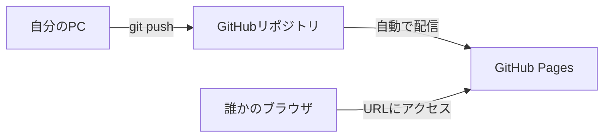

# フェーズ1:HTML/CSS・Git基礎【デプロイ①】

> **ゴール**:自己紹介ページを作り、Gitで変更履歴を管理し、GitHub Pagesで誰でも見られるURLに公開できる。

## 1. なぜ学ぶか

- フェーズ0で、ブラウザはサーバーから **HTML** を受け取って画面を表示していることを学びました。そのHTMLを自分で書けるようになります
- 作ったページを人に見せるには、インターネット上に置く必要があります。これが最初の「デプロイ」です
- 編集中にファイルを壊してしまい、元に戻せなくなる経験は誰にでもあります。それを防ぐのが **Git** です

## 2. 仕組みの解説

### 2-1. HTMLとCSSの役割分担

| | 役割 | 例え |
| --- | --- | --- |
| HTML | 文書の **構造**(見出し・段落・リスト) | 家の骨組み |
| CSS | **見た目**(色・大きさ・配置) | 内装・塗装 |

HTMLは **タグ** で文書の意味を表します。

```html
<h1>見出し</h1>
<p>段落</p>
<a href="https://example.com">リンク</a>  <!-- href は「属性」 -->
```

CSSは **セレクタ** で対象を選び、見た目を指定します。

```css
.card { color: blue; }  /* class="card" の要素の文字を青にする */
```

### 2-2. 静的サイト

今回作るページは、HTMLファイルを **そのまま** ブラウザに渡すだけのサイトです。誰がいつ見ても同じ内容が表示されるため、**静的サイト** と呼びます。

### 2-3. Gitの仕組み

Gitは、ファイルの変更履歴を「セーブポイント(コミット)」として記録する道具です。


- **作業ディレクトリ**:実際に編集しているファイル
- **ステージ**:「次のセーブに含める変更」を選んでおく場所
- **コミット**:セーブポイント。いつでもこの状態に戻れる
- **GitHub**:履歴をインターネット上に保存・共有するサービス

### 2-4. GitHub Pages

GitHub Pagesは、リポジトリにあるHTMLファイルをそのまま配信してくれる **Webサーバー** です。
自分でサーバーを用意しなくても、`https://ユーザー名.github.io/リポジトリ名/` というURLでページを公開できます。



## 3. ハンズオン

### Step 1. 作業フォルダを作る

```bash
mkdir -p ~/dev/my-profile
cd ~/dev/my-profile
code .   # VS Codeで開く
```

### Step 2. HTMLを書く

`index.html` を作成し、自己紹介ページを書きます。見出し(`h1`, `h2`)・段落(`p`)・リスト(`ul`, `li`)・リンク(`a`)を使ってください。
完成例は [sample/index.html](sample/index.html) です。

ブラウザで開いて確認します。

```bash
open index.html   # 既定のブラウザで開く
```

> Chromeで開きたい場合は `open -a "Google Chrome" index.html` を実行します。

### Step 3. CSSで見た目を整える

`style.css` を作成し、`index.html` の `<head>` 内で読み込みます。

```html
<link rel="stylesheet" href="style.css">
```

Flexbox(`display: flex`)を使って、カードを横に並べてみましょう。完成例は [sample/style.css](sample/style.css) です。

**期待される結果**:ブラウザの幅を狭くすると、カードが縦に並び替わる(CSSを変更したら `command + R` で再読み込みする)。

### Step 4. Gitで履歴を残す

```bash
git init                         # このフォルダをGitで管理し始める
git status                       # 状態を確認(赤字=未追加のファイル)
git add index.html style.css     # ステージに追加
git status                       # 緑字になったことを確認
git commit -m "自己紹介ページを作成"
git log --oneline                # 履歴を確認
```

### Step 5. わざと壊して、元に戻す

1. `index.html` の中身をすべて削除して保存する
2. ブラウザで表示が消えたことを確認する
3. 以下を実行して元に戻す

```bash
git status                  # index.html が変更されていることを確認
git diff                    # 何が変わったかを確認
git restore index.html      # 最後のコミットの状態に戻す
```

**期待される結果**:ページが元通りに表示される。これがGitを使う一番の理由です。

### Step 6. `.gitignore` を作る

Macが自動で作る `.DS_Store`(フォルダの表示設定を保存するファイル)などを履歴に含めないため、`.gitignore` を作成します(例:[sample/.gitignore](sample/.gitignore))。

> `.` で始まるファイルは、Finder では隠しファイルとして表示されません。Finder で `command + shift + .` を押すと表示/非表示を切り替えられます。

```bash
git add .gitignore
git commit -m ".gitignoreを追加"
```

### Step 7. GitHubにpushする

1. GitHubで新しいリポジトリ `my-profile` を作成する(**Public**、READMEは追加しない)
2. 表示されたコマンドを実行する

```bash
git remote add origin https://github.com/ユーザー名/my-profile.git
git push -u origin main
```

> フェーズ0の Step 9 で `gh auth login` を済ませていれば、パスワードを聞かれずにpushできます。認証エラーになる場合は、`gh auth status` でログイン状態を確認してください。

### Step 8. GitHub Pagesで公開する

1. リポジトリの **Settings → Pages** を開く
2. Source を **Deploy from a branch**、Branch を **main / (root)** にして Save
3. 1〜2分待つと、`https://ユーザー名.github.io/my-profile/` が表示される

**期待される結果**:スマホ(Wi-Fiを切った状態)でもURLを開くとページが表示される。**自分のPC以外からアクセスできている** ことを確認しましょう。

## 4. 確認課題

- [ ] `works.html`(作品ページ)を追加し、`index.html` からリンクでつなぐ。pushして公開URLに反映されることを確認する
- [ ] `git log` で、3つ以上のコミットがあることを確認する
- [ ] 開発者ツールのNetworkタブで、公開URLを開いたときに `index.html` と `style.css` がそれぞれ取得されていることを確認する

## 5. 振り返り

- 公開URLにアクセスしたとき、HTMLファイルはどこから届いている?
- ローカルでファイルを開いたときと、GitHub Pagesで見たときの違いは何?(ヒント:アドレスバーのURL)
- 今のページは「誰が見ても同じ内容」です。見る人や操作によって内容を変えるには、何が必要だろう?(→ フェーズ2・3へ)

## このフェーズのファイル

```
sample/
├── index.html   … 自己紹介ページ(構造)
├── style.css    … 見た目の指定
└── .gitignore   … Gitで管理しないファイルの一覧
```

## よくあるエラー

| エラー | 原因 | 対処 |
| --- | --- | --- |
| CSSが反映されない | `href` のファイル名・場所が違う | `index.html` と同じフォルダにあるか確認する |
| `fatal: not a git repository` | `git init` していないフォルダにいる | `pwd` で場所を確認する |
| push時に認証エラー | GitHub にログインしていない | `gh auth login` を実行する(フェーズ0 Step 9) |
| `.gitignore` が Finder に見えない | 隠しファイルのため | Finder で `command + shift + .` |
| GitHub Pagesが404 | 反映待ち、またはファイル名が `index.html` でない | 数分待つ、ファイル名を確認する |
