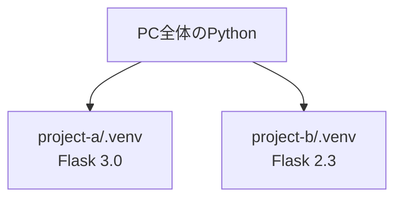

# フェーズ2:Python基礎

> **ゴール**:ターミナルで動くTodoアプリ(追加・一覧・削除)をPythonで書き、データをファイルに保存できる。

## 1. なぜ学ぶか

- フェーズ1のHTMLは、誰が見ても同じ内容しか表示できませんでした
- 「入力に応じて結果を変える」「データを追加・削除する」といった **処理** を書くには、プログラミング言語が必要です
- この教材では、後のフェーズで作るWebアプリの中身(ロジック)をPythonで書きます。まずはブラウザを使わず、ターミナル上でTodoアプリを作ります

## 2. 仕組みの解説

### 2-1. プログラムは上から順に実行される(変数と出力)

```python
name = "太郎"                      # 変数に値を入れる
print(f"こんにちは、{name}さん")     # 画面に表示する
```

- **変数**:値に名前を付けて、後で使い回せるようにしたもの
- **`print()`**:()の中身を画面に表示する
- **f文字列**:`f"..."` の中に `{変数名}` と書くと、その部分が変数の値に置き換わる(例:`{name}` → `太郎`)

プログラムは、上の行から順番に1行ずつ実行されます。

### 2-2. データ型の基本(文字列・数値・真偽値)

Pythonで扱う値には、いくつかの種類(**型**)があります。

| 型 | 意味 | 例 |
| --- | --- | --- |
| 文字列(str) | 文字の並び。`"` または `'` で囲む | `"牛乳を買う"` |
| 整数(int) | 整数の数値 | `1`、`100` |
| 真偽値(bool) | 「はい/いいえ」の2択 | `True` / `False` |

```python
title = "牛乳を買う"   # 文字列
count = 3              # 整数
done = False           # 真偽値
```

> 文字列は `"..."` のように引用符で囲みますが、数値や真偽値は囲みません。`"3"`(文字列の3)と `3`(数値の3)は別物として扱われるので注意してください。

### 2-3. リスト(list):複数の値をまとめる

**リスト** は、複数の値を順番に並べて1つにまとめたものです。買い物メモのようなものだとイメージしてください。

```python
fruits = ["りんご", "みかん", "ぶどう"]
```

- `[` と `]` で囲み、値を `,`(カンマ)で区切ります
- それぞれの値を **要素** と呼びます
- 要素には **0から始まる番号(インデックス)** が付きます

| インデックス | 0 | 1 | 2 |
| --- | --- | --- | --- |
| 要素 | `"りんご"` | `"みかん"` | `"ぶどう"` |

```python
print(fruits[0])         # りんご(最初の要素は0番目)
print(fruits[1])         # みかん
print(len(fruits))        # 3(要素の数)

fruits.append("もも")     # 末尾に要素を追加する
print(fruits)              # ['りんご', 'みかん', 'ぶどう', 'もも']
```

> 「1番目がほしくて `fruits[1]` を指定したら、2番目の "みかん" が出てきた」は、リストを初めて使うときによくある勘違いです。**最初の要素は0番目** であることを覚えておきましょう。

### 2-4. 辞書(dict):名前と値のペアで管理する

**辞書** は、「名前(キー)」と「値」のペアをまとめたものです。国語辞典のように、「この言葉(キー)の意味(値)は何か」を調べるイメージです。

```python
todo = {"id": 1, "title": "牛乳を買う", "done": False}
```

- `{` と `}` で囲みます
- `キー: 値` という形で書き、複数のペアは `,`(カンマ)で区切ります
- リストが「番号(インデックス)」で値を取り出すのに対し、辞書は **キー(名前)** で値を取り出します

```python
print(todo["title"])      # 牛乳を買う(キー "title" に対応する値)
print(todo["done"])        # False

todo["done"] = True         # 値を書き換える
todo["memo"] = "午後に"     # 新しいキーを追加する
print(todo)                  # {'id': 1, 'title': '牛乳を買う', 'done': True, 'memo': '午後に'}
```

> 存在しないキーを指定する(例:`todo["titie"]` のようにスペルを間違える)と `KeyError` になります。キー名は1文字も間違えずに書く必要があります。

**リストと辞書を組み合わせる**

Todo1件は辞書で表し、Todoの一覧はその辞書を並べた「辞書のリスト」で表します。

```python
todos = [
    {"id": 1, "title": "牛乳を買う", "done": False},
    {"id": 2, "title": "本を読む", "done": True},
]

print(todos[0])               # 1件目の辞書全体({'id': 1, 'title': '牛乳を買う', 'done': False})
print(todos[0]["title"])      # 1件目のタイトルだけ(牛乳を買う)
```

### 2-5. 入力とデータ型の変換

キーボードからの入力は `input()` で受け取ります。

```python
name = input("名前を入力してください: ")  # 入力を待ち、Enterが押されたら次に進む
print(f"こんにちは、{name}さん")
```

**重要**:`input()` の結果は、何を入力しても必ず **文字列(str)** になります。数値として計算したいときは `int()` や `float()` で変換します。

```python
age = input("年齢を入力してください: ")
print(age + 1)          # TypeError:文字列(str)と数値(int)は足し算できない

age = int(input("年齢を入力してください: "))
print(age + 1)           # OK:int に変換したので計算できる
```

数値に変換できない文字(例:`abc`)を `int()` に渡すと `ValueError` になります。これは Step 10 で実際に体験します。

### 2-6. 比較演算子と条件分岐(if)

2つの値を比べるには **比較演算子** を使います。結果は常に `True`(真)か `False`(偽)という **真偽値(bool)** になります。

| 演算子 | 意味 | 例 | 結果 |
| --- | --- | --- | --- |
| `==` | 等しい | `1 == 1` | `True` |
| `!=` | 等しくない | `1 != 2` | `True` |
| `>` | より大きい | `3 > 5` | `False` |
| `<` | より小さい | `3 < 5` | `True` |
| `>=` | 以上 | `5 >= 5` | `True` |
| `<=` | 以下 | `4 <= 5` | `True` |

> `=` は「代入」(値を入れる)、`==` は「比較」(等しいか調べる)です。見た目が似ているので混同しないよう注意してください。

`if` を使うと、条件によって実行する処理を変えられます。

```python
age = 20

if age >= 20:
    print("成人です")
elif age >= 13:
    print("中高生です")
else:
    print("子供です")
```

- `if`(もし〜なら):条件が `True` ならここを実行する
- `elif`(else if の略):上の条件が `False` で、こちらが `True` ならここを実行する(いくつでも追加できる)
- `else`(それ以外なら):すべての条件が `False` のときに実行する

複数の条件を組み合わせるには `and`(かつ)・`or`(または)を使います。

```python
if age >= 6 and age < 13:
    print("小学生です")
```

> **インデント(字下げ)に注意**:`if` の中身はスペース4つ分インデントします。インデントがずれると `IndentationError` になります。

### 2-7. 繰り返し(for・while)

**for:回数や対象が決まっている繰り返し**

```python
for i in range(3):        # 0, 1, 2 の3回繰り返す
    print(f"{i}回目")

fruits = ["りんご", "みかん", "ぶどう"]
for fruit in fruits:       # リストの要素を順番に取り出す
    print(fruit)
```

**while:条件を満たす間続ける繰り返し**

```python
count = 0
while count < 3:          # count が 3 未満の間、繰り返す
    print(count)
    count += 1             # count = count + 1 の省略形。これを忘れると終わらない
```

> `while` の条件を `True` のままにしてしまうと **無限ループ**(終わらない繰り返し)になります。止まらなくなったら `control + C` で強制終了できます。

`break` を使うと、繰り返しを途中で抜けられます。

```python
while True:                # 条件が常に True = 自分で止めるまで繰り返す
    command = input("> ")
    if command == "quit":
        break               # ここで while ループを抜ける
    print(f"入力されたのは: {command}")
```

使い分けの目安:**for** は繰り返す回数や対象(リストの中身など)が最初から決まっているとき、**while** は「ある条件を満たす間」繰り返したいとき(ユーザーが `quit` と入力するまで、など)に使います。

### 2-8. 関数

一連の処理に名前を付けてまとめたものが **関数** です。同じ処理を何度も書かずに、呼び出すだけで使えます。

```python
def greet(name):           # name は「引数」:関数に渡す値
    return f"こんにちは、{name}さん"   # return で呼び出し元に結果を返す

message = greet("太郎")     # 関数を呼び出す
print(message)
```

関数に分けると、「どこで何をしているか」が読みやすくなり、同じ処理を使い回せます。

### 2-9. 仮想環境とパッケージ管理:`uv`

- **仮想環境**:プロジェクトごとにライブラリを分けて管理する仕組み。プロジェクトAとBで違うバージョンを使っても衝突しません
- **パッケージ管理**:外部のライブラリ(他の人が作った便利なコード)をインストールする仕組み



これらは従来、Python標準の `venv`(仮想環境の作成)と `pip`(ライブラリのインストール)という2つの道具で行っていました。この教材では、両方をまとめて高速に行える **uv** というツールを使います。

| | 従来(venv + pip) | uv |
| --- | --- | --- |
| 仮想環境の作成 | `python3.12 -m venv .venv` | `uv venv` |
| ライブラリのインストール | `pip install ...` | `uv pip install ...` |
| 速度 | 基準 | 公式ベンチマークで pip の10〜100倍速いとされる(Rust製) |
| 必要な道具の数 | venv・pip(2つ) | uv(1つ) |

コマンドの使い方は `pip` とほぼ同じで、`pip install` を `uv pip install` に読み替えるだけで使えます。本格的なPythonプロジェクトでは、2024年ごろから pip に代わる定番ツールとして急速に普及しています。

### 2-10. エラーメッセージ(Traceback)の読み方

```
Traceback (most recent call last):
  File "todo_cli.py", line 87, in main
    todo_id = int(input("削除するID: "))
ValueError: invalid literal for int() with base 10: 'abc'
```

1. **最後の行** を見る:`ValueError`(値がおかしい)、`'abc'` を数値にできなかった
2. **ファイル名と行番号** を見る:`todo_cli.py` の87行目

### 2-11. ファイルへの保存(JSON)

プログラムの変数は、終了すると消えてしまいます。データを残すには **ファイルに書き出す** 必要があります。
JSONは、辞書やリストをそのまま文字として保存できる形式です。Pythonでは `json` というモジュール(標準でインストール済みの道具箱)を使って読み書きします。

```python
import json

todos = [{"id": 1, "title": "牛乳を買う", "done": False}]

# 保存する(書き込み)
with open("todos.json", "w", encoding="utf-8") as f:
    json.dump(todos, f, ensure_ascii=False, indent=2)

# 読み込む
with open("todos.json", encoding="utf-8") as f:
    loaded = json.load(f)
```

- `open(ファイル名, "w", ...)`:ファイルを**書き込みモード**で開く(`"w"`がないと読み込み専用になる)
- `with ... as f:`:ブロックを抜けるときに、ファイルを自動で閉じてくれる書き方です。閉じ忘れを防げます
- `encoding="utf-8"`:日本語などの文字が正しく保存されるようにする指定
- `ensure_ascii=False`:日本語をそのまま(`牛乳`のような文字コードにせず)保存する指定
- `json.dump(データ, f, ...)`:データをJSON形式にしてファイルへ書き出す
- `json.load(f)`:ファイルの中身をJSONとして読み込み、リストや辞書に戻す

## 3. ハンズオン

### Step 1. uvをインストールし、プロジェクトと仮想環境を作る

まず `uv` をインストールします(Homebrewなので、すでに入っていてもそのまま実行して問題ありません)。

```bash
brew install uv
uv --version   # uv 0.x.x などと表示されればOK
```

続けてプロジェクトを作成し、仮想環境を作ります。

```bash
mkdir -p ~/dev/my-todo-app
cd ~/dev/my-todo-app
git init
uv venv --python 3.12          # Python 3.12 で仮想環境を作成
source .venv/bin/activate      # 有効化(プロンプトに (.venv) が付く)
which python                   # .venv の中のpythonが使われていることを確認
python --version               # Python 3.12.x と表示されればOK
```

> 以降、ターミナルを開き直したら毎回 `source .venv/bin/activate` を実行します。仮想環境の中では `python3` ではなく `python` で Python 3.12 が動きます。
>
> VS Code で `command + shift + P` → 「Python: Select Interpreter」から `.venv` を選んでおくと、エディタのエラー表示も正しくなります。

`.gitignore` を作成し、`.venv/` を管理対象外にします(例:[sample/.gitignore](sample/.gitignore))。

### Step 2. 出力と入力を練習する

Todoアプリを作り始める前に、土台となる文法を小さいコードで確認します。`practice.py` というファイルに1つずつ試しながら書いていきましょう(Todoアプリ本体には使わないので、確認が終わったら削除して構いません)。

```python
name = input("名前を入力してください: ")
age = input("年齢を入力してください: ")
print(f"{name}さんは{age}歳です")
```

```bash
python practice.py
```

**期待される結果**:入力した名前と年齢が、そのまま文章に埋め込まれて表示される。

次に、入力した年齢をそのまま計算に使おうとして、何が起きるか確かめます。

```python
age = input("年齢を入力してください: ")
print(age + 1)   # 来年の年齢を表示したいが…
```

**期待される結果**:`TypeError: can only concatenate str (not "int") to str` というエラーになる。`input()` の結果は文字列(str)だからです。`int()` で数値に変換すると解決します。

```python
age = int(input("年齢を入力してください: "))
print(age + 1)
```

**期待される結果**:入力した年齢に1を足した数値が表示される。

### Step 3. 条件分岐を練習する

```python
age = int(input("年齢を入力してください: "))

if age >= 20:
    print("成人です")
elif age >= 13:
    print("中高生です")
else:
    print("子供です")
```

**期待される結果**:入力した数値によって表示が変わる(例:25→成人です、15→中高生です、10→子供です)。

`and`(かつ)・`or`(または)で、複数の条件を組み合わせられます。

```python
if age >= 6 and age < 13:
    print("小学生です")
```

> **やってみよう**:`if` の中身のインデントを1つ削除して実行し、`IndentationError` になることを確認してみましょう(確認後は元に戻します)。

### Step 4. 繰り返しを練習する

```python
for i in range(3):
    print(f"{i}回目")

fruits = ["りんご", "みかん", "ぶどう"]
for fruit in fruits:
    print(fruit)
```

**期待される結果**:`0回目`〜`2回目` の3行と、フルーツの名前3つが表示される。

```python
count = 0
while count < 3:
    print(count)
    count += 1
```

**期待される結果**:`for` のときと同じく `0`〜`2` が表示される。

```python
while True:
    command = input("> ")
    if command == "quit":
        break
    print(f"入力されたのは: {command}")
```

**期待される結果**:`quit` と入力するまで何度でも入力を受け付け、`quit` で終了する。

> **やってみよう**:`break` の行を一時的に削除して実行すると、`quit` と入力しても終わらなくなります(止まらなくなったら `control + C` で強制終了)。これが **無限ループ** です。確認したら `break` を戻しておきましょう。

### Step 5. 関数を練習する

```python
def greet(name):
    return f"こんにちは、{name}さん"

print(greet("太郎"))
print(greet("花子"))
```

**期待される結果**:2つの異なる名前で挨拶が表示される。同じ処理を関数にまとめておくと、何度でも呼び出せます。

出力・入力・条件分岐・繰り返し・関数という道具がそろいました。ここから、これらを組み合わせてTodoアプリ本体を作っていきます。

### Step 6. リストと辞書を練習する

```python
fruits = ["りんご", "みかん", "ぶどう"]
print(fruits[0])
fruits.append("もも")
print(fruits)
```

**期待される結果**:`りんご` が表示されたあと、要素が4つになったリストが表示される。

```python
todo = {"id": 1, "title": "牛乳を買う", "done": False}
print(todo["title"])
todo["done"] = True
print(todo)
```

**期待される結果**:`牛乳を買う` が表示されたあと、`done` が `True` に変わった辞書が表示される。

> **やってみよう**:`todo["titie"]` のように存在しないキーをわざと指定して実行し、`KeyError` になることを確認してみましょう。

### Step 7. リストと辞書でTodoを扱う

`todo_cli.py` を作成し、まずは固定のデータを表示します。

```python
todos = [
    {"id": 1, "title": "牛乳を買う", "done": False},
    {"id": 2, "title": "本を読む", "done": True},
]

for todo in todos:
    mark = "x" if todo["done"] else " "
    print(f"[{mark}] {todo['id']}: {todo['title']}")
```

```bash
python todo_cli.py
```

**期待される結果**:2件のTodoが `[ ] 1: 牛乳を買う` の形式で表示される。

### Step 8. コマンドを受け付ける

`input()` と `while` を使って、`add` / `list` / `quit` を受け付けるようにします。

```python
todos = []

while True:
    command = input("> ")
    if command == "add":
        title = input("タイトル: ")
        todos.append({"id": len(todos) + 1, "title": title, "done": False})
    elif command == "list":
        for todo in todos:
            print(todo["id"], todo["title"])
    elif command == "quit":
        break
```

### Step 9. 関数に分割し、削除機能を追加する

ここまで `if command == "add":` の中に直接書いていた処理を、関数に切り出します。**リストを引数で受け取り、中身を変更する** というパターンを使います。

```python
def add_todo(todos, title):
    """Todoを1件追加する。"""
    todo = {"id": len(todos) + 1, "title": title, "done": False}
    todos.append(todo)   # 引数で受け取ったリストを直接変更する
    return todo           # 追加した1件を返す(呼び出し側で使えるように)
```

- リスト(`todos`)は、関数に渡しても**コピーされず、同じものを直接操作**します。そのため `todos.append(...)` は、関数の外の `todos` にもそのまま反映されます
- `return todo` は「追加した結果を、呼び出し元にも伝える」ためのものです。なくても動きますが、呼び出し側で「何が追加されたか」を使いたい場合に必要です

同じ考え方で `list_todos(todos)` と `delete_todo(todos, todo_id)` も関数にまとめ、`delete` コマンドを追加します。

> IDを `len(todos) + 1` で決めると、削除後に追加したとき **IDが重複** します。なぜか考えてみましょう。完成例では `next_id()` 関数で「最大のID + 1」にしています。

### Step 10. JSONファイルに保存する

2-11で確認した `json.dump` / `json.load` を使い、`load_todos()` / `save_todos(todos)` という2つの関数を作ります。

```python
import json
from pathlib import Path

DATA_FILE = Path(__file__).parent / "todos.json"   # このスクリプトと同じフォルダに作る

def load_todos():
    """起動時に、保存済みのTodoを読み込む。ファイルがまだなければ空のリストを返す。"""
    if not DATA_FILE.exists():
        return []
    with DATA_FILE.open(encoding="utf-8") as f:
        return json.load(f)

def save_todos(todos):
    """Todoの一覧をファイルに保存する。"""
    with DATA_FILE.open("w", encoding="utf-8") as f:
        json.dump(todos, f, ensure_ascii=False, indent=2)
```

`load_todos()` は起動直後に1回呼び出して `todos` を復元し、`add_todo` や `delete_todo` で中身を変更するたびに `save_todos(todos)` を呼んで保存し直します。`Path(__file__).parent` は「このスクリプトファイルがあるフォルダ」を指すので、どこから実行してもファイルの保存場所がぶれません。

完成例は [sample/todo_cli.py](sample/todo_cli.py) です。

**期待される結果**:Todoを追加して `quit` し、もう一度起動して `list` すると、前回のTodoが表示される。

### Step 11. わざとエラーを起こす

`delete` コマンドで、IDの代わりに `abc` と入力します。

**期待される結果**:`ValueError` のTracebackが表示される。2-10 の手順で、原因と行番号を特定してください。

### Step 12. コミットする

```bash
git add .gitignore todo_cli.py
git commit -m "CLI版Todoアプリを作成"
```

## 4. 確認課題

- [ ] `done` コマンドを追加し、指定したIDのTodoを完了にできるようにする
- [ ] `delete` で数字以外が入力されたとき、エラーで終了せずに「数字を入力してください」と表示する(ヒント:`try` / `except`)
- [ ] `todos.json` をエディタで開き、中身がどう保存されているか確認する

## 5. 振り返り

- 関数に分けたことで、何が楽になった?
- `todos.json` をGitで管理しないのはなぜ?
- このアプリを、他の人がブラウザから使えるようにするには何が足りない?(→ フェーズ3へ)

## このフェーズのファイル

```
sample/
├── todo_cli.py   … CLI版Todoアプリ
└── .gitignore    … venvやデータファイルを除外
```

## よくあるエラー

| エラー | 原因 | 対処 |
| --- | --- | --- |
| `IndentationError` | インデント(字下げ)がずれている | スペース4つで揃える |
| `KeyError: 'title'` | 辞書に存在しないキーを指定した | キー名のスペルを確認する |
| `NameError` | 定義していない変数・関数を使った | スペル、定義の順番を確認する |
| `(.venv)` が表示されない | 仮想環境が有効でない | `source .venv/bin/activate` |
| `zsh: command not found: python` | 仮想環境が有効でない(Macには `python` コマンドがない) | `source .venv/bin/activate` するか、`python3.12` を使う |
| `zsh: command not found: uv` | uv が未インストール | `brew install uv` |
