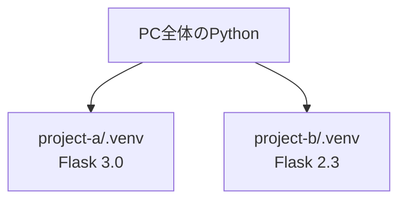

# フェーズ2:Python基礎

> **ゴール**:ターミナルで動くTodoアプリ(追加・一覧・削除)をPythonで書き、データをファイルに保存できる。

## 1. なぜ学ぶか

- フェーズ1のHTMLは、誰が見ても同じ内容しか表示できませんでした
- 「入力に応じて結果を変える」「データを追加・削除する」といった **処理** を書くには、プログラミング言語が必要です
- この教材では、後のフェーズで作るWebアプリの中身(ロジック)をPythonで書きます。まずはブラウザを使わず、ターミナル上でTodoアプリを作ります

## 2. 仕組みの解説

### 2-1. プログラムは上から順に実行される

```python
name = "太郎"          # 変数に値を入れる
print(f"こんにちは、{name}さん")  # 画面に表示する
```

### 2-2. データ型

| 型 | 例 | 用途 |
| --- | --- | --- |
| 文字列(str) | `"牛乳を買う"` | 文字 |
| 整数(int) | `1` | 数 |
| 真偽値(bool) | `True` / `False` | はい・いいえ |
| リスト(list) | `["a", "b"]` | 順番のある複数の値 |
| 辞書(dict) | `{"id": 1, "title": "牛乳"}` | 名前付きの値の集まり |

Todo1件は辞書で、Todoの一覧は「辞書のリスト」で表します。

```python
todos = [
    {"id": 1, "title": "牛乳を買う", "done": False},
    {"id": 2, "title": "本を読む", "done": True},
]
```

### 2-3. 条件分岐・繰り返し・関数

```python
for todo in todos:              # 繰り返し
    if todo["done"]:            # 条件分岐
        print("完了:", todo["title"])

def add(a, b):                  # 関数:処理に名前を付けてまとめる
    return a + b
```

関数に分けると、「どこで何をしているか」が読みやすくなり、同じ処理を使い回せます。

### 2-4. 仮想環境(venv)とpip

- **pip**:外部のライブラリ(他の人が作った便利なコード)をインストールする道具
- **venv**:プロジェクトごとにライブラリを分けて管理する仕組み。プロジェクトAとBで違うバージョンを使っても衝突しません



### 2-5. エラーメッセージ(Traceback)の読み方

```
Traceback (most recent call last):
  File "todo_cli.py", line 87, in main
    todo_id = int(input("削除するID: "))
ValueError: invalid literal for int() with base 10: 'abc'
```

1. **最後の行** を見る:`ValueError`(値がおかしい)、`'abc'` を数値にできなかった
2. **ファイル名と行番号** を見る:`todo_cli.py` の87行目

### 2-6. ファイルへの保存(JSON)

プログラムの変数は、終了すると消えてしまいます。データを残すには **ファイルに書き出す** 必要があります。
JSONは、辞書やリストをそのまま文字として保存できる形式です。

## 3. ハンズオン

### Step 1. プロジェクトと仮想環境を作る

```bash
mkdir -p ~/dev/my-todo-app
cd ~/dev/my-todo-app
git init
python3.12 -m venv .venv       # Python 3.12 で仮想環境を作成
source .venv/bin/activate      # 有効化(プロンプトに (.venv) が付く)
which python                   # .venv の中のpythonが使われていることを確認
python --version               # Python 3.12.x と表示されればOK
```

> 以降、ターミナルを開き直したら毎回 `source .venv/bin/activate` を実行します。仮想環境の中では `python3` ではなく `python` で Python 3.12 が動きます。
>
> VS Code で `command + shift + P` → 「Python: Select Interpreter」から `.venv` を選んでおくと、エディタのエラー表示も正しくなります。

`.gitignore` を作成し、`.venv/` を管理対象外にします(例:[sample/.gitignore](sample/.gitignore))。

### Step 2. リストと辞書でTodoを扱う

`todo_cli.py` を作成し、まずは固定のデータを表示します。

```python
todos = [
    {"id": 1, "title": "牛乳を買う", "done": False},
    {"id": 2, "title": "本を読む", "done": True},
]

for todo in todos:
    mark = "x" if todo["done"] else " "
    print(f"[{mark}] {todo['id']}: {todo['title']}")
```

```bash
python todo_cli.py
```

**期待される結果**:2件のTodoが `[ ] 1: 牛乳を買う` の形式で表示される。

### Step 3. コマンドを受け付ける

`input()` と `while` を使って、`add` / `list` / `quit` を受け付けるようにします。

```python
todos = []

while True:
    command = input("> ")
    if command == "add":
        title = input("タイトル: ")
        todos.append({"id": len(todos) + 1, "title": title, "done": False})
    elif command == "list":
        for todo in todos:
            print(todo["id"], todo["title"])
    elif command == "quit":
        break
```

### Step 4. 関数に分割し、削除機能を追加する

`add_todo` `list_todos` `delete_todo` などの関数に分割し、`delete` コマンドを追加します。

> IDを `len(todos) + 1` で決めると、削除後に追加したとき **IDが重複** します。なぜか考えてみましょう。完成例では `next_id()` 関数で「最大のID + 1」にしています。

### Step 5. JSONファイルに保存する

`json` モジュールを使い、変更のたびに `todos.json` へ保存し、起動時に読み込むようにします。
完成例は [sample/todo_cli.py](sample/todo_cli.py) です。

**期待される結果**:Todoを追加して `quit` し、もう一度起動して `list` すると、前回のTodoが表示される。

### Step 6. わざとエラーを起こす

`delete` コマンドで、IDの代わりに `abc` と入力します。

**期待される結果**:`ValueError` のTracebackが表示される。2-5 の手順で、原因と行番号を特定してください。

### Step 7. コミットする

```bash
git add .gitignore todo_cli.py
git commit -m "CLI版Todoアプリを作成"
```

## 4. 確認課題

- [ ] `done` コマンドを追加し、指定したIDのTodoを完了にできるようにする
- [ ] `delete` で数字以外が入力されたとき、エラーで終了せずに「数字を入力してください」と表示する(ヒント:`try` / `except`)
- [ ] `todos.json` をエディタで開き、中身がどう保存されているか確認する

## 5. 振り返り

- 関数に分けたことで、何が楽になった?
- `todos.json` をGitで管理しないのはなぜ?
- このアプリを、他の人がブラウザから使えるようにするには何が足りない?(→ フェーズ3へ)

## このフェーズのファイル

```
sample/
├── todo_cli.py   … CLI版Todoアプリ
└── .gitignore    … venvやデータファイルを除外
```

## よくあるエラー

| エラー | 原因 | 対処 |
| --- | --- | --- |
| `IndentationError` | インデント(字下げ)がずれている | スペース4つで揃える |
| `KeyError: 'title'` | 辞書に存在しないキーを指定した | キー名のスペルを確認する |
| `NameError` | 定義していない変数・関数を使った | スペル、定義の順番を確認する |
| `(.venv)` が表示されない | 仮想環境が有効でない | `source .venv/bin/activate` |
| `zsh: command not found: python` | 仮想環境が有効でない(Macには `python` コマンドがない) | `source .venv/bin/activate` するか、`python3.12` を使う |
