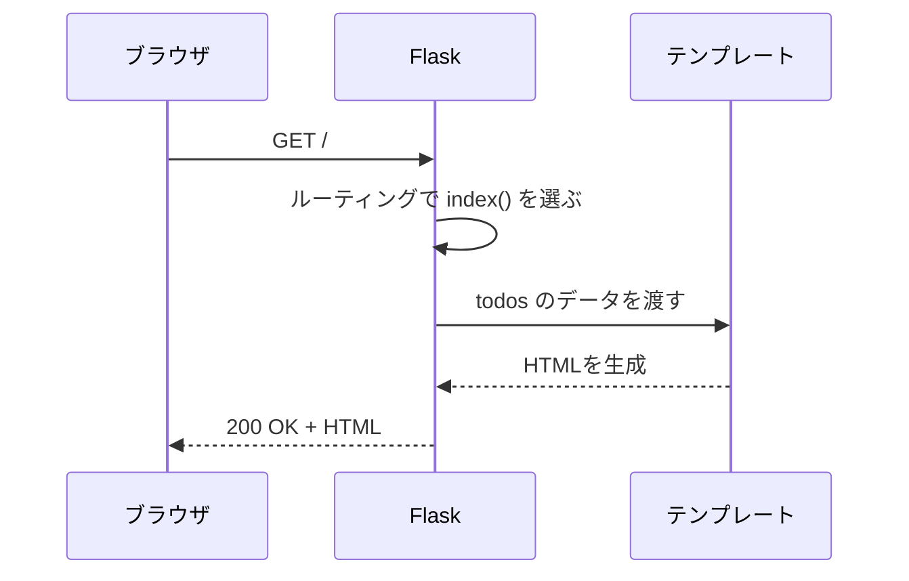
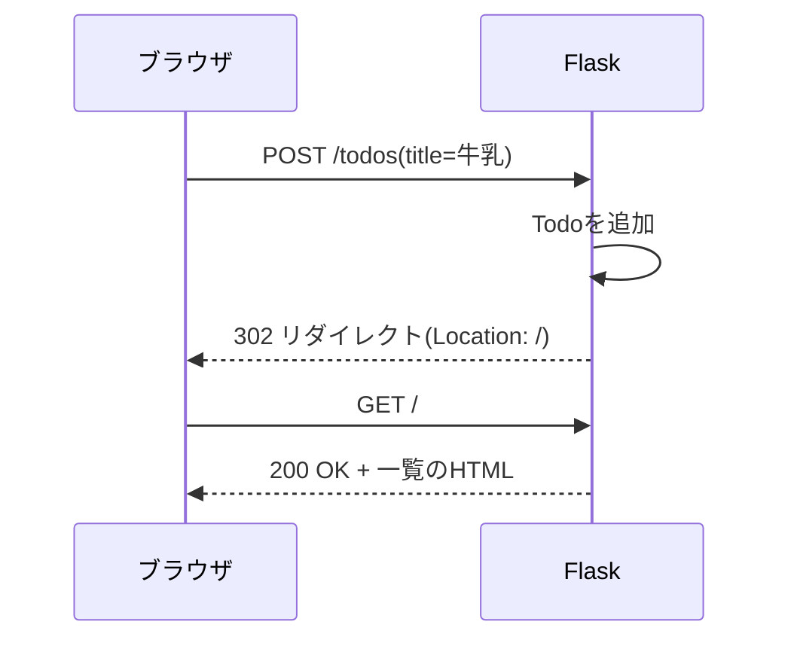

# フェーズ3:Flaskで動的Webアプリ

> **ゴール**:ブラウザから操作できるTodoアプリ(追加・一覧・編集・削除)をFlaskで作れる。データはまだメモリ上に保存する。

## 1. なぜ学ぶか

- フェーズ2のTodoアプリは、ターミナルでしか使えませんでした
- ブラウザから使うには、**「リクエストを受け取って、その場でHTMLを作って返すプログラム」** が必要です。これが **Webアプリ** です
- フェーズ0で観察したリクエストとレスポンスを、今度は自分で実装します

## 2. 仕組みの解説

### 2-1. 静的サイトと動的サイト

| | 静的サイト(フェーズ1) | 動的サイト(このフェーズ) |
| --- | --- | --- |
| HTML | あらかじめ置いておく | リクエストのたびにプログラムが作る |
| 内容 | 誰が見ても同じ | データや操作によって変わる |
| 必要なもの | ファイルを配るサーバー | プログラムを動かすサーバー |

### 2-2. Webフレームワークとルーティング

**Flask** は、Webアプリを作るための部品をまとめた **Webフレームワーク** です。
URLと、それを処理するPythonの関数を対応付けることを **ルーティング** と呼びます。

```python
@app.route("/")          # 「/」にアクセスが来たら
def index():             # この関数を実行して
    return "Hello"       # 結果をレスポンスとして返す
```



### 2-3. テンプレートエンジン(Jinja2)

HTMLの中にPythonのデータを埋め込む仕組みです。`{{ }}` で値を表示し、`` で繰り返しや条件分岐を書きます。

```html

  <li>{{ todo.title }}</li>

```

`base.html` に共通部分(ヘッダーなど)を書き、各ページは `` で継承します。

### 2-4. フォーム送信とPRGパターン



POSTの後にそのままHTMLを返すと、ブラウザを再読み込みしたときに **同じPOSTが再送信** され、Todoが二重に登録されます。
そのため「**P**OST → **R**edirect → **G**ET」の順にする **PRGパターン** を使います。

### 2-5. 開発サーバーとポート

`flask run` で起動するのは **開発用のサーバー** です。この教材では `--port 5001` を付けて起動します。

```
Running on http://127.0.0.1:5001
```

- `127.0.0.1` = 自分のPC(localhost)
- `5001` = ポート番号(受付窓口の番号)

> Flask は通常 **5000番** で起動しますが、Mac では **AirPlay レシーバー** という機能が5000番を使っています。同じ窓口を2つのプログラムが使うことはできないため、5000番のまま起動すると「Address already in use」になったり、AirPlay が応答して `403 Forbidden` が表示されたりします。そこで、空いている5001番を使います。

開発サーバーは自分のPCからの接続しか受け付けないため、**他のPCからはアクセスできません**。外部に公開する方法はフェーズ6で学びます。

## 3. ハンズオン

フェーズ2で作った `my-todo-app` リポジトリで作業します。

### Step 1. Flaskをインストールして Hello World

```bash
cd ~/dev/my-todo-app
source .venv/bin/activate
pip install flask
pip freeze | grep -i flask > requirements.txt   # 使っているライブラリを記録
```

`app.py` を作成します。

```python
from flask import Flask

app = Flask(__name__)

@app.route("/")
def index():
    return "Hello, World!"
```

```bash
flask --app app run --debug --port 5001
```

**期待される結果**:ブラウザで `http://127.0.0.1:5001` を開くと `Hello, World!` が表示される。
ターミナルには `"GET / HTTP/1.1" 200` というログが出ます。これがリクエストの記録です。

> `--debug` を付けると、コードを保存したときに自動で再起動され、エラーの詳細がブラウザに表示されます。**本番では絶対に使いません。**

### Step 2. ルーティングを追加する

```python
@app.route("/about")
def about():
    return "このアプリについて"
```

**期待される結果**:`/about` で別の内容が表示され、存在しない `/xxx` では404になる。

### Step 3. テンプレートで一覧を表示する

1. `templates/base.html` と `templates/index.html` を作成する
2. `static/style.css` を作成する(フェーズ1のCSSを流用してもよい)
3. `index()` を `render_template("index.html", todos=todos)` に書き換える

完成例:[sample/templates/](sample/templates/)、[sample/static/style.css](sample/static/style.css)

### Step 4. フォームからTodoを追加する

`index.html` にフォームを追加し、`POST /todos` を受け取る関数を作ります。

```python
from flask import redirect, request, url_for

@app.route("/todos", methods=["POST"])
def create():
    title = request.form.get("title", "").strip()
    if title:
        todos.append({"id": next_id(), "title": title, "done": False})
    return redirect(url_for("index"))
```

### Step 5. 編集・削除を実装する

- 編集:`GET /todos/<id>/edit` で編集画面を表示し、`POST` で更新する
- 削除:`POST /todos/<id>/delete` で削除する
- 存在しないIDの場合は `abort(404)` で404を返す

完成例:[sample/app.py](sample/app.py)

> 削除を `GET` ではなく `POST` にしているのはなぜでしょう?(ヒント:GETはリンクを開くだけで実行される)

### Step 6. 通信を観察する

開発者ツールのNetworkタブを開いた状態でTodoを追加し、以下を確認します。

1. `todos` へのリクエストのメソッドが **POST**、ステータスが **302** であること
2. **Payload** タブに `title` が送られていること
3. その直後に `/` への **GET** が発生していること

### Step 7. ポート番号を変えてみる

```bash
flask --app app run --debug --port 8080
```

**期待される結果**:`http://127.0.0.1:8080` で表示され、`5001` では表示されない。

5000番で起動するとどうなるかも試してみましょう(2-5 の注記)。

```bash
lsof -i :5000   # 5000番を使っているプログラムを調べる(ControlCe = AirPlay)
```

### Step 8. コミットする

```bash
git add .
git status   # .venv が含まれていないことを確認
git commit -m "Flask版Todoアプリを作成"
git push
```

## 4. 確認課題

- [ ] 完了・未完了を切り替えるボタン(`POST /todos/<id>/toggle`)を追加し、完了したTodoに取り消し線を付ける
- [ ] 一覧ページの上部に「全N件(未完了M件)」と表示する
- [ ] 存在しないURLにアクセスしたとき、独自の404ページを表示する(完成例には実装済み)

## 5. 振り返り

- Todoを追加するボタンを押してから一覧が更新されるまでに、どんなリクエストが何回送られている?
- Flaskの開発サーバーを止めて再起動すると、Todoはどうなる?それはなぜ?(→ フェーズ4へ)

## このフェーズのファイル

```
sample/
├── app.py              … ルーティングと処理
├── requirements.txt    … 必要なライブラリ
├── templates/
│   ├── base.html       … 全ページ共通のレイアウト
│   ├── index.html      … 一覧・追加フォーム
│   ├── edit.html       … 編集フォーム
│   └── 404.html        … 404エラーページ
└── static/
    └── style.css       … 見た目
```

起動方法:

```bash
cd sample
python3.12 -m venv .venv && source .venv/bin/activate
pip install -r requirements.txt
flask --app app run --debug --port 5001
```

## よくあるエラー

| エラー | 原因 | 対処 |
| --- | --- | --- |
| `TemplateNotFound` | `templates` フォルダの名前・場所が違う | `app.py` と同じ階層に `templates/` があるか確認 |
| `Method Not Allowed`(405) | ルートに `methods=["POST"]` がない | `@app.route` の `methods` を確認 |
| `BuildError` | `url_for` に存在しない関数名を指定 | 関数名のスペルを確認 |
| `Address already in use` | 前のサーバーが動いたまま、または5000番をAirPlayが使っている | `control + C` で止める、`--port 5001` で起動する |
| `403 Forbidden`(Flaskのページではない) | 5000番でAirPlayが応答している | `--port 5001` で起動する |
