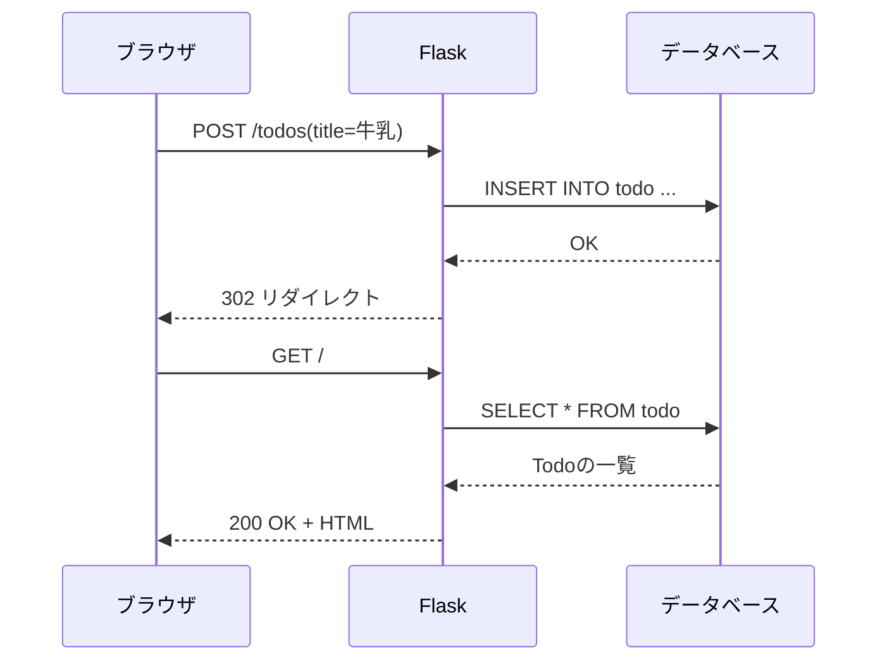

# フェーズ4:データベースとTodo CRUD

> **ゴール**:Todoをデータベース(SQLite)に保存し、作成・表示・更新・削除(CRUD)ができる。サーバーを再起動してもデータが残る。

## 1. なぜ学ぶか

- フェーズ3では、サーバーを再起動するとTodoがすべて消えてしまいました。データが **メモリ上** にしかなかったためです
- フェーズ2のようにJSONファイルに保存する方法もありますが、複数人が同時に書き込んだときにデータが壊れたり、「未完了だけ」などの検索が遅くなったりします
- そこで、データを安全に保存・検索するための専用ソフトウェア **データベース** を使います

## 2. 仕組みの解説

### 2-1. データベースとテーブル

データベースは、データを **テーブル**(表)の形で保存します。

**todo テーブル**

| id(主キー) | title | done | created_at |
| --- | --- | --- | --- |
| 1 | 牛乳を買う | 0 | 2026-10-01 10:00 |
| 2 | 本を読む | 1 | 2026-10-01 11:30 |

- **行(レコード)**:1件のデータ
- **列(カラム)**:データの項目。型(文字列・数値など)が決まっている
- **主キー**:行を一意に特定するための列(`id`)

表計算ソフトと違い、列の型が厳密に決まっていること、大量のデータでも高速に検索できること、同時に書き込んでも壊れにくいことが特徴です。

### 2-2. SQL

データベースを操作するための言語が **SQL** です。CRUDの4つの操作に対応します。

| 操作 | SQL | 例 |
| --- | --- | --- |
| Create(作成) | INSERT | `INSERT INTO todo (title) VALUES ('牛乳を買う');` |
| Read(読み取り) | SELECT | `SELECT * FROM todo WHERE done = 0;` |
| Update(更新) | UPDATE | `UPDATE todo SET done = 1 WHERE id = 1;` |
| Delete(削除) | DELETE | `DELETE FROM todo WHERE id = 1;` |

### 2-3. アプリとデータベースの関係

アプリとデータベースも、**クライアントとサーバー** の関係です。アプリがSQLを送り、データベースが結果を返します。



> SQLiteはファイル1つで動く軽量なデータベースで、アプリと同じプロセスの中で動きます。フェーズ9では、独立したサーバーとして動くPostgreSQLに切り替えます。

### 2-4. ORM(SQLAlchemy)

SQLを文字列で書く代わりに、**Pythonのクラスでテーブルを表し、メソッドで操作する** 仕組みが **ORM** です。

```python
class Todo(db.Model):          # todo テーブル
    id = db.Column(db.Integer, primary_key=True)
    title = db.Column(db.String(100), nullable=False)

db.session.add(Todo(title="牛乳"))   # → INSERT INTO todo (title) VALUES ('牛乳')
db.session.commit()
```

ORMは魔法ではなく、**裏でSQLを作って送っている** だけです。ハンズオンでは、実際に送られているSQLを確認します。

### 2-5. SQLインジェクション

ユーザーの入力をそのままSQLの文字列に埋め込むと、悪意のある入力でSQLの意味を書き換えられてしまいます。

```python
# 危険な例(絶対に書かない)
sql = f"SELECT * FROM todo WHERE title = '{title}'"
# title に「' OR '1'='1」と入力されると、全件が取得されてしまう
```

ORMやプレースホルダー(`?`)を使うと、入力値は自動で安全に処理されます。

## 3. ハンズオン

### Step 1. SQLを手で実行してみる

SQLite のコマンドラインツール `sqlite3` を使います(Macには最初からインストールされています)。

```bash
sqlite3 practice.db
```

[sample/sql/practice.sql](sample/sql/practice.sql) のSQLを1文ずつ貼り付けて実行し、結果を確認します。`.quit` で終了します。

**期待される結果**:INSERT・UPDATE・DELETE のたびに、SELECT の結果が変わる。

> 練習用の `practice.db` は、確認後に削除してください。

### Step 2. Flask-SQLAlchemy をインストールする

```bash
pip install flask-sqlalchemy
pip freeze | grep -iE "flask|sqlalchemy" > requirements.txt
```

### Step 3. モデルを定義する

`app.py` にデータベースの設定と `Todo` クラスを追加し、`db.create_all()` でテーブルを作成します。

```python
app.config["SQLALCHEMY_DATABASE_URI"] = "sqlite:///todo.db"
app.config["SQLALCHEMY_ECHO"] = True   # 実行されたSQLを表示する
db = SQLAlchemy(app)
```

### Step 4. 一覧・追加・削除をDB版に書き換える

フェーズ3でリストを操作していた部分を、データベースの操作に置き換えます。

| フェーズ3(リスト) | フェーズ4(データベース) |
| --- | --- |
| `todos` | `db.session.execute(db.select(Todo)).scalars().all()` |
| `todos.append(...)` | `db.session.add(Todo(...))` + `db.session.commit()` |
| `find_todo(todo_id)` | `db.get_or_404(Todo, todo_id)` |
| `todos.remove(todo)` | `db.session.delete(todo)` + `db.session.commit()` |

完成例:[sample/app.py](sample/app.py)

### Step 5. 実行されるSQLを確認する

```bash
flask --app app run --debug --port 5001
```

ブラウザでTodoを追加し、ターミナルを確認します。

**期待される結果**:`INSERT INTO todo (title, done, created_at) VALUES (?, ?, ?)` のようなSQLが表示される。`?` の部分に入力値が安全に渡されていることも確認しましょう。

### Step 6. 完了フラグの更新を実装する

`POST /todos/<id>/toggle` で `done` を切り替えます。ターミナルに `UPDATE` 文が出ることを確認します。

### Step 7. 再起動してもデータが残ることを確認する

1. Todoをいくつか追加する
2. `control + C` でサーバーを止め、再度起動する
3. 一覧を開く

**期待される結果**:Todoが残っている。データは `instance/todo.db` に保存されています。

```bash
sqlite3 instance/todo.db "SELECT * FROM todo;"
```

### Step 8. コミットしてpushする

データベースファイルは各自の環境で作られるデータなので、Gitで管理しません。`.gitignore` に追加してからコミットします。

```bash
echo "instance/" >> .gitignore
git add .
git status   # instance/ や *.db が含まれていないことを確認
git commit -m "SQLiteでTodoを保存するように変更"
git push
```

## 4. 確認課題

- [ ] Todoに「期限日(due_date)」の列を追加し、期限が近い順に並べて表示する(ヒント:一度 `instance/todo.db` を削除してテーブルを作り直す)
- [ ] 「未完了のみ表示」のリンクを作り、`/?filter=active` で絞り込めるようにする(ヒント:`request.args`、`where`)
- [ ] `sqlite3` コマンドで、アプリから追加したTodoを直接 `UPDATE` し、ブラウザに反映されることを確認する

## 5. 振り返り

- 「追加」ボタンを押してから、データベースにデータが入るまでの流れを説明してみよう
- ORMを使うと、SQLを書かなくてよくなるのはなぜ?裏では何が起きている?
- 今のアプリを家族や友人と一緒に使い始めたら、何が困る?(→ フェーズ5へ)

## このフェーズのファイル

```
sample/
├── app.py              … モデル定義とCRUD処理
├── requirements.txt
├── sql/
│   └── practice.sql    … SQL練習用
├── templates/          … index.html に完了ボタンを追加
└── static/
```

## よくあるエラー

| エラー | 原因 | 対処 |
| --- | --- | --- |
| `no such table: todo` | テーブルが作られていない | `db.create_all()` が実行されているか確認 |
| `no such column: todo.due_date` | モデルに列を追加したが、テーブルは古いまま | `instance/todo.db` を削除して再起動(本番ではマイグレーションを使う) |
| `NOT NULL constraint failed` | 必須の列に値がない | フォームの値が空でないか確認 |
| `RuntimeError: Working outside of application context` | アプリの外でDB操作をした | `with app.app_context():` の中で実行する |
