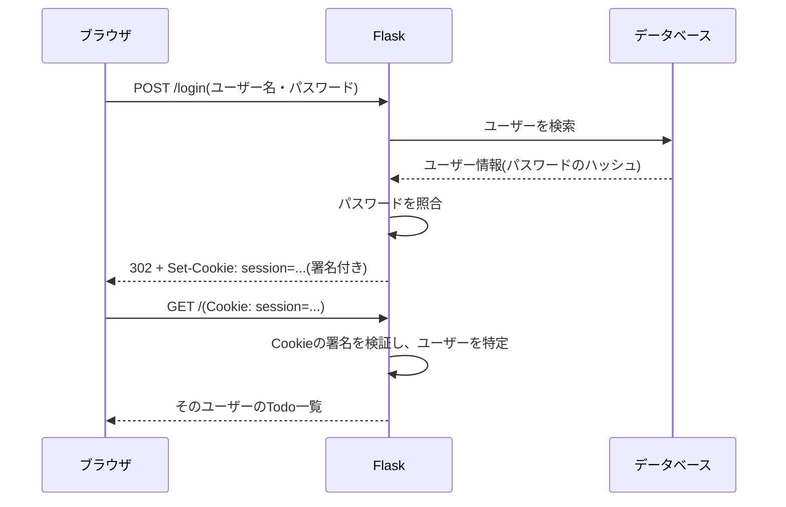
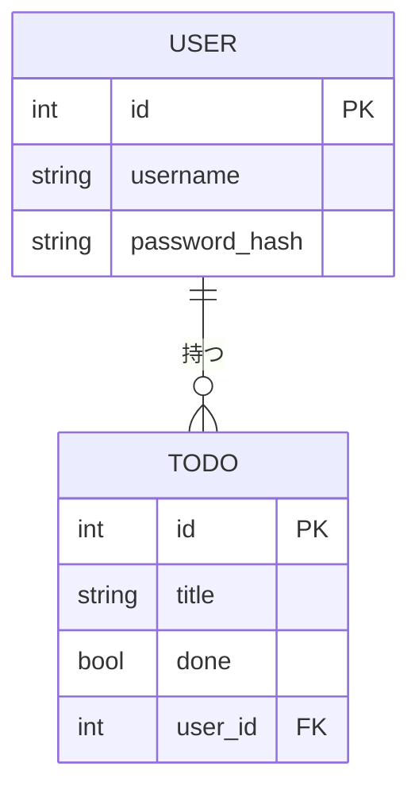

# フェーズ5:認証・認可

> **ゴール**:ユーザー登録・ログインができ、自分のTodoだけを操作できるアプリにする。

## 1. なぜ学ぶか

- フェーズ4のアプリは、**誰でも全員のTodoを見たり消したりできてしまいます**
- 複数の人が使うアプリでは、次の2つを区別して確認する必要があります
    - **認証(Authentication)**:「あなたは誰?」を確かめる(ログイン)
    - **認可(Authorization)**:「あなたはこれをしてよい?」を確かめる(自分のTodoだけ操作できる)

## 2. 仕組みの解説

### 2-1. 認証と認可の違い

| | 認証 | 認可 |
| --- | --- | --- |
| 問い | あなたは誰? | それをしてよい? |
| 例え | 社員証で本人確認する | 社員証の権限で入れる部屋が決まる |
| このアプリでは | ユーザー名とパスワードでログイン | 自分のTodoだけ編集・削除できる |
| 失敗したとき | ログイン画面へ移動(401相当) | 403 Forbidden |

### 2-2. HTTPはステートレス

HTTPは、**リクエストごとに相手のことを覚えていません**(ステートレス)。
1回ログインしても、次のリクエストでサーバーは「誰からのリクエストか」がわかりません。

### 2-3. Cookieとセッション

そこで、ログインに成功したらサーバーがブラウザに「入館証」を渡し、ブラウザは以後のリクエストに毎回それを付けて送ります。この入館証が **Cookie** に保存された **セッション** です。



FlaskのセッションCookieは、`SECRET_KEY` で **署名** されています。中身を書き換えると署名が合わなくなるため、他人になりすますことはできません。
逆に言えば、**`SECRET_KEY` が漏れると誰にでもなりすませてしまいます**。

### 2-4. パスワードのハッシュ化

パスワードをそのまま保存すると、データベースが漏洩したときに全員のパスワードが知られてしまいます。
そこで、**元に戻せない変換(ハッシュ化)** をした値だけを保存します。

```
入力: mypassword
保存: scrypt:32768:8:1$Xk2...$9f3a...(元のパスワードには戻せない)
```

ログイン時は、入力されたパスワードを同じ方法でハッシュ化し、保存された値と一致するかを比べます。

### 2-5. テーブルの関連(リレーション)

「どのTodoが誰のものか」を表すため、`todo` テーブルに `user_id`(**外部キー**)を追加します。



### 2-6. 環境変数と .env

`SECRET_KEY` のような秘密情報は、コードに直接書くとGitHubに公開されてしまいます。
**環境変数** から読み込むようにし、開発中は `.env` ファイルに書いて `.gitignore` で除外します。

## 3. ハンズオン

### Step 1. ライブラリをインストールする

```bash
pip install flask-login python-dotenv
pip freeze | grep -iE "flask|sqlalchemy|dotenv" > requirements.txt
```

### Step 2. SECRET_KEY を .env で管理する

```bash
python3 -c "import secrets; print(secrets.token_hex(32))"   # ランダムな文字列を生成
```

`.env` を作成し、生成した値を書きます。

```
SECRET_KEY=生成した文字列
```

```bash
echo ".env" >> .gitignore
git status   # .env が表示されないことを確認
```

チームメンバー向けに、値を空にした `.env.example` を作ってコミットします(例:[sample/.env.example](sample/.env.example))。

### Step 3. Userテーブルを作り、TodoにユーザーIDを持たせる

`User` モデルを追加し、`Todo` に `user_id` を追加します。テーブルの構造が変わるため、**`instance/todo.db` を一度削除** してから起動します。

```bash
rm instance/todo.db
```

### Step 4. ユーザー登録を実装する

`/register` で、パスワードを `generate_password_hash()` でハッシュ化して保存します。

**期待される結果**:登録後、以下のコマンドでパスワードがハッシュ化されて保存されていることがわかる。

```bash
sqlite3 instance/todo.db "SELECT username, password_hash FROM user;"
```

### Step 5. ログイン・ログアウトを実装する

Flask-Login の `login_user()` / `logout_user()` を使います。Todoのページには `@login_required` を付け、未ログインならログイン画面に移動させます。

完成例:[sample/app.py](sample/app.py)、[sample/templates/login.html](sample/templates/login.html)

### Step 6. Cookieを観察する

1. Chromeでログインした状態で、開発者ツール(`command + option + I`)の **Application** タブ → **Cookies** → `http://127.0.0.1:5001` を開く
2. `session` というCookieがあることを確認する
3. そのCookieを削除して、ページを再読み込みする

**期待される結果**:ログイン画面に移動する。ログイン状態はCookieだけで保たれていることがわかる。

### Step 7. 自分のTodoだけを表示・操作する(認可)

- 一覧:`filter_by(user_id=current_user.id)` で自分のTodoだけを取得する
- 編集・完了・削除:Todoの `user_id` がログイン中のユーザーと違えば `abort(403)` にする

```python
def get_own_todo_or_403(todo_id):
    todo = db.get_or_404(Todo, todo_id)
    if todo.user_id != current_user.id:
        abort(403)
    return todo
```

### Step 8. コミットする

```bash
git add .
git status   # .env が含まれていないことを必ず確認
git commit -m "ユーザー登録・ログイン機能を追加"
git push
```

## 4. 確認課題

- [ ] ユーザーを2人登録し、Aさんでログインしたまま、Bさんの Todo の編集URL(`/todos/<id>/edit`)を直接開く。403になることを確認し、Step 7 の処理がなかったら何が起きるかを説明する
- [ ] パスワードが8文字未満のときは登録できないようにする
- [ ] シークレットウィンドウ(`command + shift + N`)を使って、2人のユーザーで同時にログインし、それぞれのTodoが分かれていることを確認する

## 5. 振り返り

- 「画面にボタンを表示しない」だけでは、認可したことにならないのはなぜ?
- `SECRET_KEY` がGitHubに公開されてしまったら、何が起きる?
- このアプリを友人に実際に使ってもらうには、何が必要?(→ フェーズ6へ)

## このフェーズのファイル

```
sample/
├── app.py              … User モデル、認証・認可の処理を追加
├── requirements.txt
├── .env.example        … 環境変数のひな形(.env はコミットしない)
├── templates/
│   ├── base.html       … ログイン状態に応じたナビゲーション、フラッシュメッセージ
│   ├── login.html
│   ├── register.html
│   └── 403.html
└── ...
```

## よくあるエラー

| エラー | 原因 | 対処 |
| --- | --- | --- |
| `KeyError: 'SECRET_KEY'` | `.env` がない、または読み込まれていない | `.env` を作成し、`load_dotenv()` を確認 |
| `no such column: todo.user_id` | テーブルが古い構造のまま | `instance/todo.db` を削除して再起動 |
| `UNIQUE constraint failed: user.username` | 同じユーザー名で登録した | 登録前に重複チェックを行う |
| ログインしても一覧に戻らない | `login_user()` の後のリダイレクトがない | `redirect(url_for("index"))` を返す |
