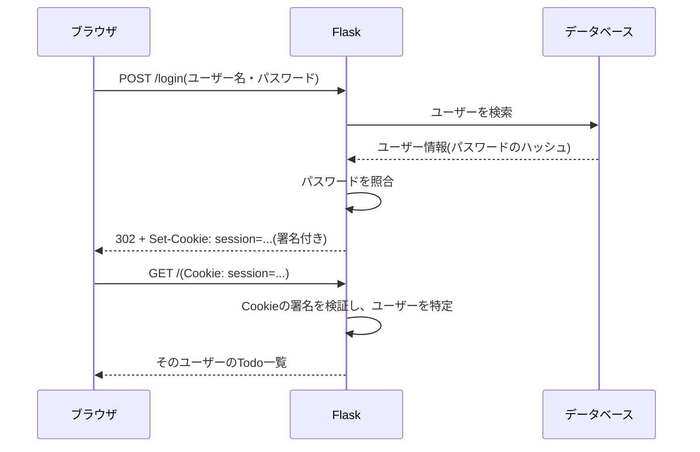
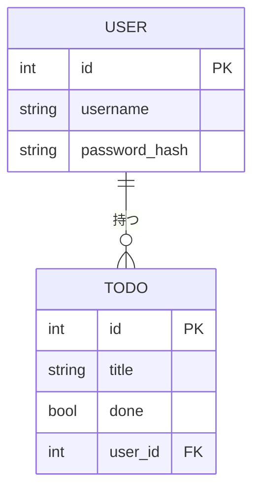

# フェーズ5:認証・認可

> **ゴール**:ユーザー登録・ログインができ、自分のTodoだけを操作できるアプリにする。

## 1. なぜ学ぶか

- フェーズ4のアプリは、**誰でも全員のTodoを見たり消したりできてしまいます**
- 複数の人が使うアプリでは、次の2つを区別して確認する必要があります
    - **認証(Authentication)**:「あなたは誰?」を確かめる(ログイン)
    - **認可(Authorization)**:「あなたはこれをしてよい?」を確かめる(自分のTodoだけ操作できる)

## 2. 仕組みの解説

### 2-1. 認証と認可の違い

| | 認証 | 認可 |
| --- | --- | --- |
| 問い | あなたは誰? | それをしてよい? |
| 例え | 社員証で本人確認する | 社員証の権限で入れる部屋が決まる |
| このアプリでは | ユーザー名とパスワードでログイン | 自分のTodoだけ編集・削除できる |
| 失敗したとき | ログイン画面へ移動(401相当) | 403 Forbidden |

### 2-2. HTTPはステートレス

HTTPは、**リクエストごとに相手のことを覚えていません**(これを「ステートレス」と呼びます。state=状態を保持しない、という意味です)。
たとえるなら、少し忘れっぽいお店の店員さんのようなものです。1回目の会話でお客さんの名前を聞いても、次にまた話しかけられたときには「初めまして」から始まってしまいます。
同じように、1回ログインに成功しても、次のリクエストが来たときサーバーは「さっきログインしてきた人と同じ人かどうか」がわかりません。

### 2-3. Cookieとセッション

そこで、ログインに成功したらサーバーがブラウザに「入館証」を渡し、ブラウザは以後のリクエストに毎回それを付けて送ります。この入館証が **Cookie** に保存された **セッション** です。



FlaskのセッションCookieは、`SECRET_KEY` で **署名** されています。中身を書き換えると署名が合わなくなるため、他人になりすますことはできません。
逆に言えば、**`SECRET_KEY` が漏れると誰にでもなりすませてしまいます**。

### 2-4. パスワードのハッシュ化

パスワードをそのまま保存すると、データベースが漏洩したときに全員のパスワードが知られてしまいます。
そこで、**元に戻せない変換(ハッシュ化)** をした値だけを保存します。

ハッシュ化は、紙をシュレッダーにかけるようなものだとイメージしてください。一度細かく裁断してしまうと、元の紙(パスワード)には戻せません。
しかし、**同じ紙を同じシュレッダーに通せば、必ず同じ結果になる** という性質があります。この性質を利用して、パスワードそのものを保存しなくても「一致しているかどうか」だけは確認できます。

```
入力: mypassword
保存: scrypt:32768:8:1$Xk2...$9f3a...(元のパスワードには戻せない)
```

ログイン時は、入力されたパスワードを同じ方法でハッシュ化し、保存された値と一致するかを比べます。

### 2-5. テーブルの関連(リレーション)

「どのTodoが誰のものか」を表すため、`todo` テーブルに `user_id`(**外部キー**)を追加します。
外部キーとは、別のテーブルの `id` をそのまま値として持たせることで、2つのテーブルを紐付ける仕組みです。宅配便の荷物に「お届け先の会員番号」を書いておくイメージで、その番号をたどれば「誰に届けるべきか」がわかります。



### 2-6. 環境変数と .env

`SECRET_KEY` のような秘密情報は、コードに直接書くとGitHubに公開されてしまいます。
**環境変数** から読み込むようにし、開発中は `.env` ファイルに書いて `.gitignore` で除外します。

環境変数とは、プログラムの外側(OSやターミナル)に保存しておき、プログラムが起動時に読み込む値のことです。メモ帳にパスワードを書いてプログラムのすぐ近くに置いておくのではなく、プログラムとは別の引き出し(`.env`)にしまっておき、必要なときだけ取り出して使う、というイメージです。
`.env` ファイル自体はGitHubにアップロードしない(`.gitignore` に入れる)ため、コードだけを見た人には秘密情報が見えません。

## 3. ハンズオン

### Step 1. ライブラリをインストールする

ログイン機能と `.env` の読み込みは自分で実装することもできますが、セキュリティに関わる部分は実績のあるライブラリに任せるのが安全です。**Flask-Login**(ログイン状態の管理)と **python-dotenv**(`.env` ファイルの読み込み)をインストールします。

```bash
uv pip install flask-login python-dotenv
uv pip freeze | grep -iE "flask|sqlalchemy|dotenv" > requirements.txt
```

### Step 2. SECRET_KEY を .env で管理する

`SECRET_KEY` は、あとで出てくる「Cookieの署名」に使う値です。他人に予測されると危険なので、辞書に載っている単語などではなく、ランダムな文字列を生成します。

```bash
python3 -c "import secrets; print(secrets.token_hex(32))"   # ランダムな文字列を生成
```

`.env` を作成し、生成した値を書きます。

```
SECRET_KEY=生成した文字列
```

秘密情報は **必ず `.gitignore` に追加してから** `git add` することが重要です(順番を間違えると、一度でもコミットした秘密情報は履歴に残り続けます)。

```bash
echo ".env" >> .gitignore
git status   # .env が表示されないことを確認
```

> **やってみよう**:あえて `.gitignore` への追加を忘れた状態で `git add .` し、`git status` の「コミットされる予定のファイル」に `.env` が含まれてしまうことを確認してみましょう(そのまま `git commit` はしないこと)。確認できたら `git restore --staged .env` で取り消し、`.gitignore` に追加してからやり直します。

チームメンバー向けに、値を空にした `.env.example` を作ってコミットします(例:[sample/.env.example](sample/.env.example))。これにより、他の人は `.env` の中身を知らなくても「どの変数を設定すればいいか」がわかります。

### Step 3. Userテーブルを作り、TodoにユーザーIDを持たせる

`User` モデルを追加します。

```python
from flask_login import UserMixin
from werkzeug.security import check_password_hash, generate_password_hash

class User(UserMixin, db.Model):
    """user テーブル"""

    id = db.Column(db.Integer, primary_key=True)
    username = db.Column(db.String(50), unique=True, nullable=False)
    # パスワードそのものではなく、ハッシュ化した値を保存する
    password_hash = db.Column(db.String(255), nullable=False)
    todos = db.relationship("Todo", back_populates="user", cascade="all, delete-orphan")

    def set_password(self, password):
        self.password_hash = generate_password_hash(password)

    def check_password(self, password):
        return check_password_hash(self.password_hash, password)
```

- **`UserMixin`**:Flask-Loginが「ログイン中かどうか」を判定するために必要ないくつかの共通メソッド(`is_authenticated`など)を、まとめて追加してくれる仕組みです。継承するだけで使えるようになります
- **`unique=True`**:同じユーザー名を2人以上登録できないようにする制約です
- **`db.relationship`**:「このUserが持っているTodoの一覧」を `user.todos` のようにPython側から取得できるようにする、テーブル同士の対応付けです。`cascade="all, delete-orphan"` は、ユーザーを削除したときにそのユーザーのTodoも一緒に削除する、という指定です
- **`set_password`/`check_password`**:パスワードを直接比較せず、ハッシュ化した値同士を比較するためのメソッドです(2-4で説明したシュレッダーの仕組みのコード版です)

`Todo` モデルにも、外部キー `user_id` を追加します。

```python
class Todo(db.Model):
    """todo テーブル"""

    id = db.Column(db.Integer, primary_key=True)
    title = db.Column(db.String(100), nullable=False)
    done = db.Column(db.Boolean, nullable=False, default=False)
    created_at = db.Column(db.DateTime, nullable=False, default=datetime.now)
    # 外部キー:どのユーザーのTodoかを表す(2-5参照)
    user_id = db.Column(db.Integer, db.ForeignKey("user.id"), nullable=False)
    user = db.relationship("User", back_populates="todos")
```

テーブルの構造が変わるため、**`instance/todo.db` を一度削除** してから起動します。

```bash
rm instance/todo.db
```

### Step 4. ユーザー登録を実装する

`/register` のビューを実装します。ユーザー名・パスワードが未入力の場合と、同じユーザー名が既に使われている場合をチェックしてから、パスワードをハッシュ化して保存します。

```python
from flask import flash

@app.route("/register", methods=["GET", "POST"])
def register():
    if request.method == "POST":
        username = request.form.get("username", "").strip()
        password = request.form.get("password", "")
        if not username or not password:
            flash("ユーザー名とパスワードを入力してください")
        elif db.session.execute(db.select(User).filter_by(username=username)).scalar():
            flash("そのユーザー名は既に使われています")
        else:
            user = User(username=username)
            user.set_password(password)
            db.session.add(user)
            db.session.commit()
            login_user(user)
            return redirect(url_for("index"))
    return render_template("register.html")
```

- **`flash(...)`**:次に表示する画面に向けて、一時的なメッセージを1つ用意しておく仕組みです。`templates/base.html` 側でこのメッセージを表示します(完成例:[sample/templates/base.html](sample/templates/base.html))
- 登録フォーム自体は、これまでのフォーム(`index.html`のTodo追加フォームなど)と同じ考え方です。`templates/register.html` を作成します(完成例:[sample/templates/register.html](sample/templates/register.html))
- `login_user(user)` は次のStepで説明するFlask-Loginの機能です。登録が成功したら、そのままログイン状態にしています

**期待される結果**:登録後、以下のコマンドでパスワードがハッシュ化されて保存されていることがわかる。

```bash
sqlite3 instance/todo.db "SELECT username, password_hash FROM user;"
```

### Step 5. ログイン・ログアウトを実装する

まず、Flask-Loginの初期設定をします。

```python
from flask_login import LoginManager, login_required, login_user, logout_user

login_manager = LoginManager(app)
# ログインが必要なページに未ログインでアクセスしたときの移動先
login_manager.login_view = "login"
login_manager.login_message = "ログインしてください"
```

次に、**`@login_manager.user_loader`** を付けた関数を用意します。これは、Cookieに保存されたユーザーID(2-3参照)から、実際の `User` オブジェクトを取り出すための関数です。**この関数がないと、Flask-Loginはログイン状態を復元できず、ログインしたはずなのに毎回ログイン画面に戻されてしまいます。**

```python
@login_manager.user_loader
def load_user(user_id):
    """セッションに保存されたユーザーIDから、ユーザーを取り出す"""
    return db.session.get(User, int(user_id))
```

ログイン・ログアウトのビューを実装します。`login_user()` / `logout_user()` が、実際にログイン状態を開始・終了させる関数です。

```python
@app.route("/login", methods=["GET", "POST"])
def login():
    if request.method == "POST":
        username = request.form.get("username", "").strip()
        password = request.form.get("password", "")
        user = db.session.execute(db.select(User).filter_by(username=username)).scalar()
        # ユーザー名とパスワードのどちらが違うかは教えない(攻撃のヒントになるため)
        if user is None or not user.check_password(password):
            flash("ユーザー名またはパスワードが違います")
        else:
            login_user(user)
            return redirect(url_for("index"))
    return render_template("login.html")


@app.route("/logout", methods=["POST"])
@login_required
def logout():
    logout_user()
    return redirect(url_for("login"))
```

最後に、Todoのページには `@login_required` というデコレーター(関数に機能を追加する目印)を付け、未ログインならログイン画面に移動させます。これを付け忘れると、ログインしていない人にもTodo一覧が見えてしまいます。

```python
@app.route("/")
@login_required
def index():
    ...
```

完成例:[sample/app.py](sample/app.py)、[sample/templates/login.html](sample/templates/login.html)

### Step 6. Cookieを観察する

1. Chromeでログインした状態で、開発者ツール(`command + option + I`)の **Application** タブ → **Cookies** → `http://127.0.0.1:5001` を開く
2. `session` というCookieがあることを確認する
3. そのCookieを削除して、ページを再読み込みする

**期待される結果**:ログイン画面に移動する。ログイン状態はCookieだけで保たれていることがわかる。

### Step 7. 自分のTodoだけを表示・操作する(認可)

- 一覧:`filter_by(user_id=current_user.id)` で自分のTodoだけを取得する
- 編集・完了・削除:Todoの `user_id` がログイン中のユーザーと違えば `abort(403)` にする

```python
def get_own_todo_or_403(todo_id):
    todo = db.get_or_404(Todo, todo_id)
    if todo.user_id != current_user.id:
        abort(403)
    return todo
```

### Step 8. コミットする

```bash
git add .
git status   # .env が含まれていないことを必ず確認
git commit -m "ユーザー登録・ログイン機能を追加"
git push
```

## 4. 確認課題

- [ ] ユーザーを2人登録し、Aさんでログインしたまま、Bさんの Todo の編集URL(`/todos/<id>/edit`)を直接開く。403になることを確認し、Step 7 の処理がなかったら何が起きるかを説明する
- [ ] パスワードが8文字未満のときは登録できないようにする
- [ ] シークレットウィンドウ(`command + shift + N`)を使って、2人のユーザーで同時にログインし、それぞれのTodoが分かれていることを確認する

## 5. 振り返り

- 「画面にボタンを表示しない」だけでは、認可したことにならないのはなぜ?
- `SECRET_KEY` がGitHubに公開されてしまったら、何が起きる?
- このアプリを友人に実際に使ってもらうには、何が必要?(→ フェーズ6へ)

## このフェーズのファイル

```
sample/
├── app.py              … User モデル、認証・認可の処理を追加
├── requirements.txt
├── .env.example        … 環境変数のひな形(.env はコミットしない)
├── templates/
│   ├── base.html       … ログイン状態に応じたナビゲーション、フラッシュメッセージ
│   ├── login.html
│   ├── register.html
│   └── 403.html
└── ...
```

## よくあるエラー

| エラー | 原因 | 対処 |
| --- | --- | --- |
| `KeyError: 'SECRET_KEY'` | `.env` がない、または読み込まれていない | `.env` を作成し、`load_dotenv()` を確認 |
| `no such column: todo.user_id` | テーブルが古い構造のまま | `instance/todo.db` を削除して再起動 |
| `UNIQUE constraint failed: user.username` | 同じユーザー名で登録した | 登録前に重複チェックを行う |
| ログインしても一覧に戻らない | `login_user()` の後のリダイレクトがない | `redirect(url_for("index"))` を返す |
