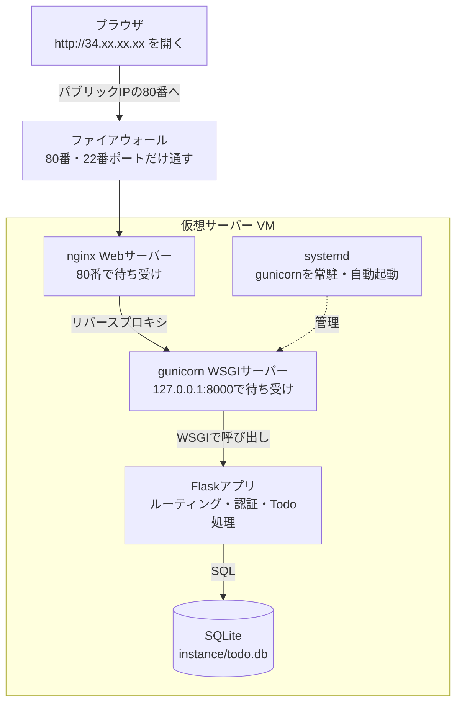

# フェーズ6:仮想サーバーへ手動デプロイ【デプロイ②】

> **ゴール**:クラウドの仮想サーバー(VM)にTodoアプリを手作業で配置し、インターネット経由で誰でもアクセスできるようにする。ブラウザからのリクエストがアプリに届くまでの経路を説明できる。

## 1. なぜ学ぶか

- フェーズ5までのアプリは `localhost` で動いているため、**自分のPCでしか見られません**。PCの電源を切れば止まってしまいます
- 他の人に使ってもらうには、**24時間動いていて、インターネットから到達できるサーバー** が必要です
- このフェーズでは、あえて **すべてを手作業で** 行います。手間がかかる分、後のフェーズで学ぶDockerやクラウドのサービスが「何を代わりにやってくれているのか」が理解できるようになります

## 2. 仕組みの解説

### 2-1. 全体像:リクエストはどこを通るか



レスポンスは、同じ経路を逆向きにたどってブラウザへ返ります。

### 2-2. 仮想サーバー(VM)

クラウド事業者のデータセンターにある物理サーバーを分割して借りる、**1台のLinuxマシン** です。
自分のPCと同じように、ソフトウェアをインストールしてプログラムを動かせます。

| | Google Cloud | AWS |
| --- | --- | --- |
| サービス名 | Compute Engine | EC2 |
| 無料枠の例 | e2-micro(米国の一部リージョン) | t2.micro / t3.micro(12か月) |

> 無料枠の条件は変更されることがあります。必ず各社の最新の情報を確認してください。

### 2-3. IPアドレスとファイアウォール

- **パブリックIP**:インターネットから到達できる住所(例:`34.123.45.67`)
- **プライベートIP**:クラウド内部でだけ使える住所(例:`10.128.0.2`)
- **ファイアウォール**:どのポートへの通信を許可するかを決める門番。必要なポート以外は閉じておくのが基本です

| ポート | 用途 | 公開する? |
| --- | --- | --- |
| 22 | SSH(サーバーにログインする) | する(本来は自分のIPだけに絞るのが望ましい) |
| 80 | HTTP | する |
| 443 | HTTPS | HTTPS化する場合はする |
| 8000 | gunicorn | **しない**(nginx経由でのみアクセスさせる) |

### 2-4. SSH

**SSH** は、離れた場所にあるサーバーに安全にログインする仕組みです。
**鍵ペア**(秘密鍵と公開鍵)を使います。

- **公開鍵**:サーバーに登録しておく「鍵穴」。他人に見られても問題ない
- **秘密鍵**:自分のPCだけに保存する「鍵」。**絶対に他人に渡さない、GitHubに上げない**

### 2-5. 開発サーバーと本番用サーバー

`flask run` の開発サーバーは、同時に1つのリクエストしか効率よく処理できず、セキュリティ面も考慮されていません。本番では役割を分けた2つのサーバーを使います。

| | 役割 | 例え |
| --- | --- | --- |
| **nginx**(Webサーバー) | 外部からのリクエストを受け付け、内側へ転送する。HTTPS処理や静的ファイルの配信も得意 | 受付係 |
| **gunicorn**(WSGIサーバー) | Flaskアプリを複数のプロセスで動かし、リクエストを渡す | 担当者を割り振る係 |
| **Flask**(アプリ) | 実際の処理を行う | 担当者 |

nginxのように、外部からのリクエストを受けて内側のサーバーへ転送する仕組みを **リバースプロキシ** と呼びます。

### 2-6. 127.0.0.1 と 0.0.0.0

| 待ち受けアドレス | 意味 |
| --- | --- |
| `127.0.0.1` | **同じマシンの中から** の接続だけを受け付ける |
| `0.0.0.0` | **どこからの** 接続でも受け付ける |

gunicornを `127.0.0.1:8000` で起動すると、外部からは直接アクセスできず、同じVM内のnginxからしか届きません。これが安全な構成です。

### 2-7. systemd

SSHでログインして `gunicorn` を起動しても、ログアウトするとプロセスが終了してしまいます。
**systemd** は、プログラムを **サービス** として登録し、常に動かし続け、VMの再起動時にも自動で起動してくれる仕組みです。

### 2-8. ドメインとHTTPS(任意)

- **ドメイン**:DNSの **Aレコード** に「`todo.example.com` → `34.123.45.67`」と登録すると、IPアドレスの代わりに名前でアクセスできる
- **HTTPS**:通信を暗号化する仕組み。**証明書** が必要で、Let's Encrypt を使うと無料で取得できる

## 3. ハンズオン

> ここではGoogle Cloud(Compute Engine)の手順を記載します。AWSの場合の対応は各Stepの注記を参照してください。

### Step 0. 課金の安全対策(必須)

1. Google Cloud のアカウントを作成し、プロジェクトを作成する
2. **お支払い → 予算とアラート** で、月1,000円などの予算アラートを設定する
3. [全フェーズ共通の注意点](../../docs/common-notes.md) を読み直す

### Step 1. SSH鍵を作成する(自分のMacで実行)

```bash
ssh-keygen -t ed25519 -f ~/.ssh/todo-vm -C "あなたのユーザー名"
pbcopy < ~/.ssh/todo-vm.pub   # 公開鍵の中身をクリップボードにコピー
```

> パスフレーズを聞かれたら、秘密鍵を守るためのパスワードを設定します(空でも動きますが、設定を推奨します)。

- `~/.ssh/todo-vm`:秘密鍵(**絶対に共有しない**)
- `~/.ssh/todo-vm.pub`:公開鍵(サーバーに登録する)

### Step 2. VMを作成する

**Compute Engine → VMインスタンス → インスタンスを作成** で以下を設定します。

| 項目 | 設定 |
| --- | --- |
| 名前 | `todo-vm` |
| リージョン | 無料枠の対象リージョン(例:`us-central1`) |
| マシンタイプ | `e2-micro` |
| ブートディスク | Ubuntu 24.04 LTS |
| ファイアウォール | 「HTTPトラフィックを許可する」にチェック |
| セキュリティ → SSH認証鍵 | Step 1 の公開鍵を貼り付ける |

作成後、一覧に表示される **外部IP** をメモします。

> **AWSの場合**:EC2 → インスタンスを起動。Ubuntu 24.04、t3.micro、キーペアを作成(`.pem` をダウンロード)、セキュリティグループでSSH(22)とHTTP(80)を許可。

### Step 3. SSHでログインする

```bash
ssh -i ~/.ssh/todo-vm あなたのユーザー名@外部IP
```

**期待される結果**:プロンプトが `ユーザー名@todo-vm:~$` に変わる。ここから先は **VM(Ubuntu Linux)の中** での操作です。

> VMはMacではなくLinuxなので、ソフトウェアのインストールには `brew` ではなく `apt` を使います。ターミナルのウィンドウが「自分のMac」と「VM」のどちらにつながっているか、常にプロンプトで確認しましょう。

```bash
whoami      # ログインしているユーザー名
hostname    # サーバーの名前
ip a        # IPアドレス(プライベートIPが表示される点に注目)
```

### Step 4. 必要なソフトウェアをインストールする

```bash
sudo apt update
sudo apt install -y python3 python3-venv python3-pip git nginx
```

### Step 5. アプリを配置する

```bash
cd ~
git clone https://github.com/あなたのユーザー名/my-todo-app.git
cd my-todo-app
python3 -m venv .venv
source .venv/bin/activate
pip install -r requirements.txt
pip install gunicorn   # requirements.txt にも追記してコミットしておく
```

`.env` はGitHubにないため、VM上で作成します。

```bash
python3 -c "import secrets; print(secrets.token_hex(32))"
nano .env   # SECRET_KEY=生成した値 を書いて保存(control+O → return → control+X)
```

> 本番用の `SECRET_KEY` は、開発用とは別の値にします。

### Step 6. gunicornで起動し、VMの中から確認する

```bash
set -a; source .env; set +a   # .env を環境変数として読み込む
gunicorn --workers 2 --bind 127.0.0.1:8000 app:app
```

もう1つターミナルを開いてVMにSSHし、以下を実行します。

```bash
curl -I http://127.0.0.1:8000/
```

**期待される結果**:`HTTP/1.1 302 FOUND` と `Location: /login?next=%2F` が表示される(未ログインなのでログイン画面へのリダイレクト)。

この時点で、自分のPCのブラウザから `http://外部IP:8000` を開いても **表示されません**。なぜか考えてみましょう(ヒント:2-3、2-6)。

確認したら、最初のターミナルで `control + C` を押してgunicornを止めます。

### Step 7. systemdでサービス化する

[sample/deploy/systemd/todo.service](sample/deploy/systemd/todo.service) を参考に、`YOUR_USER` を自分のユーザー名に書き換えて配置します。

```bash
sudo nano /etc/systemd/system/todo.service   # 内容を貼り付けて保存
sudo systemctl daemon-reload                 # 設定を読み込み直す
sudo systemctl enable --now todo             # 起動し、自動起動を有効にする
sudo systemctl status todo                   # active (running) ならOK
```

### Step 8. nginxを設定する

[sample/deploy/nginx/todo.conf](sample/deploy/nginx/todo.conf) を配置します。

```bash
sudo nano /etc/nginx/sites-available/todo           # 内容を貼り付けて保存
sudo ln -s /etc/nginx/sites-available/todo /etc/nginx/sites-enabled/todo
sudo rm /etc/nginx/sites-enabled/default            # デフォルトのページを無効化
sudo nginx -t                                       # 設定ファイルの文法チェック
sudo systemctl reload nginx
```

### Step 9. 外部からアクセスする

自分のMacのブラウザ、そして **Wi-Fiを切ったスマホ** で `http://外部IP` を開きます。

**期待される結果**:ログイン画面が表示され、ユーザー登録・Todoの追加ができる。**localhost以外で、あなたのアプリが動いています。**

### Step 10. 再起動しても動くことを確認する

```bash
sudo reboot
```

1〜2分待ってから、ブラウザで再度アクセスします。

**期待される結果**:SSHでログインして何もしなくても、アプリが表示される(systemdが自動で起動している)。

### Step 11.(任意)ドメインとHTTPS

1. ドメインを取得し、DNSの設定で **Aレコード** に外部IPを登録する
2. `todo.conf` の `server_name` をドメイン名に変更し、nginxをreloadする
3. GCPのファイアウォールで **HTTPS(443)** を許可する
4. Let's Encrypt で証明書を取得する

```bash
sudo apt install -y certbot python3-certbot-nginx
sudo certbot --nginx -d todo.example.com
```

**期待される結果**:`https://todo.example.com` で鍵マーク付きで表示される。

### 後片付け

フェーズ7でもこのVMを使います。**フェーズ7が終わったら、VMを削除** してください(停止しているだけでもディスクの料金がかかる場合があります)。

## 4. 確認課題

- [ ] GCPのファイアウォールでHTTP(80)の許可を一時的に外し、ブラウザで何が起きるかを確認する。その理由を2-1の図を使って説明し、終わったら元に戻す
- [ ] 以下のログから、自分がアクセスしたときの記録を探す
    - nginx:`sudo tail -f /var/log/nginx/todo_access.log`
    - gunicorn:`sudo journalctl -u todo -f`
- [ ] 手元のPCで画面の文言を1か所変更してpushし、VMに反映する(`git pull` → `sudo systemctl restart todo`)

## 5. 振り返り

- 2-1の図を見ながら、ブラウザからデータベースまでの各段階で「何が」「何番ポートで」リクエストを受け取っているかを説明してみよう
- gunicornを `0.0.0.0:8000` で起動し、ファイアウォールで8000番を開けていたら、どんな問題が起きる?
- 今回の手作業のうち、「面倒だった」「間違えそうだった」作業を3つ挙げよう(→ フェーズ9・11・12で解決していきます)
- 確認課題の3つ目で、変更を反映する前に「壊れていないか」をどうやって確かめた?(→ フェーズ7へ)

## このフェーズのファイル

```
sample/
├── (フェーズ5のアプリ一式)
├── requirements.txt        … gunicorn を追加
└── deploy/
    ├── nginx/todo.conf     … nginx の設定(リバースプロキシ)
    └── systemd/todo.service … gunicorn を常駐させる設定
```

## よくあるエラー

| エラー・症状 | 原因 | 対処 |
| --- | --- | --- |
| `Permission denied (publickey)` | 秘密鍵の指定・ユーザー名が違う | `-i` のパスとユーザー名を確認する |
| ブラウザでタイムアウトする | ファイアウォールで80番が閉じている | VPCファイアウォール/セキュリティグループを確認 |
| `502 Bad Gateway` | nginxは動いているが、gunicornが動いていない | `sudo systemctl status todo` と `journalctl -u todo` を確認 |
| nginxのデフォルトページが表示される | `default` 設定が有効なまま | `sites-enabled/default` を削除してreload |
| `KeyError: 'SECRET_KEY'` | VM上に `.env` がない | Step 5 で `.env` を作成する |
| `nginx -t` でエラー | 設定ファイルの書き間違い | エラーに表示された行番号を確認する |
