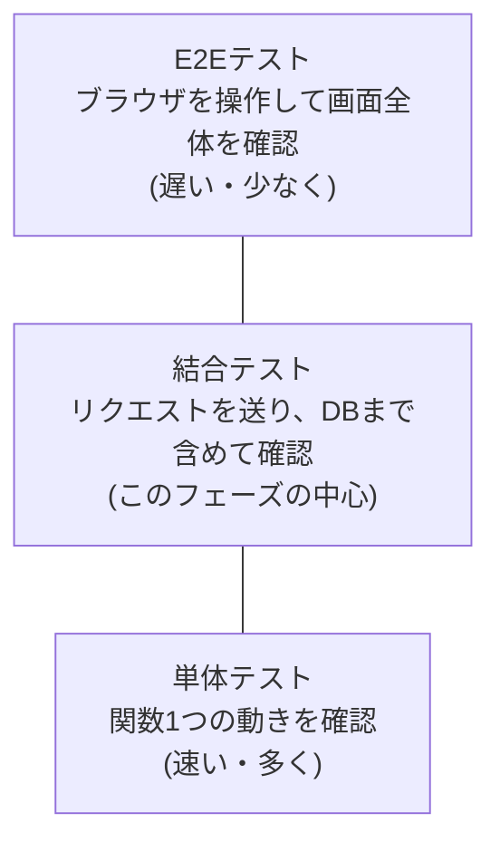
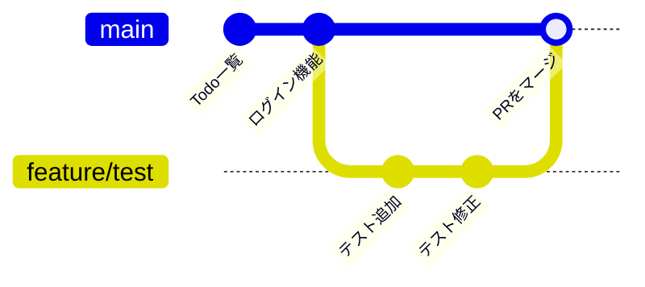

# フェーズ7:テストと品質管理・チーム開発のGit

> **ゴール**:pytestで主要機能の自動テストを書き、ブランチとプルリクエストを使って安全に変更を取り込める。

## 1. なぜ学ぶか

- フェーズ6でアプリを公開しました。ここからは「**公開中のアプリを壊さずに変更し続ける**」ことが大切になります
- 機能を追加するたびに、登録・ログイン・追加・編集・削除・他人のTodoが見えないこと…をすべて手で確認するのは大変で、確認漏れは本番の不具合につながります
- そこで、確認作業を **プログラム(テストコード)** にして、いつでも一瞬で実行できるようにします
- また、実際の開発では、変更を直接 `main` に入れず、**ブランチとプルリクエスト** で確認してから取り込みます

## 2. 仕組みの解説

### 2-1. テストの種類



下にあるほど速く・壊れにくく・数を多く書きます(**テストピラミッド**)。車の品質チェックに例えると、部品1つの検査(単体テスト)→ 部品を組み合わせた動作確認(結合テスト)→ 実際に公道を走らせる確認(E2E)のようなイメージです。公道を走らせる確認ほど本物に近い分、時間もコストもかかります。このフェーズでは、Flaskのテストクライアント(ブラウザの代わりにリクエストを送ってくれる道具)を使ってリクエストを送る **結合テスト** を中心に書きます。

### 2-2. テストケースの考え方

**テストケース**とは、「こういう操作をしたら、こうなるはず」という確認項目を1つずつ書き出したものです。思いつきで確認すると漏れが出やすいため、先に表にまとめておきます。

| 観点 | 内容 | 例 |
| --- | --- | --- |
| 正常系 | 期待どおりの操作 | タイトルを入力して追加 → 表示される |
| 異常系 | 間違った・不正な操作 | 空のタイトル → 追加されない |
| 境界値 | ぎりぎりの値 | 100文字はOK、101文字はNG |
| 認可 | 権限のない操作 | 他人のTodoを削除 → 403 |

テストコードを書く前に、[テストケース表](sample/docs/testcases.md) にまとめておくと、抜け漏れに気付きやすくなります。

### 2-3. テストの基本形(AAA)

テストのコードは、毎回「準備→実行→確認」という同じ3段階で書くと、あとで読む人(未来の自分を含む)が内容を追いやすくなります。この型を **AAA** と呼びます。

```python
def test_create_todo(logged_in_client):
    # Arrange(準備):ログイン済みのクライアントを用意(フィクスチャ)
    # Act(実行):Todoを追加する
    response = logged_in_client.post("/todos", data={"title": "牛乳"}, follow_redirects=True)
    # Assert(確認):一覧に表示されていること
    assert "牛乳" in response.get_data(as_text=True)
```

- **Arrange(準備)**:テストに必要な状態を整える
- **Act(実行)**:確認したい処理を1つ実行する
- **Assert(確認)**:`assert`(〜のはずだと断言する、という意味の英単語)を使い、結果が期待どおりかを確認する。`assert` の後ろの条件が `False` だとテストは失敗する

### 2-4. テスト用DBとフィクスチャ

テストで本番のデータベースを使うと、データが汚れたり、前のテストの結果に影響されたりします。
**フィクスチャ** は、テストごとに「まっさらな環境」を準備して後片付けする仕組みです。理科の実験で使うビーカーを、実験のたびに洗って使うようなものだとイメージしてください。前の実験の薬品が残っていると結果が狂うように、前のテストのデータが残っていると結果が正しく確認できません。このアプリでは、テストのたびに **メモリ上の空のDB** を作ります。

### 2-5. テストしやすい構造に変える(アプリファクトリ・Blueprint)

フェーズ6までの `app.py` は、読み込んだ瞬間に本番用のDB(`todo.db`)につながってしまうため、テスト用のDBに切り替えられません。
そこで、次の2つのリファクタリング(動作を変えずにコードの構造を改善すること)を行います。

- **アプリファクトリ**:`create_app()` 関数でアプリを組み立てる。呼び出すときに設定を渡せるので、テストでは別のDBを使える。たい焼きの型のようなもので、同じ型(`create_app`)からでも、流し込む具材(設定)を変えれば、本番用・テスト用など違うたい焼き(アプリ)を何個でも作れます
- **Blueprint**(ブループリント。「設計図」という意味の英単語):機能ごと(認証・Todo)にファイルを分ける仕組み。1つの `app.py` に全部書くのではなく、担当ごとに分かれた設計図を1つのアプリに組み込みます

```
フェーズ6                     フェーズ7
app.py(すべて)        →     todo_app/
                               ├── __init__.py   … create_app()
                               ├── extensions.py … db, login_manager
                               ├── models.py     … User, Todo
                               ├── auth.py       … 登録・ログイン
                               └── todos.py      … Todo の画面と処理
                              wsgi.py            … gunicorn の入り口
```

> テストを書こうとすると、「テストしづらい構造」が見えてきます。これもテストを書く大きなメリットです。

### 2-6. カバレッジ

テストで **どれだけのコードが実行されたか** の割合です。地図でいうと、「街のどこまで実際に歩いて確認したか」を塗りつぶした地図のようなものです。塗られていない道(実行されていないコード)がどこにあるかが一目でわかります。低すぎる場合はテスト漏れのサインですが、**100%を目指すこと自体が目的ではありません**。重要な処理(認可など)がテストされているかを重視します。

### 2-7. ブランチとプルリクエスト



- **ブランチ**:`main` から枝分かれした作業用の線。`main` に影響を与えずに作業できる。小説の下書きを、本編とは別の原稿用紙に書くようなものです。下書きがうまくいかなくても、本編(`main`)はそのまま安全に残ります
- **プルリクエスト(PR)**:「このブランチの変更を `main` に取り込んでください」という依頼。差分を確認し、レビューしてからマージする
- **コンフリクト**:同じ箇所を別々のブランチで変更したときに起きる衝突。どちらを残すかを人が決める

## 3. ハンズオン

### Step 1. 作業用ブランチを作る

このあと `main` のコードを大きく変更(リファクタリング)するため、動いている `main` を直接壊さないよう、まず作業用のブランチを作ります。

```bash
git switch -c feature/add-tests
```

以降の作業は、このブランチで行います。

### Step 2. テストケース表を書く

[sample/docs/testcases.md](sample/docs/testcases.md) を参考に、自分のアプリで確認したいことを表にまとめます。**コードを書く前に** 行うのがポイントです。

### Step 3. アプリファクトリとBlueprintにリファクタリングする

2-5 の構成に合わせて、`app.py` を `todo_app/` パッケージに分割します。完成例:[sample/todo_app/](sample/todo_app/)

まず `todo_app/extensions.py` に、`db` と `login_manager` を **`create_app()` の外側** で作っておきます。

```python
# todo_app/extensions.py
from flask_login import LoginManager
from flask_sqlalchemy import SQLAlchemy

db = SQLAlchemy()
login_manager = LoginManager()
login_manager.login_view = "auth.login"
```

フェーズ4〜6では `db = SQLAlchemy(app)` のように、`db` を作るときに `app` を渡していました。これだと `app` が1つに決まっていないと `db` が作れません。
ここでは逆に、`db = SQLAlchemy()` で **中身が空の状態** で先に作っておき、あとから `db.init_app(app)` で好きな `app` に結び付けます。こうすることで、「本番用の `app`」「テスト用の `app`」をいくつでも後から作って同じ `db` の仕組みを使い回せます。

次に `todo_app/__init__.py` に、`create_app()` 関数を作ります。

```python
# todo_app/__init__.py
from flask import Flask

from .extensions import db, login_manager


def create_app(test_config=None):
    app = Flask(__name__)
    app.config.from_mapping(
        SECRET_KEY="...",
        SQLALCHEMY_DATABASE_URI="sqlite:///todo.db",
    )
    if test_config is not None:
        app.config.update(test_config)   # テストのときだけ設定を上書きする

    db.init_app(app)                     # ここで db とこの app を結び付ける
    login_manager.init_app(app)

    from . import auth, todos            # Blueprint を読み込んで登録する
    app.register_blueprint(auth.bp)
    app.register_blueprint(todos.bp)

    with app.app_context():
        db.create_all()

    return app
```

`test_config` という引数がポイントです。何も渡さなければ本番用の設定のまま、テストのときだけ `create_app({"SQLALCHEMY_DATABASE_URI": "sqlite://"})` のように渡せば、**本番のデータに触れずに** 同じアプリの仕組みをテストできます(実際にテストから呼び出す様子はStep5で見ます)。

- テンプレート内の `url_for('index')` は `url_for('todos.index')` のように、Blueprint名を付けて書き換えます
- `templates/` と `static/` は `todo_app/` の中に移動します

これまでは `flask --app app` のように、ファイル名(`app.py`)を指定して起動していました。パッケージ化したことで、`todo_app` フォルダの中の `create_app()` を呼び出す形に変わります。起動方法もそれに合わせて変わります。

```bash
flask --app todo_app run --debug --port 5001
```

**期待される結果**:リファクタリング前と同じように、すべての機能が動く。見た目や動きは変えずに内部の構造だけを整理することを **リファクタリング** と呼びます。

### Step 4. pytestをインストールする

テストを自分で1から作る必要はありません。Pythonでは **pytest** というテスト専用のライブラリを使うのが定番です。`pytest-cov` は、2-6で説明したカバレッジを測るための追加機能です。

```bash
uv pip install pytest pytest-cov
```

開発でだけ使うライブラリは、`requirements-dev.txt` に分けて記録します(例:[sample/requirements-dev.txt](sample/requirements-dev.txt))。本番のサーバーにはテスト用のライブラリは不要なので、通常の `requirements.txt` とはファイルを分けます。

### Step 5. フィクスチャを書く

`tests/conftest.py` を作成します。**フィクスチャ** は `@pytest.fixture` を付けた関数で、「準備 → `yield`(ここでテスト本体が実行される)→ 後片付け」という形で書きます。

```python
# tests/conftest.py
import pytest

from todo_app import create_app
from todo_app.extensions import db


@pytest.fixture
def app():
    """テスト用のアプリ。DBはメモリ上(sqlite://)に作るので、本番のデータを汚さない。"""
    app = create_app({
        "TESTING": True,
        "SECRET_KEY": "test",
        "SQLALCHEMY_DATABASE_URI": "sqlite://",
    })
    yield app   # ここでテスト関数が実行される
    with app.app_context():
        db.drop_all()   # テストが終わったら後片付け


@pytest.fixture
def client(app):
    """ブラウザの代わりにリクエストを送るテスト用クライアント"""
    return app.test_client()
```

`yield` の前が「準備(Arrange)」、`yield` の後が「後片付け」にあたります。テスト関数の引数に `client` と書くだけで、pytestが自動的にこの `client` フィクスチャを探して渡してくれます(`app`フィクスチャも同様に、`client`の中で自動的に解決されます)。

[sample/tests/conftest.py](sample/tests/conftest.py) には、これに加えて「ユーザー登録済み・ログイン済みのクライアント」を作る `logged_in_client` フィクスチャもあります。あわせて参考にしてください。

> **よくある勘違い**:`conftest.py` は、必ず `tests/` フォルダの直下に置いてください。名前や場所を間違えると、pytestが自動で読み込んでくれず、`fixture 'client' not found` のようなエラーになります。

### Step 6. テストを書いて実行する

[sample/tests/test_todos.py](sample/tests/test_todos.py) と [sample/tests/test_auth.py](sample/tests/test_auth.py) を参考に、テストケース表の内容をテストにします。

```bash
pytest -v
```

`-v` は verbose(詳細)の略で、実行した各テストの名前と結果(PASSED/FAILED)を1件ずつ表示するオプションです。

**期待される結果**:すべてのテストが `PASSED` になる。

### Step 7. わざとバグを入れて、テストが失敗することを確認する

`todo_app/todos.py` の `get_own_todo_or_403()` の中の `abort(403)` をコメントアウトします。

```bash
pytest -v
```

**期待される結果**:`test_cannot_edit_other_users_todo` が `FAILED` になる。**画面を開かなくても、認可のバグに気付けた** ことを確認し、元に戻します。

### Step 8. カバレッジを計測する

```bash
pytest --cov=todo_app --cov-report=term-missing
```

`Missing` 列に、テストで実行されなかった行番号が表示されます。

### Step 9. プルリクエストを作ってマージする

```bash
git add .
git commit -m "テストを追加し、アプリファクトリ構成に変更"
git push -u origin feature/add-tests
```

1. GitHubで **Compare & pull request** を押す
2. 変更内容の説明を書き、**Files changed** タブで差分を確認する
3. **Merge pull request** でマージする
4. 手元の `main` を最新にする

```bash
git switch main
git pull
```

### Step 10. コンフリクトを体験する

1. `main` で `base.html` のタイトルを「Todoアプリ」→「マイTodo」に変更してコミットする
2. `git switch -c feature/conflict HEAD~1` で1つ前のコミットからブランチを作り、同じ箇所を「やることリスト」に変更してコミットする
3. `git merge main` を実行する

**期待される結果**:`CONFLICT` と表示される。ファイルを開き、`<<<<<<<` と `>>>>>>>` の間を残したい内容に書き換え、`git add` → `git commit` で解消する。

### Step 11. VMに反映する

構成が変わったため、VMのsystemd設定の起動対象を `app:app` から `wsgi:app` に変更します(例:[sample/deploy/systemd/todo.service](sample/deploy/systemd/todo.service))。

```bash
# VMにSSHしてから
cd ~/my-todo-app
git pull
source .venv/bin/activate
pip install -r requirements.txt
sudo nano /etc/systemd/system/todo.service   # app:app → wsgi:app
sudo systemctl daemon-reload
sudo systemctl restart todo
```

> テーブル構造とDBファイルの場所(`instance/todo.db`)は変わらないため、これまでのデータはそのまま使えます。

**後片付け**:このフェーズが終わったら、フェーズ6で作成したVMを削除します。

## 4. 確認課題

- [ ] タイトルが101文字以上のときは追加せず、エラーメッセージを表示する。テストケース表に T-9・T-10 を追加し、境界値のテストを書く
- [ ] カバレッジレポートで `Missing` に出ている行を1つ選び、その行を通るテストを追加する
- [ ] 確認課題1をブランチで作業し、プルリクエスト経由でマージする

## 5. 振り返り

- テストがあると、コードを変更するときの気持ちはどう変わった?
- アプリファクトリにしないと、なぜテストしづらかった?
- 画面(HTML)の確認と、処理(ロジック)の確認が混ざっていて、テストを書きにくかった箇所はなかった?(→ フェーズ8へ)

## このフェーズのファイル

```
sample/
├── todo_app/               … アプリ本体(パッケージ)
│   ├── __init__.py         … create_app()
│   ├── extensions.py
│   ├── models.py
│   ├── auth.py
│   ├── todos.py
│   ├── templates/
│   └── static/
├── tests/
│   ├── conftest.py         … フィクスチャ
│   ├── test_auth.py
│   └── test_todos.py
├── docs/testcases.md       … テストケース表
├── wsgi.py                 … gunicorn の入り口
├── pyproject.toml          … pytest の設定
├── requirements.txt
├── requirements-dev.txt    … テスト用ライブラリ
└── deploy/                 … systemd の起動対象を wsgi:app に変更
```

## よくあるエラー

| エラー | 原因 | 対処 |
| --- | --- | --- |
| `ModuleNotFoundError: No module named 'todo_app'` | リポジトリのルート以外で pytest を実行した | `pyproject.toml` がある場所で実行する |
| `BuildError: Could not build url for endpoint 'index'` | Blueprint名が付いていない | `url_for('todos.index')` に書き換える |
| テストが他のテストの影響を受ける | DBを共有している | フィクスチャで毎回新しいDBを作る |
| `fixture 'xxx' not found` | フィクスチャ名の間違い、`conftest.py` の場所が違う | `tests/conftest.py` にあるか確認する |
