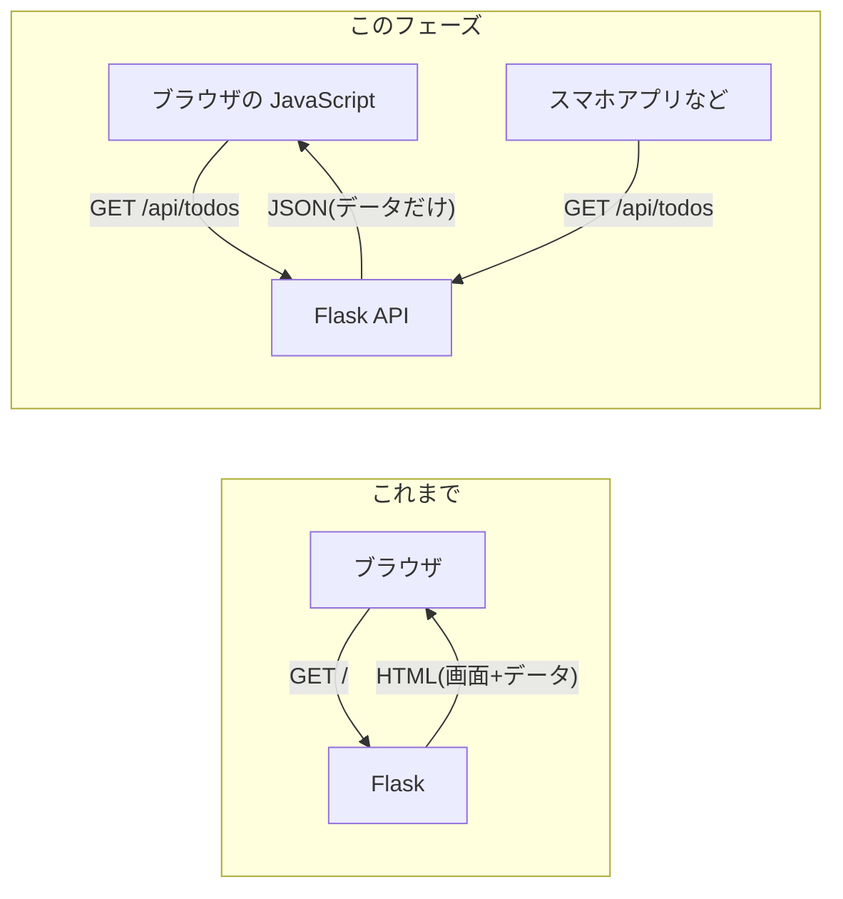
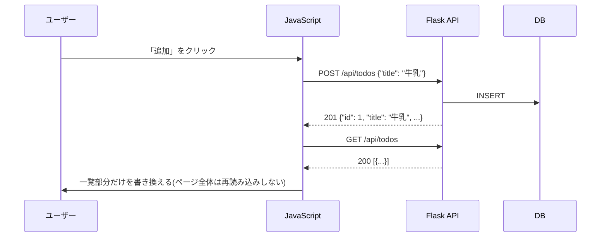

# フェーズ8:API化とフロントエンド分離

> **ゴール**:Todoの REST API(JSONを返すバックエンド)を作り、JavaScriptの画面から呼び出せる。APIのテストも書ける。

## 1. なぜ学ぶか

- フェーズ7までのアプリは、Flaskが **HTML(画面)とデータを一緒に** 返していました
- この形だと、スマホアプリや別の画面から同じTodoを使いたくなったときに、処理を再利用できません。また、ボタンを押すたびにページ全体が再読み込みされます
- 実際の開発では、**データを返す「API」** と **画面を作る「フロントエンド」** を分けるのが一般的です
- テストの面でも、HTMLの文字列を探すより、**JSONの値を確認する** ほうが正確で壊れにくくなります

## 2. 仕組みの解説

### 2-1. APIとは

**API** は、プログラム同士がやり取りするための窓口です。Web APIは、HTMLの代わりに **JSON**(データ)を返します。



### 2-2. REST の設計

**REST** は、APIを分かりやすく設計するための考え方です。「**何を**(URL=リソース)」と「**どうする**(HTTPメソッド)」を組み合わせます。

| 操作 | メソッド | URL | 成功時のステータス |
| --- | --- | --- | --- |
| 一覧取得 | GET | `/api/todos` | 200 OK |
| 追加 | POST | `/api/todos` | 201 Created |
| 1件取得 | GET | `/api/todos/1` | 200 OK |
| 更新 | PUT | `/api/todos/1` | 200 OK |
| 削除 | DELETE | `/api/todos/1` | 204 No Content |

エラーもステータスコードで表します(400:入力が不正、401:未ログイン、403:権限がない、404:存在しない)。

### 2-3. JavaScript と fetch

ブラウザの中で動くプログラミング言語が **JavaScript** です。

- **DOM操作**:HTMLの要素を取得・作成・書き換える(`document.querySelector`、`createElement`)
- **イベント**:クリックや送信などの操作に反応する(`addEventListener`)
- **fetch**:ページを移動せずに、裏でサーバーにリクエストを送る

```javascript
const response = await fetch("/api/todos");   // GET リクエストを送る
const todos = await response.json();          // JSON を受け取る
```

### 2-4. 画面遷移なしで更新される仕組み



フェーズ3のフォーム送信では「POST → リダイレクト → ページ全体を取得」でしたが、ここではJSONだけをやり取りし、JavaScriptが画面の一部を書き換えます。この考え方を発展させたものが **SPA(シングルページアプリケーション)** です。

### 2-5. API の認証と CORS

- このアプリでは、画面とAPIが **同じオリジン**(プロトコル・ドメイン・ポートが同じ)にあるため、ログイン時のセッションCookieがそのままAPIでも使えます
- 画面とAPIを **別のオリジン**(例:`localhost:3000` と `localhost:5001`)に置くと、ブラウザはセキュリティのため通信を制限します。これを許可する仕組みが **CORS** です
- スマホアプリなどCookieを使いにくいクライアントでは、**トークン**(ログイン時に発行される文字列)をリクエストヘッダーに付けて認証する方式がよく使われます

### 2-6. CSRF と XSS

| 攻撃 | 内容 | このアプリでの対策 |
| --- | --- | --- |
| CSRF | 罠サイトから、ログイン中のユーザーになりすましてリクエストを送らせる | セッションCookieに `SameSite=Lax` を設定し、他サイトからのPOSTにCookieを付けない |
| XSS | 入力欄にスクリプトを仕込み、他人のブラウザで実行させる | JavaScriptで表示するときは `innerHTML` ではなく `textContent` を使う |

> 本格的なアプリでは、CSRFトークン(Flask-WTF など)も併用します。

### 2-7.(発展)FastAPI

APIの作成に特化したPythonのフレームワークに **FastAPI** があります。型ヒントから入力チェックとAPI仕様書(Swagger UI)を自動で作ってくれるのが特徴です。この教材ではFlaskで学んだ知識を活かすため、Flaskで実装します。

## 3. ハンズオン

```bash
git switch -c feature/api
```

### Step 1. 既存サービスのAPI通信を観察する

GitHubやX(旧Twitter)などをChromeで開き、開発者ツール(`command + option + I`)のNetworkタブで **Fetch/XHR** に絞り込みます。

**期待される結果**:ページを操作すると、HTMLではなくJSONを返すリクエストが送られていることがわかる。

### Step 2. API の Blueprint を作る

`todo_app/api.py` を作成し、2-2 の5つのエンドポイントを実装します。完成例:[sample/todo_app/api.py](sample/todo_app/api.py)

これまでの画面(`todos.py`)は `@login_required` を使い、未ログインならログイン画面にリダイレクトしていました。APIでは、JavaScript側が困らないように「リダイレクト」ではなく **401というステータスコードをJSONで返す**必要があります。そのための専用の目印(**デコレーター**:関数の前に `@名前` と書いて、その関数に処理を追加する仕組み)を自分で作ります。

```python
from functools import wraps

from flask import Blueprint, abort, jsonify, request
from flask_login import current_user

from .extensions import db
from .models import Todo

bp = Blueprint("api", __name__, url_prefix="/api")


def api_login_required(view):
    """未ログインのときに、ログイン画面へリダイレクトせず401(JSON)を返す"""

    @wraps(view)
    def wrapped(*args, **kwargs):
        if not current_user.is_authenticated:
            abort(401)
        return view(*args, **kwargs)

    return wrapped


def todo_to_dict(todo):
    """Todo(モデルのオブジェクト)を、JSONにできる辞書に変換する"""
    return {
        "id": todo.id,
        "title": todo.title,
        "done": todo.done,
        "created_at": todo.created_at.isoformat(),
    }


@bp.get("/todos")
@api_login_required
def list_todos():
    """一覧を取得する:GET /api/todos"""
    todos = (
        db.session.execute(
            db.select(Todo).filter_by(user_id=current_user.id).order_by(Todo.id)
        )
        .scalars()
        .all()
    )
    return jsonify([todo_to_dict(todo) for todo in todos])
```

`@wraps(view)` は、デコレーターを作るときのお約束です(付けないと、Flaskがエンドポイントの名前を正しく認識できずエラーになることがあります)。`list_todos()` の中身自体は、これまでの `todos.py` の一覧取得とほぼ同じで、違うのは `render_template(...)` の代わりに `jsonify(...)` でJSONを返している点です。

残り4つのエンドポイント(追加・1件取得・更新・削除)も、同じ `@api_login_required` を付けて作ります。

| メソッド | URL | 関数名 | やること |
| --- | --- | --- | --- |
| POST | `/api/todos` | `create_todo` | `request.get_json()` でJSONを受け取り、追加して `201` を返す |
| GET | `/api/todos/<id>` | `get_todo` | 自分のTodoなら返す。他人のなら `403` |
| PUT | `/api/todos/<id>` | `update_todo` | タイトルや完了状態を更新する |
| DELETE | `/api/todos/<id>` | `delete_todo` | 削除して `204`(本文なし)を返す |

エラーもJSONで返すため、`@bp.errorhandler` を使います。詳しくは完成例を参照してください。

`todo_app/__init__.py` で Blueprint を登録します。

### Step 3. API を手で叩く

```bash
flask --app todo_app run --debug --port 5001
```

別のターミナルから curl で確認します。

```bash
# 未ログインなので 401 が返る
curl -i http://127.0.0.1:5001/api/todos

# ログインして Cookie を cookies.txt に保存する
curl -c cookies.txt -X POST -d "username=alice&password=password123" http://127.0.0.1:5001/login

# Cookie を付けて API を呼ぶ
curl -b cookies.txt -X POST -H "Content-Type: application/json" \
     -d '{"title": "牛乳を買う"}' http://127.0.0.1:5001/api/todos
curl -b cookies.txt http://127.0.0.1:5001/api/todos
curl -b cookies.txt -X PUT -H "Content-Type: application/json" \
     -d '{"done": true}' http://127.0.0.1:5001/api/todos/1
curl -b cookies.txt -X DELETE -i http://127.0.0.1:5001/api/todos/1
```

> 事前にブラウザで `alice` / `password123` のユーザーを登録しておいてください。`cookies.txt` は確認後に削除します。

**期待される結果**:それぞれのステータスコード(201・200・204)とJSONが返る。

### Step 4. JavaScript の画面を作る

1. `todo_app/templates/app.html` を作成し、`/app` で表示する(完成例:[sample/todo_app/templates/app.html](sample/todo_app/templates/app.html))
2. `todo_app/static/app.js` で、一覧取得・追加・完了切り替え・削除を実装する(完成例:[sample/todo_app/static/app.js](sample/todo_app/static/app.js))

2-3 で見た `fetch` はGETの例だけでした。ここでは、JSONを **送る** POSTと、送った後に **画面を書き換える** 処理を組み合わせます。追加処理を例に見てみましょう。

```javascript
const API_URL = "/api/todos";
const list = document.querySelector("#todo-list");

function createTodoElement(todo) {
  const li = document.createElement("li");
  const title = document.createElement("span");
  title.textContent = todo.title;   // XSS対策(2-6参照):innerHTMLではなくtextContentを使う
  li.append(title);
  return li;
}

async function loadTodos() {
  const response = await fetch(API_URL);
  const todos = await response.json();
  list.replaceChildren(...todos.map(createTodoElement));
}

async function addTodo(title) {
  await fetch(API_URL, {
    method: "POST",
    headers: { "Content-Type": "application/json" },
    body: JSON.stringify({ title }),
  });
  await loadTodos();
}

loadTodos();
```

- `document.createElement("li")`:HTMLタグを、画面に表示する前にJavaScript側で組み立てる方法です
- `list.replaceChildren(...)`:`list` の中身をまるごと新しい要素に差し替えます
- `method: "POST"` と `body: JSON.stringify(...)`:GET以外のリクエストでは、どんな操作か(`method`)と送るデータ(`body`)を指定します

完成例の [sample/todo_app/static/app.js](sample/todo_app/static/app.js) には、これに加えて共通の `request()` 関数・完了切り替え・削除・フォーム送信時の処理があります。同じ考え方の繰り返しなので、見比べながら実装してみましょう。

**期待される結果**:`http://127.0.0.1:5001/app` でTodoを追加すると、**ページが再読み込みされずに** 一覧が更新される。Networkタブで `api/todos` へのリクエストを確認しましょう。

### Step 5. XSS 対策を確認する

タイトルに `<b>太字</b>` と入力して追加します。

**期待される結果**:太字にならず、`<b>太字</b>` という文字のまま表示される。`app.js` の `textContent` を `innerHTML` に変えるとどうなるか試し、必ず元に戻します。

### Step 6. API のテストを書く

[sample/tests/test_api.py](sample/tests/test_api.py) を参考に、ステータスコードとJSONの中身を確認するテストを書きます。

```bash
pytest -v
```

### Step 7. API仕様書を書く

[sample/docs/api.md](sample/docs/api.md) を参考に、エンドポイント・リクエスト・レスポンスをまとめます。APIを使う人(未来の自分を含む)のための説明書です。

### Step 8. プルリクエストでマージする

```bash
git add .
git commit -m "Todo APIとJavaScript版の画面を追加"
git push -u origin feature/api
```

GitHubでプルリクエストを作成し、マージします。

## 4. 確認課題

- [ ] `GET /api/todos?done=false` で未完了のTodoだけを返せるようにし、テストを追加する
- [ ] JavaScript版の画面に、タイトルの編集機能(`PUT /api/todos/{id}`)を追加する
- [ ] 確認課題1の内容をAPI仕様書に追記する

## 5. 振り返り

- フェーズ3の「フォーム送信」と、今回の「fetch」では、通信の流れの何が違う?
- HTMLの文字列を確認するテストと、JSONを確認するテストでは、どちらが壊れにくい?それはなぜ?
- このアプリを、別のPCや別のメンバーの環境で動かそうとしたら、何が大変そう?(→ フェーズ9へ)

## このフェーズのファイル

```
sample/
├── todo_app/
│   ├── api.py               … REST API(新規)
│   ├── __init__.py          … api を登録、SameSite 設定を追加
│   ├── todos.py             … /app(JavaScript版の画面)を追加
│   ├── templates/app.html   … JavaScript版の画面(新規)
│   └── static/app.js        … fetch で API を呼ぶ処理(新規)
├── tests/test_api.py        … API のテスト(新規)
└── docs/api.md              … API仕様書(新規)
```

## よくあるエラー

| エラー・症状 | 原因 | 対処 |
| --- | --- | --- |
| APIが `415 Unsupported Media Type` / JSONが取れない | `Content-Type: application/json` を付けていない | リクエストヘッダーを確認する |
| ブラウザで `Uncaught SyntaxError` | JavaScriptの書き間違い | 開発者ツールの **Console** タブで行番号を確認する |
| `app.js` の変更が反映されない | ブラウザのキャッシュ | スーパーリロード(`command + shift + R`) |
| curl で401が返り続ける | Cookieを付けていない | `-b cookies.txt` を付ける |
