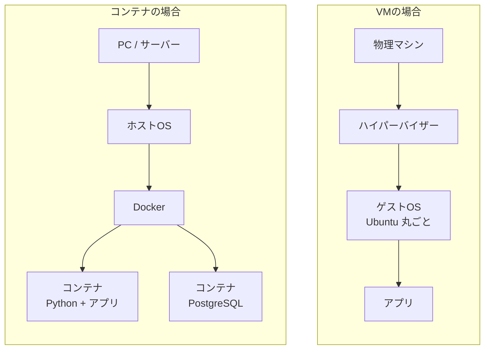
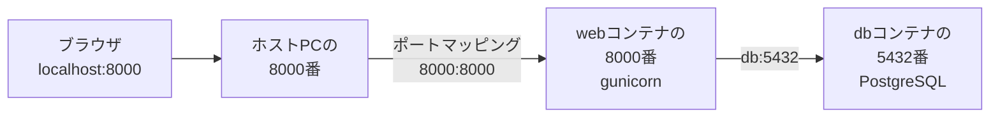

# フェーズ9:Dockerによるコンテナ化

> **ゴール**:アプリとデータベース(PostgreSQL)をDocker Composeで定義し、`docker compose up` の1コマンドで誰の環境でも同じように起動できる。

## 1. なぜ学ぶか

- フェーズ6では、VMにPython・ライブラリ・設定を **手作業で** 1つずつ準備しました。手順が多く、1つ間違えると動きませんでした
- 「自分のPCでは動くのに、サーバーや他の人のPCでは動かない」という問題は、Pythonのバージョンやライブラリ、OSの違いから起きます
- 本番で使われることの多い **PostgreSQL**(多くの企業で使われる本格的なデータベースソフト)を使いたいが、PCに直接インストールして環境を汚したくない
- **Docker** を使うと、アプリと実行環境を「箱(コンテナ)」に詰めて、どこでも同じように動かせます

## 2. 仕組みの解説

### 2-1. コンテナとは



**ハイパーバイザー** は、1台の物理マシンの中に複数の仮想的なマシン(VM)を作り出す、仕切り役のソフトです。マンションに例えると、VMは「1部屋ごとに建物(OS)をまるごと新築する」ような方式、コンテナは「同じ建物の中を間仕切りで分ける」ような方式です。間仕切りだけで済む分、コンテナは軽くて速いのです。

| | VM(フェーズ6) | コンテナ |
| --- | --- | --- |
| 中身 | OSを丸ごと持つ | アプリと必要なライブラリだけ |
| 起動時間 | 数十秒〜数分 | 数秒 |
| サイズ | 数GB | 数十MB〜数百MB |
| 環境の再現 | 手作業の手順書 | Dockerfile(コード) |

### 2-2. イメージとコンテナ

| | 意味 | 例え |
| --- | --- | --- |
| **イメージ** | アプリと実行環境をまとめた「設計図」。読み取り専用 | レシピ・型 |
| **コンテナ** | イメージから起動した「実体」。何個でも作れる | 型から作ったお菓子 |
| **Dockerfile** | イメージの作り方を書いたファイル | レシピの手順書 |

お菓子作りに例えると、Dockerfileは「レシピ」、イメージは「レシピから作った型」、コンテナは「その型から出来上がったお菓子」です。同じ型(イメージ)があれば、何個でも同じお菓子(コンテナ)を作れます。

### 2-3. Dockerfile は「フェーズ6の手順書」をコードにしたもの

| フェーズ6の手作業 | Dockerfile |
| --- | --- |
| Ubuntu の VM を作成する | `FROM python:3.12-slim` |
| `cd ~/my-todo-app` | `WORKDIR /app` |
| `git clone` | `COPY . .` |
| `pip install -r requirements.txt` | `RUN pip install -r requirements.txt` |
| systemd で gunicorn を起動する | `CMD ["gunicorn", ...]` |

### 2-4. ポートマッピング

コンテナは、ホストPCから隔離された **専用のネットワーク** を持っています。外からアクセスするには、ホストのポートとコンテナのポートをつなぐ必要があります。



> フェーズ6では gunicorn を `127.0.0.1` で待ち受けましたが、コンテナでは `0.0.0.0` で待ち受けます。コンテナの外(ホストPC)から届くリクエストを受け付ける必要があるためです。外部に公開するかどうかは、ポートマッピングで制御します。

> **よくある勘違い**:`-p 8080:80` の順番は **「ホストの番号:コンテナの番号」** です。左右を逆にすると、意図したポートにつながりません。覚え方は「外側(ホスト)が左、内側(コンテナ)が右」です。

### 2-5. ボリューム

コンテナを削除すると、コンテナの中で作られたファイルも消えます。USBメモリや外付けハードディスクのように、コンテナの外に置いておけば、コンテナを作り直しても消えない保管庫が **ボリューム** です。DBのデータのように残したいものは、ボリュームに保存します。

### 2-6. Docker Compose

複数のコンテナ(アプリ・DB)の設定を `compose.yaml` にまとめ、一括で起動・停止する仕組みです。
Compose で起動したコンテナ同士は、**サービス名**(`db` など)をホスト名として通信できます。

### 2-7. 環境変数による設定の切り替え

**環境変数** とは、プログラムの外側からOSを通じて渡す設定値のことで、フェーズ5の `SECRET_KEY` と同じ仕組みです。海外旅行で使うコンセントの変換プラグのように、同じアプリのコードでも、差し込む先(接続先)を環境ごとに切り替えられます。
同じコードを、開発ではSQLite、Docker ではPostgreSQL、本番ではクラウドのDBにつなげるため、接続先を環境変数 **`DATABASE_URL`** で渡します。

```python
SQLALCHEMY_DATABASE_URI=os.environ.get("DATABASE_URL", "sqlite:///todo.db")
```

## 3. ハンズオン

### Step 1. Docker をインストールする

[Docker Desktop](https://www.docker.com/products/docker-desktop/) をインストールします。ダウンロード時は、フェーズ0で確認したチップに合わせて **Apple Silicon 版** か **Intel 版** を選びます(Homebrew の場合は `brew install --cask docker`)。

インストール後、アプリケーションフォルダから **Docker** を起動し、メニューバーにクジラのアイコンが表示されるまで待ちます。

```bash
docker --version
docker compose version
```

> Docker Desktop は、個人利用や小規模な組織では無料ですが、一定規模以上の企業での業務利用には有料のサブスクリプションが必要です。会社のMacで学習する場合は、利用条件を確認してください。
>
> Apple シリコンのMacでは、コンテナは **arm64** 版のイメージで動きます。`python:3.12-slim` や `postgres:16` は両方に対応しているため、そのまま使えます(クラウドに持っていくときの注意はフェーズ11で扱います)。

### Step 2. 既成のイメージを動かしてみる

```bash
docker run --rm -p 8080:80 nginx
```

**期待される結果**:ブラウザで `http://localhost:8080` を開くと、nginx の歓迎ページが表示される。フェーズ6でVMにインストールしたnginxが、**1コマンドで** 動きました。`control + C` で停止します。

`-p 8080:80` を `-p 9090:80` に変えると、どのURLで表示されるか試してみましょう。

### Step 3. アプリを PostgreSQL に対応させる

DBの種類を変える大きめの変更なので、専用のブランチで作業します。

```bash
git switch -c feature/docker
```

PythonからPostgreSQLに接続するには、専用の橋渡し役となるライブラリ(**ドライバ**)が必要です。`psycopg` はPythonでPostgreSQLを扱うときの定番ライブラリです。

```bash
uv pip install "psycopg[binary]"
```

- `requirements.txt` に `psycopg[binary]` を追加する
- `todo_app/__init__.py` で、DBの接続先を環境変数 `DATABASE_URL` から読むようにする(2-7)

### Step 4. Dockerfile を書く

`Dockerfile` に、イメージの作り方を1行ずつ書いていきます。2-3 の表と見比べながら、各行がフェーズ6のどの作業に当たるかを確認しましょう。

まず、土台となるPythonと作業フォルダを用意します。

```dockerfile
FROM python:3.12-slim

ENV PYTHONUNBUFFERED=1 \
    PYTHONDONTWRITEBYTECODE=1

WORKDIR /app
```

- `FROM`:どのイメージを土台にするかを指定します。`python:3.12-slim`は、Python 3.12が最初から入った軽量なLinuxです
- `WORKDIR`:これ以降のコマンドを実行する、コンテナ内の作業フォルダを指定します

次に、ライブラリをインストールします。

```dockerfile
COPY requirements.txt .
RUN pip install --no-cache-dir -r requirements.txt

COPY . .
```

`requirements.txt`だけを先にコピーしてインストールしているのには理由があります。Dockerは「前回から変わっていない行」の結果を使い回す(**キャッシュ**)仕組みを持っています。アプリのコード(`COPY . .`)はよく変わりますが、依存ライブラリ(`requirements.txt`)はあまり変わりません。先にライブラリだけをコピー・インストールしておけば、コードを1行変えただけのときにライブラリの再インストールを省略でき、ビルドが速くなります。

最後に、実行時の設定をします。

```dockerfile
RUN useradd --create-home appuser && chown -R appuser /app
USER appuser

EXPOSE 8000

CMD ["gunicorn", "--workers", "1", "--threads", "4", "--bind", "0.0.0.0:8000", "wsgi:app"]
```

- `RUN useradd ... && chown ...` と `USER appuser`:管理者権限を持つ`root`ユーザーのままアプリを動かすと、もし脆弱性を突かれたときの被害が大きくなります。そのため一般ユーザー(`appuser`)を作り、そのユーザーとしてアプリを動かします
- `EXPOSE`:このコンテナが何番のポートを使うつもりかを示す、ドキュメント的な記述です(実際にポートを公開するかはStep5の`-p`オプションで決まります)
- `CMD`:コンテナが起動したときに実行するコマンドです。`8000`番で待ち受けさせます(フェーズ11でこのポート番号に合わせてクラウド側の設定を行います)

[sample/Dockerfile](sample/Dockerfile) が完成形です。

`.dockerignore` も作成します(例:[sample/.dockerignore](sample/.dockerignore))。`.gitignore` と同じ考え方のファイルです。`.gitignore` がGitの管理対象から外すのに対し、`.dockerignore` は **イメージに含めないファイル**(`.venv/` など)を指定します。不要なファイルが入らないため、イメージが軽くなり、ビルドも速くなります。

### Step 5. イメージをビルドしてコンテナで起動する

```bash
docker build -t my-todo-app .
docker images                     # イメージができたことを確認
docker run --rm -p 8000:8000 --env-file .env my-todo-app
```

**期待される結果**:`http://localhost:8000` でアプリが表示される(この時点ではコンテナ内のSQLiteを使っている)。

コンテナを止めて、もう一度起動するとデータはどうなるでしょうか?(ヒント:2-5)

### Step 6. Docker Compose でアプリと PostgreSQL を起動する

`compose.yaml` に、`web`(アプリ)と `db`(PostgreSQL)という2つのコンテナの設定をまとめて書きます。

```yaml
services:
  web:
    build: .
    ports:
      - "8000:8000"
    env_file:
      - .env
    environment:
      DATABASE_URL: postgresql+psycopg://todo:todo@db:5432/todo
    depends_on:
      db:
        condition: service_healthy
```

- `build: .`:このフォルダの`Dockerfile`からイメージをビルドして使う、という意味です
- `env_file`:`.env`の中身を、そのままコンテナの環境変数として渡します
- `environment`:接続先のホスト名が`db`になっているのは、2-6で説明した「サービス名がそのままホスト名になる」という仕組みを使っているためです
- `depends_on` と `condition: service_healthy`:ただ「先に起動する」だけでは不十分です。PostgreSQLは起動を開始してから接続を受け付けられるようになるまで少し時間がかかるため、「`db`が**起動完了した**(ヘルスチェックに成功した)のを待ってから`web`を起動する」という指定です

続けて、`db`の設定を書きます。

```yaml
  db:
    image: postgres:16
    environment:
      POSTGRES_USER: todo
      POSTGRES_PASSWORD: todo
      POSTGRES_DB: todo
    volumes:
      - db-data:/var/lib/postgresql/data
    healthcheck:
      test: ["CMD-SHELL", "pg_isready -U todo -d todo"]
      interval: 5s
      timeout: 3s
      retries: 10

volumes:
  db-data:
```

- `image: postgres:16`:自分でDockerfileを書かず、公式に配布されているPostgreSQLのイメージをそのまま使います
- `healthcheck`:「このコンテナが本当に使える状態か」を定期的に確認する設定です。`pg_isready`はPostgreSQLに同梱されているコマンドで、接続可能になったかを教えてくれます。これが成功して初めて、上の`depends_on`の条件が満たされます
- `volumes`:2-5で説明したボリュームです。コンテナを削除してもデータが残るよう、DBのデータだけは外部に保存します

[sample/compose.yaml](sample/compose.yaml) が完成形です。書けたら起動します。

```bash
docker compose up --build
```

**期待される結果**:`web` と `db` の2つのコンテナが起動し、`http://localhost:8000` でアプリが使える。

別のターミナルで状態を確認します。

```bash
docker compose ps                      # 起動中のコンテナ一覧
docker compose logs web                # web のログ
docker compose exec db psql -U todo -d todo -c 'SELECT * FROM todo;'   # DBの中身
```

### Step 7. ボリュームでデータが残ることを確認する

```bash
docker compose down        # コンテナを削除(ボリュームは残る)
docker compose up          # 再度起動
```

**期待される結果**:登録したユーザーやTodoが残っている。

```bash
docker compose down -v     # -v を付けるとボリュームも削除される(データが消える)
```

### Step 8. コンテナの中でテストを実行する

```bash
docker compose run --rm web sh -c "pip install --user -r requirements-dev.txt && python -m pytest"
```

**期待される結果**:自分のPCにPythonの環境がなくても、コンテナの中でテストが通る。

### Step 9. 別の場所から起動できるか確認する

```bash
git add .
git commit -m "Docker Composeで起動できるようにする"
git push -u origin feature/docker
cd /tmp
git clone -b feature/docker https://github.com/あなたのユーザー名/my-todo-app.git docker-check
cd docker-check
cp .env.example .env    # SECRET_KEY を設定する
docker compose up --build
```

**期待される結果**:Python や PostgreSQL のインストールなしで、アプリが起動する。確認後、プルリクエストでマージします。

## 4. 確認課題

- [ ] DB管理ツール **Adminer**(`adminer` イメージ)を `compose.yaml` に追加し、ブラウザからDBのテーブルとデータを確認する
- [ ] `Dockerfile` の `COPY requirements.txt .` と `RUN pip install` を `COPY . .` の後ろに移動し、コードを1行変えたときのビルド時間の違いを比べる。なぜ差が出るか説明する(確認後は元に戻す)
- [ ] `docker compose exec web sh` でコンテナに入り、`whoami` と `ls` を実行する。root ではなく `appuser` で動いている理由を説明する

## 5. 振り返り

- フェーズ6の手作業のうち、Dockerfile で自動化できたものと、まだできていないもの(ファイアウォール、HTTPS など)は?
- `DATABASE_URL` を環境変数にしたことで、何ができるようになった?
- Step 8 でテストを実行しましたが、毎回自分で実行するのを忘れたことはない?(→ フェーズ10へ)

## このフェーズのファイル

```
sample/
├── Dockerfile        … アプリのイメージの作り方(新規)
├── .dockerignore     … イメージに含めないファイル(新規)
├── compose.yaml      … web と db をまとめて起動する設定(新規)
├── requirements.txt  … psycopg を追加
└── todo_app/__init__.py … DATABASE_URL を環境変数から読む
```

> フェーズ6・7の `deploy/`(nginx・systemd)は、VMを削除したため以降のサンプルには含めていません。

## よくあるエラー

| エラー・症状 | 原因 | 対処 |
| --- | --- | --- |
| `Cannot connect to the Docker daemon` | Docker Desktop が起動していない | Docker Desktop を起動し、メニューバーのクジラのアイコンが落ち着くまで待つ |
| ビルドやディスクが極端に遅い・容量不足 | 古いイメージやキャッシュがたまっている | `docker system df` で確認し、`docker system prune` で削除 |
| `port is already allocated` | ホストの8000番を別のプロセスが使っている | 他のサーバーを止めるか、`"8001:8000"` に変える |
| `connection refused`(db) | DBの起動前にwebが接続した | `depends_on` の `condition: service_healthy` を確認する |
| `KeyError: 'SECRET_KEY'` / `SECRET_KEY が設定されていません` | `.env` がない | `cp .env.example .env` して値を設定する |
| コードを変えても反映されない | イメージを作り直していない | `docker compose up --build` |
