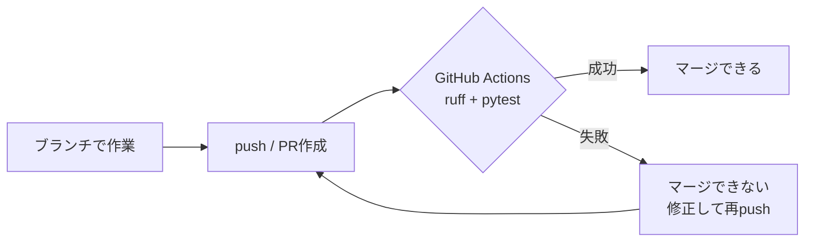

# フェーズ10:CI(GitHub Actionsで自動テスト)

> **ゴール**:プルリクエストを作るたびに、コードチェックとテストが自動で実行され、失敗したらマージできない状態にする。

## 1. なぜ学ぶか

- フェーズ7でテストを書きましたが、**実行を忘れたら意味がありません**
- 「自分のPCでは通った」は、他の人の環境や本番で通る保証になりません
- チームで開発するときは、**誰の変更でも、同じ環境で、必ずテストが通っていること** を確認してから取り込みたい
- これを自動化する仕組みが **CI(継続的インテグレーション)** です

## 2. 仕組みの解説

### 2-1. CIとは

**CI(Continuous Integration:継続的インテグレーション)** は、コードの変更を取り込むたびに、自動でビルドやテストを行う習慣と仕組みのことです。



### 2-2. GitHub Actions の構成

| 用語 | 意味 | このアプリでは |
| --- | --- | --- |
| ワークフロー | 自動化の手順をまとめたもの(YAMLファイル) | `.github/workflows/ci.yml` |
| トリガー(`on`) | いつ実行するか | main への push、プルリクエスト |
| ジョブ(`jobs`) | 1台のマシンで行う作業のまとまり | `test` |
| ステップ(`steps`) | ジョブの中の1つ1つの作業 | checkout → Python準備 → インストール → ruff → pytest |
| ランナー | ジョブを実行する仮想マシン | `ubuntu-latest` |

### 2-3. ランナーで何が起きているか

ランナーは、**ジョブのたびに新しく用意される、まっさらなUbuntuマシン** です。
そのため、フェーズ6でVMに対して行ったのと同じように、「コードを取得 → Pythonを準備 → ライブラリをインストール → 実行」をすべてワークフローに書く必要があります。終わったらマシンは破棄されます。

### 2-4. サービスコンテナ

ジョブの中で、PostgreSQL などのコンテナを一緒に起動できます。これにより、**本番と同じ種類のDB** でテストできます。
(SQLiteでは通るのに、PostgreSQLでは失敗する、という違いを早く見つけられます)

### 2-5. リンターとフォーマッター

| 道具 | 役割 |
| --- | --- |
| リンター(`ruff check`) | 使っていない変数・import、バグになりやすい書き方を指摘する |
| フォーマッター(`ruff format`) | インデントや改行などの書き方を自動でそろえる |

書き方の議論をレビューで行う必要がなくなり、**本質的な内容のレビューに集中** できます。

### 2-6. ブランチ保護

GitHubの設定で、「CIが成功しないと main にマージできない」というルールを設定できます。人間の注意力に頼らず、**仕組みで品質を守る** ことができます。

## 3. ハンズオン

```bash
git switch -c feature/ci
```

### Step 1. ruff を導入する

```bash
pip install ruff
```

`pyproject.toml` に ruff の設定を追加し(例:[sample/pyproject.toml](sample/pyproject.toml))、`requirements-dev.txt` に `ruff` を追加します。

```bash
ruff check .            # 問題点を表示
ruff check . --fix      # 自動で直せるものは直す
ruff format .           # 書き方をそろえる
```

**期待される結果**:最後に `ruff check .` と `ruff format --check .` を実行し、どちらもエラーが出ない。

### Step 2. テストで使うDBを環境変数で切り替える

CIでは PostgreSQL でテストするため、`tests/conftest.py` を、環境変数 `TEST_DATABASE_URL` があればそのDBを使うように変更します(例:[sample/tests/conftest.py](sample/tests/conftest.py))。

### Step 3. ワークフローを作成する

リポジトリのルートに `.github/workflows/ci.yml` を作成します。完成例:[sample/.github/workflows/ci.yml](sample/.github/workflows/ci.yml)

> **注意**:ワークフローファイルは、**リポジトリのルート直下** の `.github/workflows/` に置かないと動きません。この教材リポジトリの `sample/` の中にあるファイルは、参考用のため実行されません。

### Step 4. push して、Actions タブでログを読む

```bash
git add .
git commit -m "GitHub ActionsでCIを追加"
git push -u origin feature/ci
```

GitHubでプルリクエストを作成し、**Actions** タブ(またはPRの **Checks**)を開きます。

**期待される結果**:各ステップが緑のチェックになる。ステップをクリックしてログを開き、手元で実行していたコマンドと同じものが実行されていることを確認する。

### Step 5. わざと失敗させる

1. テストの期待値をわざと間違えて(例:`"牛乳を買う"` → `"牛乳を買わない"`)push する
2. CIが赤くなり、ログのどこで失敗したかを確認する
3. 元に戻して push し、緑に戻ることを確認する

### Step 6. ブランチ保護を設定する

1. リポジトリの **Settings → Branches(または Rules → Rulesets)** を開く
2. `main` を対象に、**Require status checks to pass** を有効にし、`test` ジョブを必須にする
3. CIが失敗するPRを作り、**Merge ボタンが押せない** ことを確認する

### Step 7. マージする

CIが通った状態のプルリクエストをマージします。

## 4. 確認課題

- [ ] README.md に CI のステータスバッジを表示する(Actions → ワークフロー → **…** → **Create status badge**)
- [ ] pip のキャッシュ(`cache: pip`)を外した場合と付けた場合で、「Install dependencies」ステップの実行時間を比べる
- [ ] ワークフローに `docker build .` を実行するステップを追加し、DockerイメージがビルドできることもCIで確認する

## 5. 振り返り

- CIのログに出ている各ステップは、これまで自分のPCやVMで手作業でやっていたことのどれに当たる?
- ブランチ保護を設定すると、チーム開発で何が安心になる?
- テストが通ったコードを、次は **自動で本番に届けたい**。そのために、まずフェーズ6のVMの代わりにどこで動かせばよいだろう?(→ フェーズ11へ)

## このフェーズのファイル

```
sample/
├── .github/workflows/ci.yml   … CIのワークフロー(新規)
├── pyproject.toml             … ruff の設定を追加
├── requirements-dev.txt       … ruff を追加
└── tests/conftest.py          … TEST_DATABASE_URL に対応
```

## よくあるエラー

| エラー・症状 | 原因 | 対処 |
| --- | --- | --- |
| Actions タブに何も表示されない | ワークフローの場所が違う | ルート直下の `.github/workflows/` にあるか確認 |
| `Invalid workflow file` | YAMLのインデントが崩れている | スペースでそろえる(タブは使えない) |
| ruff のステップで失敗する | 手元で format していない | `ruff format .` と `ruff check . --fix` を実行してから push |
| DB接続エラー(CIのみ) | サービスコンテナの起動待ちが足りない、URLの誤り | `options` の health check と `TEST_DATABASE_URL` を確認 |
