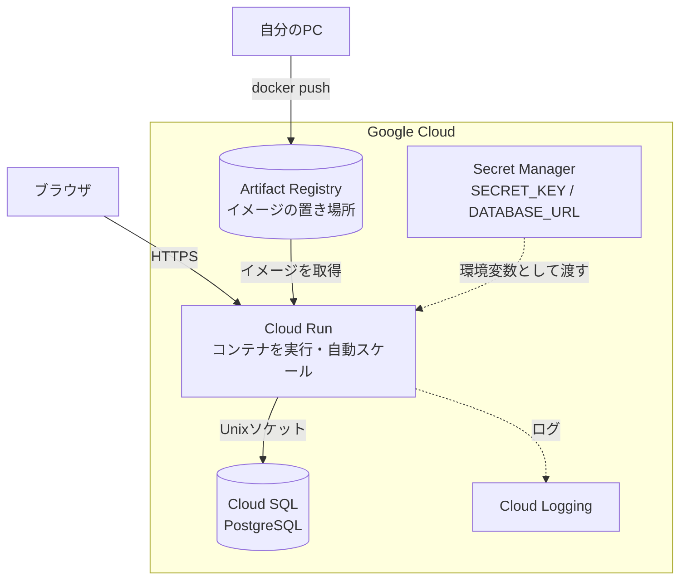

# フェーズ11:クラウドへコンテナデプロイ【デプロイ③】

> **ゴール**:フェーズ9で作ったDockerイメージを、クラウドのマネージドサービス(Cloud Run)で公開し、マネージドDB(Cloud SQL)に接続できる。フェーズ6のVM構成と比べて、何をクラウドに任せたのかを説明できる。

## 1. なぜ学ぶか

フェーズ6のVMでは、次のような作業をすべて自分で行う必要がありました。

- OSやソフトウェアのアップデート、セキュリティ対策
- nginx・gunicorn・systemd の設定
- HTTPS証明書の取得と更新
- アクセスが増えたときのサーバー増強、障害時の復旧
- DBのバックアップ

**マネージドサービス** を使うと、これらをクラウド事業者に任せ、**「コンテナイメージを渡すだけ」** でアプリを公開できます。

## 2. 仕組みの解説

### 2-1. どこまで自分で管理するか

| | IaaS(フェーズ6) | PaaS / サーバーレス(このフェーズ) |
| --- | --- | --- |
| サービス例 | Compute Engine / EC2 | Cloud Run / ECS on Fargate |
| 自分で管理するもの | OS・ミドルウェア・アプリ・スケール | **アプリ(コンテナ)だけ** |
| HTTPS | 自分で証明書を設定 | 自動 |
| アクセスが増えたら | 自分でサーバーを増やす | 自動でコンテナが増える |
| 料金 | 起動している時間 | 主にリクエストを処理した時間 |

### 2-2. 全体構成



### 2-3. フェーズ6との対応

| フェーズ6(VM)で自分がやったこと | このフェーズで代わりにやってくれるもの |
| --- | --- |
| VMの作成・OSの管理 | Cloud Run |
| nginx(HTTPS・リバースプロキシ) | Cloud Run(HTTPSのURLを自動発行) |
| systemd(常駐・自動再起動) | Cloud Run(コンテナが落ちたら自動で再起動) |
| `git clone` + `pip install` | Dockerイメージ(Artifact Registry から取得) |
| `.env` ファイル | Secret Manager |
| SQLite ファイル | Cloud SQL(バックアップ・障害対応つき) |
| ファイアウォールの設定 | Cloud Run(HTTPSのみ受け付ける) |
| `journalctl` / nginx のログ | Cloud Logging |

### 2-4. コンテナレジストリ

**Artifact Registry**(AWSでは ECR)は、Dockerイメージを保存する場所です。GitHubがコードの置き場所であるように、レジストリは **イメージの置き場所** です。

### 2-5. シークレット管理

`SECRET_KEY` やDBのパスワードは、イメージの中に入れてはいけません(イメージを見られると漏れるため)。
**Secret Manager** に保存し、Cloud Run の起動時に環境変数として渡します。アプリのコードは `os.environ` から読むだけなので、**フェーズ5から1行も変更していません**。

### 2-6. IAM と最小権限の原則

**IAM** は、「誰が」「何に対して」「何をしてよいか」を管理する仕組みです。
Cloud Run 専用の **サービスアカウント**(アプリ用のアカウント)を作り、必要な権限だけを与えます。

| 権限 | 理由 |
| --- | --- |
| `roles/cloudsql.client` | Cloud SQL に接続するため |
| `roles/secretmanager.secretAccessor`(2つのシークレットにだけ) | 秘密情報を読むため |

必要以上の権限を与えないことを **最小権限の原則** と呼びます。万が一アプリが乗っ取られても、被害を小さく抑えられます。

### 2-7. ヘルスチェック

`/health` は、「アプリが起動していて、DBにもつながっているか」を返すエンドポイントです。監視サービスやデプロイの自動確認(フェーズ12)で使います。

### 2-8. リビジョンとロールバック

Cloud Run では、デプロイのたびに **リビジョン**(バージョン)が作られます。新しいバージョンに問題があれば、**前のリビジョンにトラフィックを戻す** だけで元に戻せます。

### AWSで実施する場合の対応

| Google Cloud | AWS |
| --- | --- |
| Cloud Run | ECS on Fargate(+ Application Load Balancer) |
| Artifact Registry | ECR |
| Cloud SQL | RDS for PostgreSQL |
| Secret Manager | Secrets Manager / SSM Parameter Store |
| IAM サービスアカウント | IAM ロール(タスクロール) |
| Cloud Logging | CloudWatch Logs |

## 3. ハンズオン

コマンドは [sample/deploy/gcp/commands.sh](sample/deploy/gcp/commands.sh) にまとめています。**一度に実行せず**、各Stepに対応するブロックをコピーして実行してください。

### Step 0. 課金の確認(必須)

- 予算アラートが設定されていることを確認する
- **Cloud SQL には無料枠がありません**。最小構成でも、起動している間は料金がかかります。このフェーズとフェーズ12が終わったら、必ず「後片付け」を実行してください

### Step 1. /health エンドポイントを追加する

```bash
git switch -c feature/cloud-run
```

`todo_app/__init__.py` に `/health` を追加し、テストを書きます(例:[sample/tests/test_health.py](sample/tests/test_health.py))。CIが通ることを確認してマージします。

### Step 2. gcloud CLI をセットアップする

[Google Cloud CLI のインストール手順](https://cloud.google.com/sdk/docs/install) の **macOS** の項目に従い、自分のチップ(Apple シリコン / Intel)に合ったパッケージをインストールします。インストールの途中で PATH の設定を聞かれたら `Y` を選び、ターミナルを開き直してから `gcloud --version` で確認します。

その後、`commands.sh` の **0** と **1** を実行します。

### Step 3. イメージを Artifact Registry に push する

`commands.sh` の **2** を実行します。

**期待される結果**:GCPコンソールの **Artifact Registry** に `web:v1` が表示される。

> **Apple シリコンのMacでは特に重要です。** そのままビルドすると arm64 用のイメージになり、Cloud Run(amd64)では起動しません。`--platform linux/amd64` を必ず付けます。この場合、Mac上で amd64 の環境を再現しながらビルドするため、普段より時間がかかります。
>
> 「自分のPCの環境」と「本番の環境」が違うと動かない、という問題の実例です。フェーズ12では、amd64 の GitHub Actions のランナーでビルドするため、この指定は不要になります。

### Step 4. Cloud SQL を作成する

`commands.sh` の **3** を実行します。作成には数分かかります。

### Step 5. 秘密情報を Secret Manager に登録する

`commands.sh` の **4** を実行します。

**期待される結果**:GCPコンソールの **Secret Manager** に2つのシークレットが表示される。値はターミナルの履歴以外には残っていません。

### Step 6. サービスアカウントを作り、必要な権限だけを付ける

`commands.sh` の **5** を実行します。

### Step 7. Cloud Run にデプロイする

`commands.sh` の **6** を実行します。

**期待される結果**:`https://todo-xxxxx-an.a.run.app` のようなURLが表示され、**最初からHTTPS** でアプリが使える。`/health` を開くと `{"status": "ok"}` が返る。

### Step 8. ログを確認する

GCPコンソールの **Cloud Run → todo → ログ** を開き、自分のアクセスの記録を探します(`commands.sh` の **7** でも確認できます)。

### Step 9. 新しいバージョンをデプロイし、ロールバックする

1. 画面の文言を変更し、`v2` タグでイメージをビルド・pushする
2. `--image="${IMAGE}:v2"` で再度 `gcloud run deploy` する
3. `gcloud run revisions list` でリビジョンが2つあることを確認する
4. `update-traffic` で `v1` のリビジョンに戻し、文言が元に戻ることを確認する

### 後片付け

フェーズ12でも同じ環境を使います。**フェーズ12が終わったら**、`commands.sh` の **8** を実行してすべて削除してください。

## 4. 確認課題

- [ ] フェーズ6のVM構成と、このフェーズの構成を、「自分で管理するもの・HTTPS・スケール・料金・デプロイの手間」の観点で比較表にまとめる
- [ ] Cloud Run の **リビジョン** 画面で、v1 と v2 にトラフィックを 50% ずつ振り分け、再読み込みのたびに表示が変わることを確認する(カナリアリリースの体験)
- [ ] (任意)独自ドメインを Cloud Run にマッピングする

## 5. 振り返り

- 2-3 の表を見ながら、フェーズ6で手作業だったことが、それぞれ何に置き換わったかを説明してみよう
- `SECRET_KEY` をイメージに含めず、Secret Manager から渡すのはなぜ?
- 「コードを変更してから本番に反映されるまで」の手順を書き出すと、何ステップある?その中で、人間がやる必要のない作業はどれ?(→ フェーズ12へ)

## このフェーズのファイル

```
sample/
├── todo_app/__init__.py      … /health を追加
├── tests/test_health.py      … ヘルスチェックのテスト(新規)
└── deploy/gcp/commands.sh    … GCPの構築・デプロイ手順(新規)
```

## よくあるエラー

| エラー・症状 | 原因 | 対処 |
| --- | --- | --- |
| `exec format error`(Cloud Runのログ) | Apple シリコンのMacでビルドした arm64 イメージ | `--platform linux/amd64` でビルドし直す |
| `Container failed to start ... PORT=8080` | アプリが `PORT` 環境変数のポートで待ち受けていない | Dockerfile の `${PORT:-8000}` を確認 |
| `Permission denied on secret` | サービスアカウントにシークレットの権限がない | Step 6 の権限付与を確認 |
| DB に接続できない | `--add-cloudsql-instances` の指定漏れ、`DATABASE_URL` の誤り | 接続名とURLの `host=/cloudsql/...` を確認 |
| `API has not been used in project` | サービス(API)が有効になっていない | `gcloud services enable` を実行 |
