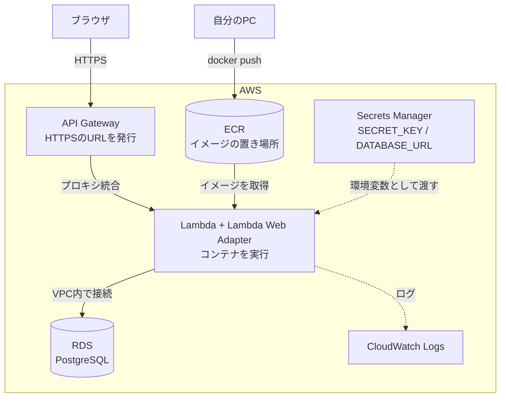
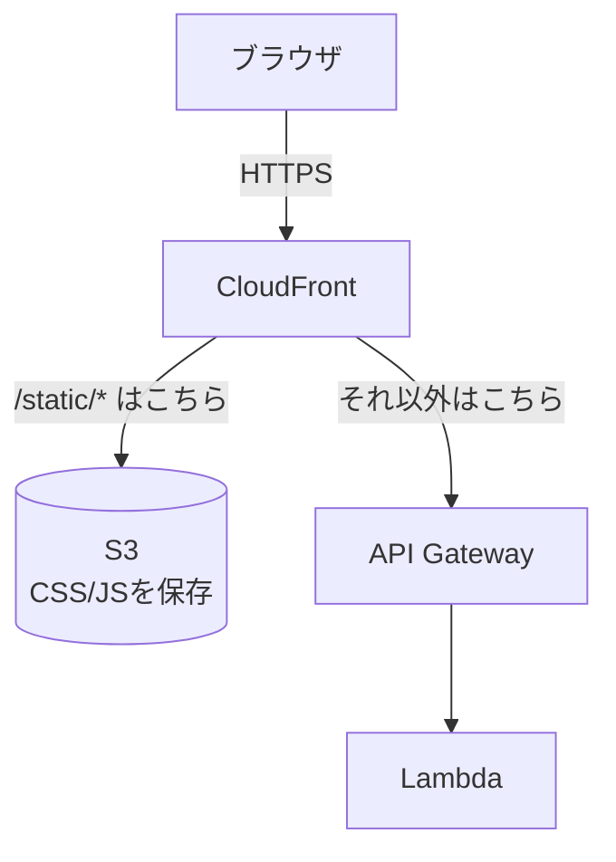

# フェーズ11:クラウドへコンテナデプロイ【デプロイ③】

> **ゴール**:フェーズ9で作ったDockerイメージを、クラウドのマネージドサービス(AWS Lambda + API Gateway)で公開し、マネージドDB(RDS)に接続できる。フェーズ6のVM構成と比べて、何をクラウドに任せたのかを説明できる。

## 1. なぜ学ぶか

フェーズ6のVMでは、次のような作業をすべて自分で行う必要がありました。

- OSやソフトウェアのアップデート、セキュリティ対策
- nginx・gunicorn・systemd の設定
- HTTPS証明書の取得と更新
- アクセスが増えたときのサーバー増強、障害時の復旧
- DBのバックアップ

**マネージドサービス** を使うと、これらをクラウド事業者に任せ、**「コンテナイメージを渡すだけ」** でアプリを公開できます。

## 2. 仕組みの解説

### 2-1. どこまで自分で管理するか

クラウドのサービスには、「どこまでを自分で管理し、どこから先をクラウド事業者に任せるか」によっていくつかの種類があります。

- **IaaS**(Infrastructure as a Service の略。「土台となる機材を貸してくれるサービス」という意味):仮想サーバーそのものを借りる形態です。OSのインストールやアップデート、ソフトウェアの設定は自分で行います。フェーズ6の EC2 がこれにあたります
- **PaaS / サーバーレス**(Platform as a Service の略。「動かす土台ごと用意してくれるサービス」という意味):アプリのコード(このフェーズではコンテナ)だけを渡せば動く形態です。OSの管理やサーバー台数の調整はクラウド事業者が行います

たとえるなら、IaaSは「更地を借りて自分で家を建てる」、PaaS・サーバーレスは「家具付きの部屋をそのまま借りる」イメージです。自由度は下がりますが、管理する手間が大きく減ります。

このフェーズでは、サーバーレスの中でも **AWS Lambda**(リクエストが来たときだけ起動する実行環境)を使います。Lambdaは本来「1回のリクエストを処理する小さな関数」を動かす仕組みですが、**Lambda Web Adapter** という部品を使うと、普段通りのFlask(gunicorn)アプリを**ほぼそのままの形で**Lambdaの上で動かせます。フェーズ9で作ったDockerfileも、1行追加するだけで使い回せます。

| | IaaS(フェーズ6) | PaaS / サーバーレス(このフェーズ) |
| --- | --- | --- |
| サービス例 | EC2 | Lambda + API Gateway |
| 自分で管理するもの | OS・ミドルウェア・アプリ・スケール | **アプリ(コンテナ)だけ** |
| HTTPS | 自分で証明書を設定 | 自動(API Gatewayが発行するURL) |
| アクセスが増えたら | 自分でサーバーを増やす | 自動で同時実行数が増える |
| 料金 | 起動している時間 | 主にリクエストを処理した時間 |

### 2-2. 全体構成



### 2-3. フェーズ6との対応

| フェーズ6(VM)で自分がやったこと | このフェーズで代わりにやってくれるもの |
| --- | --- |
| VMの作成・OSの管理 | Lambda(コンテナの実行環境そのものを管理してくれる) |
| nginx(HTTPS・リバースプロキシ) | API Gateway(HTTPSのURLを自動発行) |
| systemd(常駐・自動再起動) | Lambda(落ちたら自動で新しい実行環境に切り替わる) |
| `git clone` + `pip install` | Dockerイメージ(ECR から取得) |
| `.env` ファイル | Secrets Manager |
| SQLite ファイル | RDS(バックアップ・障害対応つき) |
| ファイアウォールの設定 | API Gateway(HTTPSのみ受け付ける) |
| `journalctl` / nginx のログ | CloudWatch Logs |

### 2-4. コンテナレジストリ

**ECR**(Elastic Container Registry の略。「レジストリ」は英語で「登録所・保管所」という意味です)は、Dockerイメージを保存しておく場所です。GitHubがコードの置き場所であるように、レジストリは **イメージの置き場所** です。Lambdaは、ここに置かれたイメージを取りに行って実行するだけなので、デプロイの前には必ずイメージを push しておく必要があります。

### 2-5. シークレット管理

`SECRET_KEY` やDBのパスワードは、イメージの中に書き込んではいけません(イメージはレジストリに保存され、権限を持つ人なら誰でも取得して中身を見られるためです)。
**Secrets Manager** は、こうした秘密情報だけを保管する専用の金庫のようなサービスです。ここに保存した値を、Lambda の起動時に環境変数として渡します。アプリのコードは `os.environ` から読むだけなので、**フェーズ5から1行も変更していません**。

### 2-6. VPCとセキュリティグループ

ここまでの説明で「LambdaをVPCの中で動かす」「RDSに接続する」とさらっと書いてきましたが、**VPC**(Virtual Private Cloud の略。「自分専用の仮想的なネットワーク」という意味)が何なのかに触れていませんでした。

- **VPC**:クラウドの中に作る、自分だけのネットワーク区画です。マンション全体(AWSのデータセンター)の中に、自分の契約した部屋(VPC)があり、その中にどんな部屋割り(サブネット)にするかを自分で決められる、とイメージしてください
- **サブネット**:VPCをさらに分割した区画。「インターネットから直接アクセスできるパブリックサブネット」と「内部からしかアクセスできないプライベートサブネット」に分けるのが基本です
- **セキュリティグループ**:EC2やLambda、RDSなど、個々のリソースに付ける「このリソース宛ての通信を誰に許可するか」というミニ・ファイアウォール。フェーズ6ではEC2に直接付けましたが、今回はRDSとLambdaのそれぞれに設定します

今回の`commands.sh`では、学習をシンプルにするため、AWSアカウントに最初から用意されている **デフォルトVPC**(パブリックサブネットのみの、お試し用の区画)をそのまま使っています。本番では「RDSはプライベートサブネットに置き、インターネットから直接アクセスできないようにする」のが定石ですが、これは発展的なテーマとして、フェーズ13(ECS Fargate)でより本格的に扱います。

```mermaid
flowchart TB
    subgraph VPC[VPC(デフォルト)]
        subgraph SUB[パブリックサブネット]
            LAM2[Lambda<br>セキュリティグループ: SG-A]
            RDS2[(RDS<br>セキュリティグループ: SG-A)]
        end
    end
    LAM2 -- 5432番ポートを許可 --> RDS2
```

このフェーズの構成では、LambdaとRDSに**同じセキュリティグループ**を使うことで、「このグループに属するリソース同士は通信してよい」という設定だけでPostgreSQLの5432番ポートへの接続を許可しています。

### 2-7. IAM と最小権限の原則

**IAM**(Identity and Access Management の略。「誰が、何に対して、何をしてよいかを管理する仕組み」という意味です)を使うと、「このプログラムには、この操作だけを許可する」という細かい設定ができます。
Lambda 専用の **実行ロール**(人間ではなく、プログラムのために発行する「社員証」のようなもの)を作り、必要な権限だけを与えます。

| 権限 | 理由 |
| --- | --- |
| `AWSLambdaVPCAccessExecutionRole`(マネージドポリシー) | RDSに接続するため、LambdaをVPCの中で動かす権限 |
| `secretsmanager:GetSecretValue`(2つのシークレットにだけ) | 秘密情報を読むため |

このように、仕事に必要な分だけの権限しか渡さないことを **最小権限の原則** と呼びます。会社の入館証に「すべての部屋に入れる権限」を持たせず、担当部署の部屋だけ入れるようにするのと同じ考え方です。万が一アプリが乗っ取られても、被害をその権限の範囲内に抑えられます。

### 2-8. ヘルスチェック

**ヘルスチェック**(health=健康、check=確認。「健康診断」のようなもの)とは、「アプリが正常に動いているか」を外部から確認できる仕組みです。`/health` にアクセスすると、「アプリが起動していて、DBにもつながっているか」を返すようにします。監視や、デプロイが正しく終わったかの自動確認(フェーズ12)で使います。

### 2-9. 監視とアラート:CloudWatch Alarm

ヘルスチェックは「誰かがアクセスしたとき」にしか確認できません。夜中にアプリが壊れても、気づくのは翌朝かもしれません。**CloudWatch Alarm**(アラーム=警報)を使うと、Lambdaの指標(エラー率、実行時間など)を常時監視し、しきい値を超えたら **自動でメール通知** できます。

健康診断を「聞かれたら答える」仕組みだとすると、Alarmは「異常があれば向こうから知らせてくれる」仕組みです。例えば「5分間でエラーが5回を超えたら通知する」というアラームを設定しておけば、障害に気づくまでの時間を大きく短縮できます。

```bash
# 通知先のメールアドレスを登録する(SNSトピック)
aws sns create-topic --name todo-alerts
aws sns subscribe --topic-arn "$TOPIC_ARN" --protocol email --notification-endpoint あなたのメールアドレス

# Lambdaのエラー数を監視するアラームを作る
aws cloudwatch put-metric-alarm \
  --alarm-name todo-lambda-errors \
  --namespace AWS/Lambda --metric-name Errors --dimensions Name=FunctionName,Value=todo \
  --statistic Sum --period 300 --threshold 5 --comparison-operator GreaterThanThreshold \
  --evaluation-periods 1 --alarm-actions "$TOPIC_ARN"
```

### 2-10. バージョンとロールバック

Lambdaのコンテナイメージ型関数は、デプロイのたびに **ECR上のイメージタグ** を切り替えるだけの仕組みです。`v1`・`v2`のようにタグを変えてpushしておけば、過去のイメージはECRに残り続けます。ゲームの「セーブデータ」を毎回新しい枠に保存しておくイメージです。新しいバージョンに問題があれば、**前のタグのイメージに向けて `update-function-code` をもう一度実行する**(=前のセーブデータを読み込む)だけで、短時間で元の状態に戻せます。

> Google Cloud の場合はCloud Runを使い、デプロイのたびに自動で作られる「リビジョン」を切り替えることでロールバックします。AWSのLambdaには同じ「リビジョン」という概念はありませんが、イメージタグを使えば同じことが実現できます。

### 2-11.(任意)静的ファイルの配信:S3 + CloudFront

今の構成では、`style.css`のような**変化しない静的ファイル**へのアクセスも、毎回Lambdaが起動して処理しています。動かないわけではありませんが、無駄にLambdaの実行回数を使っていますし、ファイルが変わらないのに毎回同じ処理をしているのは非効率です。

- **S3**(Simple Storage Service の略):ファイルを保存しておく倉庫のようなサービスです。静的ファイルの置き場所に向いています
- **CloudFront**:**CDN**(Content Delivery Network の略。「内容を配達するネットワーク」という意味)の一種です。世界中にある「利用者の近くの拠点」にファイルのコピー(キャッシュ)を置いておき、そこから配ることで、速く・オリジン(発信元)の負荷を減らして配信できます



CloudFrontは、アクセスされたパスによって **転送先を振り分け**(パスパターンによるルーティング)られます。`/static/*` はS3へ、それ以外(ログイン画面やTodo一覧など、アプリが毎回作るページ)はこれまで通りAPI Gatewayへ、という設定にすることで、**Flask側のコードは1行も変えずに**、静的ファイルだけ高速な経路に乗せ替えられます。

> **重要な注意点**:CloudFrontは、デフォルトでは**Cookieをオリジンに転送しません**。この設定のまま何もしないと、フェーズ5で作ったFlask-Loginのセッションログインが、API Gateway経由のアクセスで壊れてしまいます(「ログインしたはずなのに、次のページでログアウト状態に戻る」という症状になります)。API Gateway向けの**キャッシュビヘイビア**(経路ごとの転送ルール)で、「Cookieヘッダーをすべて転送する」「キャッシュはしない」という設定を明示的に行う必要があります。CDNと動的なサイトを組み合わせるときの、代表的な落とし穴です。

### Google Cloudで実施する場合の対応

| AWS | Google Cloud |
| --- | --- |
| Lambda + API Gateway | Cloud Run |
| ECR | Artifact Registry |
| RDS for PostgreSQL | Cloud SQL |
| Secrets Manager | Secret Manager |
| IAM 実行ロール | IAM サービスアカウント |
| CloudWatch Logs | Cloud Logging |

手順は[sample/deploy/gcp/commands.sh](sample/deploy/gcp/commands.sh)にまとめています(過去バージョンの教材と同じ内容です)。

## 3. ハンズオン

コマンドは [sample/deploy/aws/commands.sh](sample/deploy/aws/commands.sh) にまとめています。**一度に実行せず**、各Stepに対応するブロックをコピーして実行してください。

### Step 0. 課金の確認(必須)

このフェーズでは、実際に料金が発生するクラウド上のリソースを作成します。油断すると「使っていないのに請求される」という事故につながるため、作業を始める前に必ず確認してください。

- 予算アラートが設定されていることを確認する([全フェーズ共通の注意点](../../docs/common-notes.md)を参照)
- **RDSは、作成から12か月以内の新規AWSアカウントであれば無料利用枠(db.t3.micro、750時間/月など)の対象ですが、それ以外のアカウントでは起動している間ずっと料金がかかります**。自分のアカウントがどちらか分からない場合は無料枠がないものとして扱ってください。このフェーズとフェーズ12が終わったら、必ず「後片付け」を実行してください

> **やってみよう**:今の時点で、AWSコンソールの **Billing(請求情報)** を開き、現在の請求額を確認しておきましょう。このフェーズの作業後にもう一度同じ場所を見て、何にお金がかかっているかを確認する習慣をつけます。

### Step 1. /health エンドポイントを追加する

```bash
git switch -c feature/lambda
```

Lambda + API Gateway は、2-8 で説明した仕組みで「アプリがちゃんと動いているか」を外部から確認したいため、まずその確認先となる `/health` を用意します。`todo_app/__init__.py` に `/health` を追加し、テストを書きます(例:[sample/tests/test_health.py](sample/tests/test_health.py))。CIが通ることを確認してマージします。

### Step 2. AWS CLI をセットアップする

**AWS CLI** は、ターミナルからAWSを操作するための公式ツールです。これがないと、AWSの操作をいちいちブラウザの画面で行う必要があり、このフェーズのように何十個もの設定を再現性のある形で進めるのが難しくなります。

[AWS CLI のインストール手順](https://docs.aws.amazon.com/cli/latest/userguide/getting-started-install.html) の **macOS** の項目に従ってインストールし、`aws --version` で確認します。続けて `aws configure` を実行し、IAMユーザーのアクセスキー・リージョン(`ap-northeast-1`)を設定します。

その後、`commands.sh` の **0**(リージョンなどの変数を設定する)を実行します。

### Step 3. イメージに Lambda Web Adapter を組み込み、ECR に push する

Lambdaは自分でビルドをせず、すでに完成したイメージをレジストリから取得して実行するだけです(2-4)。そのため、デプロイの前に自分でイメージをビルドし、ECR に push しておく必要があります。

まず `Dockerfile` に1行だけ追加します(完成例:[sample/Dockerfile](sample/Dockerfile))。

```dockerfile
# Lambda上でこのコンテナを「普通のWebサーバー」として動かすための変換アダプター
COPY --from=public.ecr.aws/awsguru/aws-lambda-adapter:0.9.1 /lambda-adapter /opt/extensions/lambda-adapter
ENV AWS_LWA_PORT=8000
```

`AWS_LWA_PORT` は、アダプターが「アプリがどのポートで待ち受けているか」を知るための環境変数です。フェーズ9で使っていた「Cloud Runが渡す`PORT`環境変数に合わせる」という仕組みは不要になるため、Dockerfileの`CMD`も固定ポート(`8000`)に戻します。

`commands.sh` の **1** を実行し、イメージをビルドして push します。

**期待される結果**:AWSコンソールの **ECR** に `web:v1` が表示される。

> **Apple シリコンのMacでは特に重要です。** そのままビルドすると arm64 用のイメージになります。このフェーズではLambdaの関数を **x86_64** アーキテクチャで作るため、`--platform linux/amd64` を必ず付けます。この場合、Mac上で amd64 の環境を再現しながらビルドするため、普段より時間がかかります。
>
> 「自分のPCの環境」と「本番の環境」が違うと動かない、という問題の実例です。フェーズ12では、amd64 の GitHub Actions のランナーでビルドするため、この指定は不要になります。

### Step 4. RDS を作成する

フェーズ9まではコンテナの中のSQLiteファイルにデータを保存していましたが、Lambdaはリクエストが来ていない間、実行環境を破棄することがあるため、コンテナの中にデータを置いても消えてしまいます。そこで、アプリとは別の場所で動く **マネージドDB(RDS for PostgreSQL)** にデータを保存します。`commands.sh` の **2** を実行します。作成には数分かかります。

### Step 5. 秘密情報を Secrets Manager に登録する

`SECRET_KEY` やDBの接続情報をコードや環境変数ファイルに直接書かず、2-5 で説明した「金庫」に保管するための作業です。`commands.sh` の **3** を実行します。

**期待される結果**:AWSコンソールの **Secrets Manager** に2つのシークレットが表示される。値はターミナルの履歴以外には残っていません。

### Step 6. 実行ロールを作り、必要な権限だけを付ける

Lambdaが「誰の権限で」Secrets Managerにアクセスし、VPCの中で動くのかを明確にするための作業です。ここで権限を絞っておくことで、2-7 の最小権限の原則を実現します。`commands.sh` の **4** を実行します。

### Step 7. Lambda + API Gateway にデプロイする

ここまでに用意した「イメージ・DB・秘密情報・権限」をすべて組み合わせて、実際にコンテナを起動する最終ステップです。`commands.sh` の **5**(Lambda関数の作成、VPCへの接続)と **6**(API Gatewayの作成、Lambdaとの統合)を実行します。

**期待される結果**:`https://xxxxx.execute-api.ap-northeast-1.amazonaws.com` のようなURLが表示され、**最初からHTTPS** でアプリが使える。`/health` を開くと `{"status": "ok"}` が返る。

### Step 8. ログを確認する

公開して終わりではなく、「正しく動いているか」「エラーが出ていないか」を確認する習慣をつけることが大切です。AWSコンソールの **CloudWatch → ロググループ → /aws/lambda/todo** を開き、自分のアクセスの記録を探します(`commands.sh` の **7** でも確認できます)。

### Step 9. 新しいバージョンをデプロイし、ロールバックする

本番運用では「新しいバージョンに問題があったとき、すぐ前の状態に戻せること」が欠かせません。ここでは、2-10 で説明したロールバックを実際に体験します。

1. 画面の文言を変更し、`v2` タグでイメージをビルド・pushする
2. `aws lambda update-function-code --image-uri "${IMAGE}:v2"` で再度デプロイする
3. ブラウザで新しい文言が表示されることを確認する
4. `aws lambda update-function-code --image-uri "${IMAGE}:v1"` を実行し、`v1` のイメージに戻して文言が元に戻ることを確認する

### Step 10.(任意)S3 + CloudFrontで静的ファイルを配信する

2-11で説明した構成を実際に作ります。

```bash
# S3バケットを作り、static/ をアップロードする
export BUCKET="todo-static-$(date +%s)"
aws s3 mb "s3://${BUCKET}"
aws s3 sync todo_app/static/ "s3://${BUCKET}/static/"

# CloudFrontからS3を読めるようにするOAC(Origin Access Control)を作る
export OAC_ID="$(aws cloudfront create-origin-access-control \
  --origin-access-control-config Name=todo-oac,OriginAccessControlOriginType=s3,SigningBehavior=always,SigningProtocol=sigv4 \
  --query OriginAccessControl.Id --output text)"
```

CloudFrontのディストリビューション本体は、設定項目が多いため、[AWSコンソール](https://console.aws.amazon.com/cloudfront/)から作成することをおすすめします。

1. オリジンを2つ追加する:S3バケット(OACを設定)、API Gateway(カスタムオリジンとして、HTTPSのみ)
2. ビヘイビア(経路ごとの転送ルール)を2つ設定する:`/static/*` → S3オリジン・キャッシュ有効、それ以外(デフォルト)→ API Gatewayオリジン・**キャッシュポリシーは`CachingDisabled`、オリジンリクエストポリシーで`Cookie`をすべて転送**
3. 発行されたCloudFrontのURL(`https://xxxxx.cloudfront.net`)を開く

**期待される結果**:`/static/style.css` をブラウザの開発者ツールのNetworkタブで確認し、2回目以降のアクセスで `x-cache: Hit from cloudfront` ヘッダーが付くことを確認する。ログイン機能が、CloudFront経由でも(API Gateway直接アクセスと同じく)正常に動くことも確認する。

### 後片付け

フェーズ12でも同じ環境を使います。**フェーズ12が終わったら**、`commands.sh` の **8** を実行してすべて削除してください。削除を忘れると、使っていなくても料金が発生し続けます。Step 10(任意)を実施した場合は、CloudFrontのディストリビューション・S3バケット・CloudWatch Alarm(2-9)・SNSトピックも忘れずに削除してください。削除後は、AWSコンソールの **Billing** を開き、動いているリソースが残っていないか・今後の請求予定額が0円に近いかを必ず確認してください。

## 4. 確認課題

- [ ] フェーズ6のVM構成と、このフェーズの構成を、「自分で管理するもの・HTTPS・スケール・料金・デプロイの手間」の観点で比較表にまとめる
- [ ] `v1`・`v2`のイメージタグを使い分けて2回デプロイし、`aws lambda get-function --query 'Code.ImageUri'`で「今どちらが動いているか」を確認する
- [ ] 2-9のCloudWatch Alarmを設定し、わざと`/health`がエラーを返すようにコードを壊してアラームが発火(ALARM状態)することを確認する。確認後は元に戻す
- [ ] (任意)独自ドメインを API Gateway にマッピングする(Route 53 + ACM証明書が必要)

## 5. 振り返り

- 2-3 の表を見ながら、フェーズ6で手作業だったことが、それぞれ何に置き換わったかを説明してみよう
- `SECRET_KEY` をイメージに含めず、Secrets Manager から渡すのはなぜ?
- ヘルスチェック(2-8)とCloudWatch Alarm(2-9)は、何が違う?両方必要なのはなぜ?
- 「コードを変更してから本番に反映されるまで」の手順を書き出すと、何ステップある?その中で、人間がやる必要のない作業はどれ?(→ フェーズ12へ)

## このフェーズのファイル

```
sample/
├── Dockerfile                … Lambda Web Adapter を追加
├── todo_app/__init__.py      … /health を追加
├── tests/test_health.py      … ヘルスチェックのテスト(新規)
└── deploy/aws/commands.sh    … AWSの構築・デプロイ手順(新規)
```

## よくあるエラー

| エラー・症状 | 原因 | 対処 |
| --- | --- | --- |
| `exec format error`(CloudWatch Logs) | Apple シリコンのMacでビルドした arm64 イメージを x86_64 のLambdaに登録した | `--platform linux/amd64` でビルドし直す |
| `{"message":"Internal Server Error"}`+ログに起動失敗 | アプリが `AWS_LWA_PORT` のポートで待ち受けていない | Dockerfile の `EXPOSE`/`CMD` のポート番号と `AWS_LWA_PORT` が一致しているか確認 |
| `AccessDeniedException`(Secrets Manager) | 実行ロールにシークレットの読み取り権限がない | Step 6 の権限付与を確認 |
| DB に接続できない(タイムアウト) | LambdaのVPC設定漏れ、セキュリティグループでRDSへの通信を許可していない | `--vpc-config` のサブネット・セキュリティグループと、RDS側のインバウンドルールを確認 |
| API Gatewayにアクセスすると`{"message":"Forbidden"}` | Lambdaの実行権限をAPI Gatewayに許可していない(`add-permission`漏れ) | `commands.sh` の **6** を再実行 |
