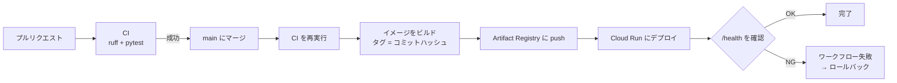
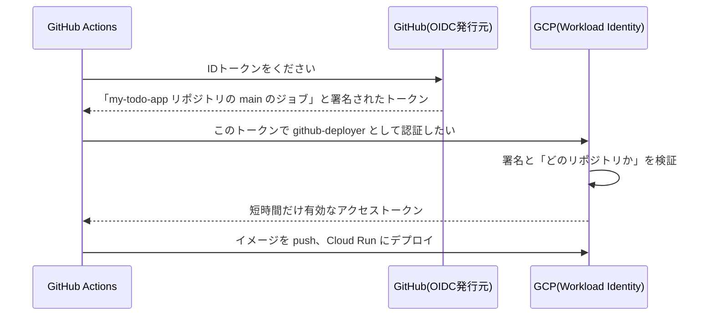

# フェーズ12:CD(自動デプロイ)

> **ゴール**:main ブランチにマージすると、テスト → イメージのビルド → Cloud Run へのデプロイ → 動作確認 までが自動で行われる。問題があればロールバックできる。

## 1. なぜ学ぶか

- フェーズ11の手動デプロイは、ビルド・タグ付け・push・デプロイ・確認と手順が多く、**手順の抜けや操作ミス** が起きやすい作業でした
- 「テストが通っていないコードをデプロイしてしまった」「どのバージョンが本番で動いているかわからない」といった事故も起きます
- 小さな変更を、**安全に、何度でも、誰がやっても同じ手順で** リリースできることが、アプリを育て続けるための土台になります

## 2. 仕組みの解説

### 2-1. CD とは

| 用語 | 意味 |
| --- | --- |
| 継続的デリバリー(Continuous Delivery) | いつでも本番に出せる状態を自動で作る。本番反映は人が承認する |
| 継続的デプロイ(Continuous Deployment) | テストが通れば、本番反映まで自動で行う |

### 2-2. パイプラインの全体像



### 2-3. GitHub Actions からクラウドへの認証:OIDC

GitHub Actions が GCP にデプロイするには、GCP にログインする必要があります。

| 方法 | 仕組み | 問題点 |
| --- | --- | --- |
| サービスアカウントキー(JSON)をGitHubのSecretsに保存 | 長期間有効な鍵を渡す | 漏れると、無効化するまで悪用され続ける |
| **OIDC(Workload Identity 連携)** | GitHub が発行する **一時的なトークン** を GCP が検証する | 鍵を保存しない。トークンは数分〜1時間で失効する |



GCP側では「**自分のリポジトリからのトークンだけ**」を信頼するよう設定します。他人のリポジトリからは認証できません。

### 2-4. イメージのタグとトレーサビリティ

イメージのタグに **コミットハッシュ**(`github.sha`)を使うと、「本番で動いているイメージ = どのコミットのコードか」が一目でわかります。不具合が起きたときに、原因となった変更をすぐに特定できます。

### 2-5. 環境の分離と承認

- **ステージング環境**:本番とほぼ同じ構成の確認用環境。ここで動作確認してから本番に出す
- **GitHub Environments**:環境ごとに「承認者の許可がないとデプロイしない」などのルールを設定できる

### 2-6. ロールバック

デプロイ後のヘルスチェックが失敗したり、不具合が見つかったりしたら、**前のリビジョンに戻す** のが最優先です。原因の調査と修正は、その後で落ち着いて行います。

## 3. ハンズオン

```bash
git switch -c feature/cd
```

### Step 1. Workload Identity 連携を設定する

[sample/deploy/gcp/github-oidc.sh](sample/deploy/gcp/github-oidc.sh) を、ブロックごとに実行します(事前に `commands.sh` の「0. 変数の設定」を実行しておく)。

**期待される結果**:最後に、GitHubに登録する4つの値が表示される。

### Step 2. GitHub に変数を登録する

リポジトリの **Settings → Secrets and variables → Actions → Variables** に、Step 1 で表示された4つの値を登録します。

> これらは秘密情報ではないため **Variables** に登録します。アクセスキーを **Secrets** に登録する必要はありません。これが OIDC の利点です。

### Step 3. Environment を作成する

**Settings → Environments → New environment** で `production` を作成します。

### Step 4. ワークフローを作成する

- `ci.yml` のトリガーを、`pull_request` と `workflow_call`(他のワークフローから呼び出される)に変更する(例:[sample/.github/workflows/ci.yml](sample/.github/workflows/ci.yml))
- `deploy.yml` を作成する(例:[sample/.github/workflows/deploy.yml](sample/.github/workflows/deploy.yml))

### Step 5. 自動デプロイを観察する

1. 画面の文言を少し変更する
2. コミットして push し、プルリクエストを作成する(CIが走る)
3. マージする
4. **Actions** タブで `Deploy` ワークフローを開き、`test` → `deploy` の順に実行される様子を観察する

**期待される結果**:数分後、Cloud Run のURLで変更が反映されている。**自分では一度もデプロイコマンドを実行していない** ことを確認しましょう。

### Step 6. どのコードが動いているかを確認する

```bash
gcloud run services describe todo --format='value(spec.template.spec.containers[0].image)'
```

**期待される結果**:イメージのタグが、GitHub上の最新コミットのハッシュと一致する。

### Step 7. 不具合のある版を出して、ロールバックする

1. `/health` がエラーを返すように、わざとコードを壊す(例:`SELECT 1` を `SELECT * FROM not_exists` に変える)
2. CIのテストも失敗するため、マージできないことを確認する(**CIが本番を守っている**)
3. 次に、テストが通ってしまう不具合を想定し、画面の表示を崩すだけの変更をマージする
4. デプロイ後、Cloud Run のリビジョン画面で **前のリビジョンにトラフィックを100%戻す**

```bash
gcloud run revisions list --service=todo
gcloud run services update-traffic todo --to-revisions=前のリビジョン名=100
```

5. 修正版をマージし、通常のデプロイで最新に戻す

### 後片付け(必須)

学習が終わったら、以下をすべて実行して、課金が発生するリソースを削除します。

1. `github-oidc.sh` の「5. 後片付け」
2. `commands.sh` の「8. 後片付け」
3. GCPコンソールの **お支払い** で、今後の請求が発生しないことを確認する

## 4. 確認課題

- [ ] `production` Environment に **Required reviewers**(自分)を設定し、承認するまで本番デプロイが止まることを確認する
- [ ] Cloud Run にステージング用のサービス(`todo-staging`)を作り、「main → ステージングに自動デプロイ → 承認 → 本番デプロイ」の流れにする
- [ ] 完成したパイプライン全体の図を自分で描き、各ステップの役割と、フェーズ6で手作業だったどの作業に当たるかを書き込む

## 5. 振り返り

- フェーズ6で手作業だった「git pull → pip install → 再起動 → 動作確認」は、最終的にどこで、何によって自動化された?
- アクセスキーをGitHubに保存しない OIDC は、なぜ安全なのか説明してみよう
- **卒業課題**:自分のアプリに追加したい機能を1つ決め、「ブランチ作成 → 実装 → テスト → プルリクエスト → CI → マージ → 自動デプロイ」までを一人で回してみよう

## このフェーズのファイル

```
sample/
├── .github/workflows/
│   ├── ci.yml                 … workflow_call で呼び出せるように変更
│   └── deploy.yml             … CDのワークフロー(新規)
└── deploy/gcp/
    ├── commands.sh            … フェーズ11の構築手順
    └── github-oidc.sh         … Workload Identity 連携の設定(新規)
```

## よくあるエラー

| エラー・症状 | 原因 | 対処 |
| --- | --- | --- |
| `Unable to retrieve ... id-token` | `permissions: id-token: write` がない | ジョブの `permissions` を確認 |
| `Permission 'iam.serviceAccounts.getAccessToken' denied` | Workload Identity の紐付けが違う | `GITHUB_REPO` の値(owner/repo)と Step 1 の 3 を確認 |
| `The attribute condition must reference ...` / 認証できない | `attribute-condition` のリポジトリ名の誤り | 大文字・小文字も含めて確認する |
| `denied: Permission "artifactregistry.repositories.uploadArtifacts"` | push 権限がない | `roles/artifactregistry.writer` を確認 |
| `iam.serviceaccounts.actAs` の権限エラー | Cloud Run 用サービスアカウントの利用権限がない | `roles/iam.serviceAccountUser` を確認 |
| Health check が失敗する | アプリの起動失敗、DB接続エラー | Cloud Run のログを確認し、必要ならロールバック |
