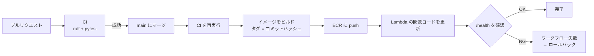
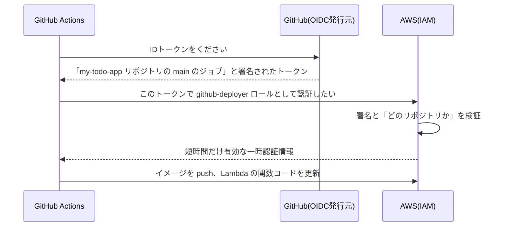

# フェーズ12:CD(自動デプロイ)

> **ゴール**:main ブランチにマージすると、テスト → イメージのビルド → Lambda へのデプロイ → 動作確認 までが自動で行われる。問題があればロールバックできる。

## 1. なぜ学ぶか

- フェーズ11の手動デプロイは、ビルド・タグ付け・push・デプロイ・確認と手順が多く、**手順の抜けや操作ミス** が起きやすい作業でした
- 「テストが通っていないコードをデプロイしてしまった」「どのバージョンが本番で動いているかわからない」といった事故も起きます
- 小さな変更を、**安全に、何度でも、誰がやっても同じ手順で** リリースできることが、アプリを育て続けるための土台になります

## 2. 仕組みの解説

### 2-1. CD とは

**CD** は「Continuous Delivery / Continuous Deployment」の略で、どちらも日本語では「継続的デリバリー・継続的デプロイ」と訳されます。「continuous(継続的)」は「途切れず、小さく何度も行われる」という意味です。工場のベルトコンベアで、できた製品を1つずつ検査して出荷していく様子に近いイメージです。

| 用語 | 意味 |
| --- | --- |
| 継続的デリバリー(Continuous Delivery) | いつでも本番に出せる状態を自動で作る。本番反映は人が承認する |
| 継続的デプロイ(Continuous Deployment) | テストが通れば、本番反映まで自動で行う |

このフェーズで作るのは、テストが通ったら自動で本番にデプロイする **継続的デプロイ** の仕組みです。

### 2-2. パイプラインの全体像



### 2-3. GitHub Actions からクラウドへの認証:OIDC

GitHub Actions が AWS にデプロイするには、AWS にログインする必要があります。

| 方法 | 仕組み | 問題点 |
| --- | --- | --- |
| アクセスキー(IAMユーザーの鍵)をGitHubのSecretsに保存 | 長期間有効な鍵を渡す | 漏れると、無効化するまで悪用され続ける |
| **OIDC(IDプロバイダ連携)** | GitHub が発行する **一時的なトークン** を AWS が検証する | 鍵を保存しない。トークンは数分〜1時間で失効する |

**OIDC**(OpenID Connect の略。「本人確認の結果を、安全にやり取りするための共通ルール」という意味です)を使う方法は、ホテルの「ずっと使える部屋の鍵」ではなく、「今日だけ有効な使い捨てのゲストパス」を毎回発行してもらうようなイメージです。パスを盗まれても、すぐに使えなくなります。



AWS側では、IAMの **IDプロバイダ**(`token.actions.githubusercontent.com` を信頼先として登録したもの)と、それを信頼する **IAMロール** の信頼ポリシーで「**自分のリポジトリからのトークンだけ**」を許可するよう設定します。他人のリポジトリからは認証できません。

### 2-4. イメージのタグとトレーサビリティ

**トレーサビリティ**(trace=追跡する、ability=〜できること。「追跡できる状態であること」)とは、「今本番で動いているものが、元をたどって何であるか分かる」状態のことです。宅配便の荷物に送り状(配送ラベル)が貼ってあり、番号を追跡すればどこから発送されたかが分かるのと同じ考え方です。
イメージのタグに **コミットハッシュ**(`github.sha`。Gitの各コミットに自動で割り振られる一意な識別子)を使うと、「本番で動いているイメージ = どのコミットのコードか」が一目でわかります。不具合が起きたときに、原因となった変更をすぐに特定できます。

### 2-5. 環境の分離と承認

- **ステージング環境**(staging=本番直前の一時的な待機場所、という意味):本番とほぼ同じ構成の確認用環境。ここで動作確認してから本番に出す
- **GitHub Environments**:環境ごとに「承認者の許可がないとデプロイしない」などのルールを設定できる機能

### 2-6. ロールバック

デプロイ後のヘルスチェックが失敗したり、不具合が見つかったりしたら、**前のイメージタグに戻す**(フェーズ11の 2-8 で説明した「セーブデータを読み込む」操作)のが最優先です。原因の調査と修正は、その後で落ち着いて行います。

### Google Cloudで実施する場合の対応

| AWS | Google Cloud |
| --- | --- |
| IAM IDプロバイダ + ロール | Workload Identity 連携 + サービスアカウント |
| `aws-actions/configure-aws-credentials@v4` | `google-github-actions/auth@v2` |
| ECR | Artifact Registry |
| `aws lambda update-function-code` | `gcloud run deploy` |

手順は[sample/deploy/gcp/github-oidc.sh](sample/deploy/gcp/github-oidc.sh)にまとめています(過去バージョンの教材と同じ内容です)。

## 3. ハンズオン

```bash
git switch -c feature/cd
```

### Step 1. IDプロバイダとデプロイ用ロールを設定する

[sample/deploy/aws/github-oidc.sh](sample/deploy/aws/github-oidc.sh) を、ブロックごとに実行します(事前に `commands.sh` の「0. 変数の設定」を実行しておく)。

**期待される結果**:最後に、GitHubに登録する3つの値が表示される。

### Step 2. GitHub に変数を登録する

リポジトリの **Settings → Secrets and variables → Actions → Variables** に、Step 1 で表示された3つの値(`AWS_REGION`・`AWS_ACCOUNT_ID`・`AWS_ROLE_ARN`)を登録します。

> これらは秘密情報ではないため **Variables** に登録します。アクセスキーを **Secrets** に登録する必要はありません。これが OIDC の利点です。

### Step 3. Environment を作成する

**Settings → Environments → New environment** で `production` を作成します。

### Step 4. ワークフローを作成する

**`ci.yml`を変更する**

まず、`ci.yml`の`on`を書き換えます。

```yaml
# 変更前
on:
  push:
    branches: [main]
  pull_request:

# 変更後
on:
  pull_request:
  workflow_call:
```

`main`へのpushをトリガーから外し、代わりに`workflow_call`(他のワークフローから呼び出し専用で実行される、という意味)を追加します。これにより、`ci.yml`単体では「プルリクエストのときだけ」実行され、`main`にマージされたときのテストは、次に作る`deploy.yml`から呼び出す形に変わります(完成例:[sample/.github/workflows/ci.yml](sample/.github/workflows/ci.yml))。

**`deploy.yml`を新規作成する**

```yaml
name: Deploy

on:
  push:
    branches: [main]

jobs:
  test:
    uses: ./.github/workflows/ci.yml

  deploy:
    needs: test
    runs-on: ubuntu-latest
    environment: production
    permissions:
      contents: read
      id-token: write
```

- `test`ジョブの`uses: ./.github/workflows/ci.yml`:**再利用可能ワークフロー**という機能で、さきほど`workflow_call`に対応させた`ci.yml`を、そのままジョブとして呼び出しています。テストのコードを2か所に重複させる必要がありません
- `needs: test`:`test`ジョブが成功するまで、`deploy`ジョブを始めません。テストが通っていないコードは本番に出ない、という安全装置です
- `environment: production`:2-5で説明したGitHub Environmentsです。ここに承認者を設定すれば、デプロイ前に人の承認を挟めます
- `permissions: id-token: write`:2-3で説明したOIDCで認証するために必要な権限です。これがないと、GitHubがIDトークンを発行してくれません

続けて、デプロイの実処理を書きます。

```yaml
    env:
      IMAGE: ${{ vars.AWS_ACCOUNT_ID }}.dkr.ecr.${{ vars.AWS_REGION }}.amazonaws.com/todo:${{ github.sha }}

    permissions:
      contents: read
      id-token: write

    steps:
      - name: Checkout
        uses: actions/checkout@v4

      - name: Authenticate to AWS
        uses: aws-actions/configure-aws-credentials@v4
        with:
          role-to-assume: ${{ vars.AWS_ROLE_ARN }}
          aws-region: ${{ vars.AWS_REGION }}

      - name: Login to ECR
        run: |
          aws ecr get-login-password --region "${{ vars.AWS_REGION }}" \
            | docker login --username AWS --password-stdin "${{ vars.AWS_ACCOUNT_ID }}.dkr.ecr.${{ vars.AWS_REGION }}.amazonaws.com"

      - name: Build and push image
        run: |
          docker build -t "$IMAGE" .
          docker push "$IMAGE"

      - name: Deploy to Lambda
        run: |
          aws lambda update-function-code --function-name todo --image-uri "$IMAGE"
          aws lambda wait function-updated --function-name todo
```

- `IMAGE`:タグに`github.sha`(2-4で説明したコミットハッシュ)を使い、どのコードがデプロイされたか追跡できるようにしています
- `aws-actions/configure-aws-credentials@v4`:Step1〜3で設定したOIDCの仕組みを使い、アクセスキーなしでAWSに認証するGitHub公式の部品です
- 最後は、Dockerイメージをビルドしてpushし、Lambdaの関数コードを更新する、フェーズ11のハンズオンと同じ内容のコマンドです

最後に、デプロイ後に `/health` を確認し、失敗したらワークフロー自体を失敗させる処理を追加します(ロールバックの判断材料にするため)。完成例:[sample/.github/workflows/deploy.yml](sample/.github/workflows/deploy.yml)

### Step 5. 自動デプロイを観察する

1. 画面の文言を少し変更する
2. コミットして push し、プルリクエストを作成する(CIが走る)
3. マージする
4. **Actions** タブで `Deploy` ワークフローを開き、`test` → `deploy` の順に実行される様子を観察する

**期待される結果**:数分後、API GatewayのURLで変更が反映されている。**自分では一度もデプロイコマンドを実行していない** ことを確認しましょう。

### Step 6. どのコードが動いているかを確認する

```bash
aws lambda get-function --function-name todo --query 'Code.ImageUri' --output text
```

**期待される結果**:イメージのタグが、GitHub上の最新コミットのハッシュと一致する。

### Step 7. 不具合のある版を出して、ロールバックする

1. `/health` がエラーを返すように、わざとコードを壊す(例:`SELECT 1` を `SELECT * FROM not_exists` に変える)
2. CIのテストも失敗するため、マージできないことを確認する(**CIが本番を守っている**)
3. 次に、テストが通ってしまう不具合を想定し、画面の表示を崩すだけの変更をマージする
4. デプロイ後、**前のコミットのイメージタグに戻す**

```bash
# 1つ前のコミットハッシュを確認してから
aws lambda update-function-code --function-name todo --image-uri "${ACCOUNT_ID}.dkr.ecr.${AWS_REGION}.amazonaws.com/todo:前のコミットハッシュ"
```

5. 修正版をマージし、通常のデプロイで最新に戻す

### 後片付け(必須)

学習が終わったら、以下をすべて実行して、課金が発生するリソースを削除します。

1. `github-oidc.sh` の「後片付け」
2. `commands.sh` の「8. 後片付け」
3. AWSコンソールの **Billing** で、今後の請求が発生しないことを確認する

## 4. 確認課題

- [ ] `production` Environment に **Required reviewers**(自分)を設定し、承認するまで本番デプロイが止まることを確認する
- [ ] Lambdaにステージング用の別関数(`todo-staging`)を作り、「main → ステージングに自動デプロイ → 承認 → 本番デプロイ」の流れにする
- [ ] 完成したパイプライン全体の図を自分で描き、各ステップの役割と、フェーズ6で手作業だったどの作業に当たるかを書き込む

## 5. 振り返り

- フェーズ6で手作業だった「git pull → pip install → 再起動 → 動作確認」は、最終的にどこで、何によって自動化された?
- アクセスキーをGitHubに保存しない OIDC は、なぜ安全なのか説明してみよう
- **卒業課題**:自分のアプリに追加したい機能を1つ決め、「ブランチ作成 → 実装 → テスト → プルリクエスト → CI → マージ → 自動デプロイ」までを一人で回してみよう

## このフェーズのファイル

```
sample/
├── .github/workflows/
│   ├── ci.yml                 … workflow_call で呼び出せるように変更
│   └── deploy.yml             … CDのワークフロー(新規)
└── deploy/aws/
    ├── commands.sh            … フェーズ11の構築手順
    └── github-oidc.sh         … IDプロバイダ・デプロイ用ロールの設定(新規)
```

## よくあるエラー

| エラー・症状 | 原因 | 対処 |
| --- | --- | --- |
| `Unable to retrieve ... id-token` | `permissions: id-token: write` がない | ジョブの `permissions` を確認 |
| `Not authorized to perform sts:AssumeRoleWithWebIdentity` | 信頼ポリシーの紐付けが違う | `GITHUB_REPO` の値(owner/repo)と Step 1 の内容を確認 |
| `An error occurred (AccessDenied)` / 認証できない | 信頼ポリシーの`sub`条件(リポジトリ名)の誤り | 大文字・小文字、ブランチ名も含めて確認する |
| `denied: requested access to the resource is denied`(ECR) | push 権限がない | デプロイ用ロールのECR権限(`ecr:PutImage`等)を確認 |
| `AccessDeniedException`(Lambda) | デプロイ用ロールに`lambda:UpdateFunctionCode`がない | `github-oidc.sh` の権限設定を確認 |
| Health check が失敗する | アプリの起動失敗、DB接続エラー | CloudWatch Logsを確認し、必要ならロールバック |
