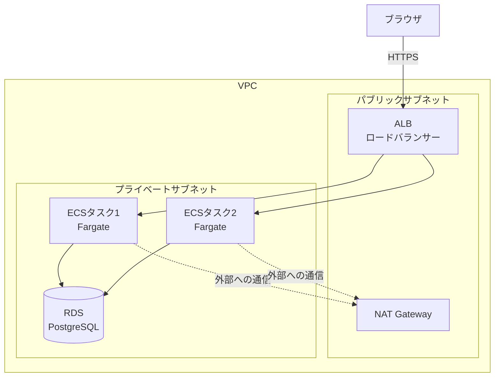

# フェーズ13(発展):ECS Fargateで本格的なネットワーク構成を体験する

> **このフェーズは任意です。** フェーズ0〜12を終えた方向けの発展編で、やらなくても教材は完了したことになります。
>
> **ゴール**:フェーズ11と同じアプリを、Lambdaではなく **ECS Fargate**(常駐型のコンテナ実行サービス)+ **ALB**(ロードバランサー)で動かせる。パブリック/プライベートサブネットを分離した、本番に近いネットワーク構成を自分の手で組み立てられる。

## 1. なぜ学ぶか

- フェーズ11のLambda + API Gatewayは、シンプルで費用対効果も良い構成でしたが、実務では「常駐させ続けたい」「長時間の処理をしたい」といった理由から、**コンテナをそのまま動かし続けるサービス**もよく使われます。ECS Fargateはその代表例です
- フェーズ11では、学習をシンプルにするため「デフォルトVPC」をそのまま使いました(2-6)。しかし本来は、**ALBやNAT Gatewayが置かれる「表」の区画(パブリックサブネット)**と、**ECSタスクやRDSが置かれる「奥」の区画(プライベートサブネット)**を分けるのが定石です。このフェーズでは、その「本格的な形」を自分の手で組み立てます
- アプリのコード(Flask)は**フェーズ12までと一切変わりません**。変わるのは「どうやって動かすか」というインフラだけだ、ということも体感できます

## 2. 仕組みの解説

### 2-1. ECS Fargateとは

**ECS**(Elastic Container Service の略)は、AWSのコンテナオーケストレーション(複数のコンテナを管理する仕組み)サービスです。**Fargate** は、その中でも「サーバーの管理が一切不要」な実行方式です。

| | Lambda(フェーズ11) | ECS Fargate(このフェーズ) |
| --- | --- | --- |
| 実行のされ方 | リクエストが来るたびに起動(都度課金) | **指定した数を常に起動し続ける**(起動時間で課金) |
| 向いている処理 | 短時間で終わるリクエスト処理 | 常駐処理、長時間の処理、WebSocketなど |
| コールドスタート | VPC接続時は数百ms程度ある | 起動済みのコンテナが受けるため、ほぼない |
| ネットワーク | Lambda自体はVPCの外にも置ける | 必ずVPCの中で動く |

### 2-2. 全体構成



### 2-3. パブリックサブネットとプライベートサブネット

- **パブリックサブネット**:インターネットゲートウェイ(VPCの玄関)への経路を持つ区画。ALBやNAT Gatewayなど、**外部と直接やり取りする必要があるもの**を置きます
- **プライベートサブネット**:インターネットゲートウェイへの経路を持たない区画。ECSタスクやRDSなど、**外部から直接アクセスされたくないもの**を置きます
- **NAT Gateway**:プライベートサブネットの中からライブラリの取得などで外部に通信したいときに経由する出口。「表からは入れないが、中からは出られる」一方通行の仕組みです

マンションで例えると、パブリックサブネットは「誰でも入れるエントランス」、プライベートサブネットは「鍵を持つ住人しか入れない居住スペース」です。訪問者(インターネットからのリクエスト)はまずエントランス(ALB)で受付をし、そこから先(ECSタスク)へは内部の案内に従って進みます。

### 2-4. ロードバランサー(ALB)

**ALB**(Application Load Balancer)は、複数のECSタスクにリクエストを振り分ける受付係です。**ターゲットグループ**(振り分け先の一覧)に対して定期的にヘルスチェック(`/health`)を送り、異常なタスクには振り分けないようにします。

### 2-5. タスク定義とサービス

- **タスク定義**:「どのイメージを、どれくらいのCPU/メモリで、どのポートで動かすか」を書いた設計図です。フェーズ11のLambda関数の設定に相当します
- **サービス**:タスク定義をもとに、**指定した数のタスクを常に維持し続ける**仕組みです。タスクが異常終了したら自動で新しいタスクを起動します(フェーズ6のsystemdに相当する役割です)

### 2-6. 自動スケーリング

CPU使用率などの指標に応じて、サービスが動かすタスクの数を自動で増減できます。アクセスが増えたら自動でタスクを増やし(フェーズ11のLambdaも同時実行数が自動で増えましたが、ECSでは「何個まで増やせるか」を自分で設定します)、落ち着いたら減らしてコストを抑えます。

### 2-7. フェーズ11との対応

| フェーズ11(Lambda) | このフェーズ(ECS Fargate) |
| --- | --- |
| API Gateway | ALB |
| Lambda(関数) | ECSタスク(コンテナ) |
| デフォルトVPC | 自分で作るVPC(パブリック/プライベート分離) |
| `aws lambda update-function-code` | タスク定義を新しいイメージで登録 → サービス更新 |
| 同時実行数の自動調整 | 自動スケーリング(タスク数の自動調整) |

## 3. ハンズオン

コマンドは [sample/deploy/aws/commands.sh](sample/deploy/aws/commands.sh) にまとめています。**一度に実行せず**、各Stepに対応するブロックをコピーして実行してください。VPCまわりのコマンド数が多いため、慌てずに1つずつ結果を確認しながら進めてください。

### Step 0. 課金の確認(必須)

- 予算アラートが設定されていることを確認する([全フェーズ共通の注意点](../../docs/common-notes.md)を参照)
- **NAT Gatewayは、起動している時間とデータ転送量の両方に課金されます**。無料枠がないため、学習が終わったら真っ先に削除してください
- ALB・RDS・NAT Gatewayはいずれも「起動しているだけ」で課金されるリソースです

### Step 1. Dockerfileを整える

フェーズ11で追加したLambda Web Adapterの2行は、ECS Fargateでは不要です。完成例([sample/Dockerfile](sample/Dockerfile))を参考に、通常のコンテナとして使える形に戻します。

### Step 2. VPC・サブネット・NAT Gatewayを作る

`commands.sh` の **2** を実行します。パブリックサブネット2つ・プライベートサブネット2つ・インターネットゲートウェイ・NAT Gatewayを作成します(NAT Gatewayの作成完了まで数分かかります)。

### Step 3. セキュリティグループを作る

`commands.sh` の **3** を実行します。「ALBは誰からでも受け付ける」「ECSタスクはALBからだけ受け付ける」「RDSはECSタスクからだけ受け付ける」という、2-3で説明した一方向の許可を設定します。

### Step 4. RDSをプライベートサブネットに作る

`commands.sh` の **4** を実行します。フェーズ11と異なり、今回は`--no-publicly-accessible`に加えて、物理的にインターネットから経路のないプライベートサブネットに配置します。

### Step 5. イメージをpushし、Secrets Managerに登録する

`commands.sh` の **1**(イメージのビルド・push)と **5**(秘密情報の登録)を実行します。

### Step 6. ECSクラスター・タスク定義を作る

`commands.sh` の **6**(クラスター・実行ロール作成)と **7**(タスク定義の登録)を実行します。

### Step 7. ALBを作る

`commands.sh` の **8** を実行します。

**期待される結果**:ALBのDNS名(`todo-alb-xxxxx.ap-northeast-1.elb.amazonaws.com`)が発行される。この時点ではまだECSタスクが動いていないため、アクセスしてもエラーになります。

### Step 8. ECSサービスを作り、動作確認する

`commands.sh` の **9** を実行します。`aws ecs wait services-stable` の完了まで数分待ちます。

**期待される結果**:ALBのDNS名にアクセスすると、ログイン画面が表示される。`/health`が200を返す。

### Step 9.(任意)自動スケーリングを設定する

`commands.sh` の **10** を実行します。負荷テストツール(`ab`や`hey`など)でALBに負荷をかけ、CPU使用率が上がるとタスク数が自動で増えることを確認してみましょう。

### 後片付け(必須)

`commands.sh` の **11** を、**上から順番に**実行してください。特にNAT Gatewayは削除リクエストの完了に数分かかるため、完了を待ってからEIPやVPC本体の削除に進んでください。削除後は、AWSコンソールの **Billing** で今後の請求予定額を確認してください。

## 4. 確認課題

- [ ] ECSタスクのセキュリティグループで、一時的にRDSへのアクセス許可(ポート5432)を外し、アプリがどう壊れるかを確認する。終わったら元に戻す
- [ ] タスク定義を新しいイメージタグ(`v2`)で再登録し、`aws ecs update-service --force-new-deployment`でローリングアップデート(タスクを1つずつ入れ替える)される様子をコンソールで観察する
- [ ] フェーズ11とこのフェーズの構成を、「料金の発生の仕方」「スケールの仕組み」「ネットワークの複雑さ」の3観点で比較表にまとめる

## 5. 振り返り

- このフェーズで、フェーズ11の「デフォルトVPC」を使ったときと比べて、新しく登場した概念は何だった?
- NAT Gatewayは何のためにあり、削除し忘れるとどうなる?
- 自分のアプリやチームの性質を考えたとき、Lambda(フェーズ11)とECS Fargate(このフェーズ)のどちらが向いていそうか、理由とともに説明してみよう

## このフェーズのファイル

```
sample/
├── Dockerfile                … Lambda Web Adapterを削除(通常のコンテナに戻す)
└── deploy/aws/commands.sh    … VPC構築からECS Fargateデプロイまでの手順(新規)
```

アプリ本体(`todo_app/`以下)はフェーズ12から変更ありません。

## よくあるエラー

| エラー・症状 | 原因 | 対処 |
| --- | --- | --- |
| タスクが`PENDING`のまま進まない | サブネット・セキュリティグループの指定ミス、イメージのpull失敗 | `aws ecs describe-services`のイベント欄、タスクの「停止理由」を確認 |
| ALBにアクセスすると`503 Service Temporarily Unavailable` | ターゲットグループにヘルシーなタスクが登録されていない | ヘルスチェックパス(`/health`)とセキュリティグループ(ALB→ECS:8000)を確認 |
| タスクが起動してすぐ停止する | DBに接続できず、アプリが起動時エラーで落ちている | CloudWatch Logs(`/ecs/todo`)でアプリのエラーを確認 |
| NAT Gatewayの削除が終わらない | 削除には数分かかる(正常) | `aws ec2 describe-nat-gateways`でステータスが`deleted`になるまで待つ |
| VPCが削除できない | 依存するリソース(サブネット・ルートテーブル・IGW・セキュリティグループ)が残っている | 後片付けの手順を上から順番に、1つずつ確認しながら実行する |
