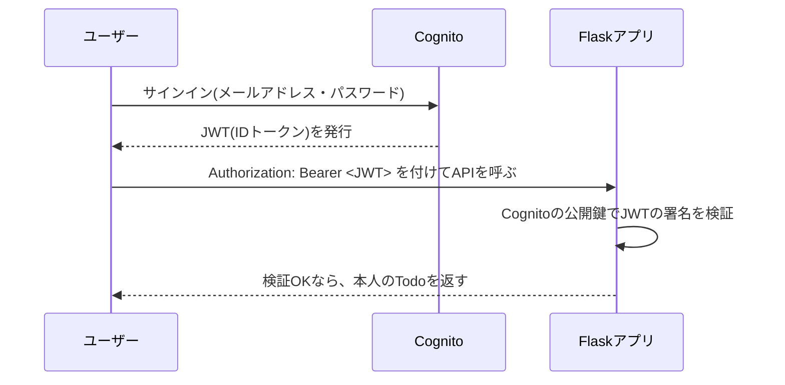

# フェーズ14(発展):Amazon Cognitoで認証をマネージドサービスに任せる

> **このフェーズは任意です。** フェーズ0〜12を終えた方向けの発展編で、やらなくても教材は完了したことになります。
>
> **ゴール**:フェーズ8で作ったREST APIの認証を、Flask-Login(自前のセッション・パスワード管理)から **Amazon Cognito**(マネージドな認証サービス)+ **JWT**(トークン)方式に置き換えられる。
>
> **スコープについて**:このフェーズは `phases/phase-14-cognito/sample/` という**独立したサンプル**で、フェーズ8のAPIをCognito向けに作り変えたものです。フェーズ5〜12本編のコード(Flask-Login・セッションCookie)は一切変更しません。「もし認証をCognitoに任せていたら、作りはどう変わるか」を比較するための教材です。

## 1. なぜ学ぶか

- フェーズ5では、ユーザーテーブル・パスワードのハッシュ化・セッション管理を**自分で実装**しました。これは学習としては価値がありますが、実務では「餅は餅屋」で、認証基盤を専門のマネージドサービスに任せることもよくあります
- **Amazon Cognito** は、ユーザー登録・ログイン・パスワード再設定・多要素認証などを代行してくれるサービスです。使うと、アプリ側は「ユーザーテーブルを持たず、トークンを検証するだけ」というシンプルな形になります
- セッションCookie方式(フェーズ5)とJWTトークン方式(このフェーズ)の違いを体験することで、認証の設計には複数の選択肢があることを理解します

## 2. 仕組みの解説

### 2-1. Cognitoとは

**Cognito**(「認知」という意味の英単語)は、AWSの認証・ユーザー管理サービスです。**User Pool**(ユーザーの集まり)という単位でユーザーを管理し、サインアップ・サインイン・パスワードの確認などをすべて代行してくれます。

| | フェーズ5(自前) | このフェーズ(Cognito) |
| --- | --- | --- |
| ユーザー情報の保存先 | 自分のDBの`User`テーブル | Cognitoの中(自分のDBにはユーザーを持たない) |
| パスワードのハッシュ化 | 自分で実装(`werkzeug.security`) | Cognitoが内部で行う(アプリからは見えない) |
| ログイン状態の管理 | セッションCookie(サーバーが状態を覚える) | JWTトークン(**サーバーは何も覚えない**) |

### 2-2. JWT(JSON Web Token)とは

**JWT** は、「誰が」「いつまで有効か」といった情報を、**署名付きで**やり取りできる文字列です。`ヘッダー.ペイロード.署名`という3つのパーツが`.`(ピリオド)で繋がった形をしています。



セッションCookie方式との最大の違いは、**サーバー(Flask)が「誰がログインしているか」を一切覚えていない**ことです。リクエストのたびに送られてくるトークンを、その場で検証するだけです(これを**ステートレス**と呼びます)。

### 2-3. 署名の検証:JWKSと公開鍵

CognitoはJWTを**秘密鍵**で署名して発行します。アプリ側は、対応する**公開鍵**(JWKS:JSON Web Key Set)をCognitoから取得し、それを使って「本当にCognitoが発行したトークンか」「中身が改ざんされていないか」を検証します。鍵(公開鍵)は誰が見ても問題ないので、Cognitoが公開しているURLから自由に取得できます。

### 2-4. フェーズ8との対応

| フェーズ8(Flask-Login) | このフェーズ(Cognito) |
| --- | --- |
| `User`テーブル(自前) | なし(Cognitoがユーザーを管理) |
| セッションCookie | `Authorization: Bearer <JWT>`ヘッダー |
| `@login_required` / `current_user` | `@cognito_auth_required` / `g.cognito_sub` |
| `Todo.user_id`(自前Userへの外部キー) | `Todo.cognito_sub`(Cognitoのユーザー識別子を文字列で保存) |

アプリの**Todoを操作するロジック自体**(一覧・追加・編集・削除、自分のTodoだけ操作できる認可)は、フェーズ8とほとんど変わりません。変わるのは「誰がログインしているかをどう確認するか」という一点だけです。

## 3. ハンズオン

このフェーズはローカル(Mac)でFlaskを動かしたまま、Cognitoという外部の認証サービスと組み合わせる構成です。コマンドは [sample/deploy/aws/commands.sh](sample/deploy/aws/commands.sh) にまとめています。

### Step 0. 課金の確認

Cognitoは**月間アクティブユーザー数(MAU)に応じた無料利用枠が大きく**(執筆時点で数万MAUまで無料)、このフェーズの学習用途であれば通常は無料の範囲に収まります。念のため、AWSコンソールの **Billing** で確認する習慣は続けてください。

### Step 1. User PoolとApp Clientを作る

`commands.sh` の **1**・**2** を実行します。

**期待される結果**:`COGNITO_USER_POOL_ID`・`COGNITO_APP_CLIENT_ID`が表示される。これを`.env`にコピーします(`cp .env.example .env`してから書き換え)。

### Step 2. テストユーザーを作る

`commands.sh` の **3** を実行します。通常のサインアップでは確認メールが届きますが、学習用に`--message-action SUPPRESS`でその手間を省略しています。

### Step 3. サインインしてトークンを取得する

`commands.sh` の **4** を実行します。

**期待される結果**:`ヘッダー.ペイロード.署名`の形をした、長い文字列(JWT)が表示される。[jwt.io](https://jwt.io/)のようなツールに貼り付けると(**本物のトークンを貼り付けるのは学習時だけにし、本番のトークンは絶対に貼り付けないこと**)、中身(ペイロード)が人間にも読める形で確認できます。

### Step 4. アプリを起動する

```bash
uv venv --python 3.12
source .venv/bin/activate
uv pip install -r requirements.txt
flask --app wsgi run --debug --port 5001
```

### Step 5. トークン付きでAPIを呼ぶ

`commands.sh` の **5** にあるcurlコマンドを、別のターミナルから実行します。

**期待される結果**:`Authorization`ヘッダーなしだと401、Step 3で取得したトークンを付けると200・201になる。

### Step 6.(確認)トークンを改ざんしてみる

Step 3で取得したトークンの一部の文字を書き換えてから、もう一度Step 5のcurlを実行してみましょう。

**期待される結果**:署名が合わなくなり、401が返る。これが「公開鍵による署名検証」の効果です。

### 後片付け

`commands.sh` の **6** を実行し、User PoolとApp Clientを削除してください。

## 4. 確認課題

- [ ] 2人目のテストユーザーを作り、それぞれのトークンでTodoを追加し、互いのTodoが見えない(403になる)ことを確認する
- [ ] `sample/tests/test_api.py`を読み、本物のCognitoに問い合わせずにテストが書けている理由(`conftest.py`の`patch_cognito`)を説明してみよう
- [ ] JWTの`exp`(有効期限)が切れたトークンで呼び出すとどうなるか、`commands.sh`のペイロードを参考に短い有効期限のトークンを作って試してみる

## 5. 振り返り

- セッションCookie(フェーズ5)とJWTトークン(このフェーズ)で、「サーバーが覚えていること」はそれぞれ何?
- `User`テーブルを自分で持たなくなったことで、何が楽になり、何ができなくなった?(ヒント:ユーザー一覧の取得や、アプリ独自のユーザー属性の追加)
- 自分が開発するなら、新規サービスの認証はFlask-Login(自前)とCognito(マネージド)のどちらを選ぶ?理由とともに説明してみよう

## このフェーズのファイル

```
sample/
├── todo_app/
│   ├── __init__.py       … Blueprintはapiのみ登録、/healthを追加
│   ├── api.py            … 認証をcognito_auth_requiredに変更
│   ├── cognito_auth.py   … JWT検証の仕組み(新規)
│   ├── extensions.py     … login_managerを削除
│   └── models.py         … UserテーブルをなくしTodo.cognito_subに変更
├── tests/
│   ├── conftest.py       … テスト用の鍵でCognitoを模擬する
│   └── test_api.py       … トークンベースの認証・認可のテスト
└── deploy/aws/commands.sh … Cognitoの構築手順(新規)
```

`todos.py`・`auth.py`・`templates/`・`static/`(画面系)はこのフェーズでは使わないため含まれていません。

## よくあるエラー

| エラー・症状 | 原因 | 対処 |
| --- | --- | --- |
| `401 Unauthorized`(トークンありでも) | `.env`の`COGNITO_USER_POOL_ID`/`COGNITO_APP_CLIENT_ID`が実際の値と違う | `commands.sh` Step1・2の出力値と`.env`を見比べる |
| `NotAuthorizedException`(Cognito) | パスワードが間違っている、ユーザーが存在しない | `admin-set-user-password`をやり直す |
| `InvalidParameterException: USER_PASSWORD_AUTH flow not enabled` | App Clientの認証フロー設定漏れ | `commands.sh` Step2の`--explicit-auth-flows`を確認 |
| トークンの中身が読めない | JWTはBase64url形式であって暗号化ではない(署名により改ざんは検知できるが、中身は誰でも読める) | 秘密情報をペイロードに入れないのが前提 |
| テストで`jwt.exceptions.PyJWKClientError` | `conftest.py`の`patch_cognito`が適用されていない(他のテストファイルから直接importした場合など) | `tests/`配下で実行し、`conftest.py`のautouseフィクスチャが効いているか確認 |
